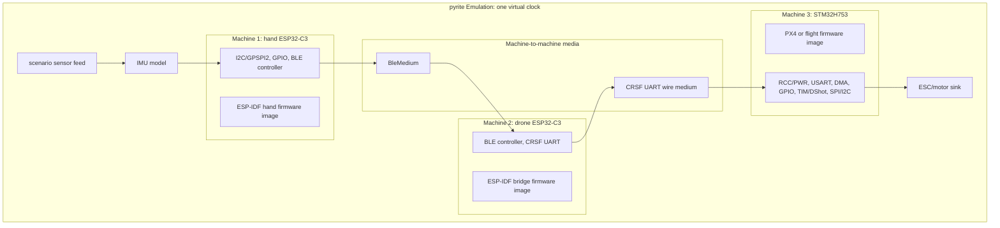
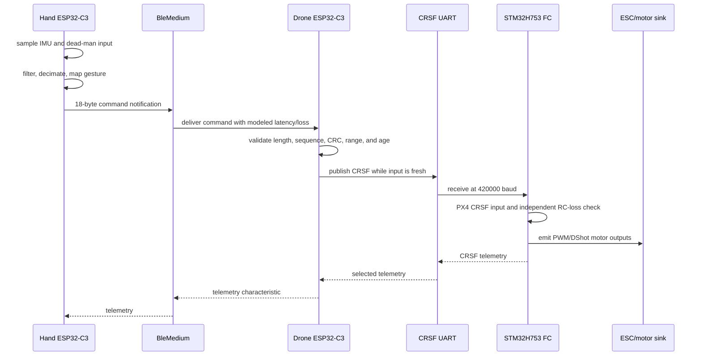

# Architecture Design

This design keeps human-interface logic, radio bridging, and real-time flight
control as separate responsibilities.

## Responsibility Split

| Subsystem | Processor | Owns | Does not own |
|---|---|---|---|
| Hand controller | ESP32-C3-MINI-1-N4X | IMU sampling, filtering, gesture mapping, 18-byte command notifications, local safety input | Motor mixing, flight stabilization |
| Drone radio bridge | ESP32-C3-MINI-1-N4X | BLE central, packet validation, BLE-to-CRSF conversion, telemetry forwarding | Gesture interpretation, arming authority, motor control |
| Flight controller | STM32H753VIT6 | CRSF input, arming, failsafe, control loops, estimator, mixer, PWM/DShot outputs | BLE stack, hand gesture classification |
| Simulation harness | pyrite / rn-engine | Virtual clock, multi-machine lockstep, scenario inputs, impairment injection, trace capture | Product firmware policy |

## End-To-End Control Path

```mermaid
flowchart LR
    trace[Scenario IMU trace] --> imu[IMU device model]
    imu --> handDriver[Hand C3 IMU driver]
    handDriver --> gesture[Gesture filtering and mapping]
    gesture --> cmd[Command frame]
    cmd --> bleTx[Hand C3 NimBLE peripheral]
    bleTx --> medium[BleMedium with impairments and pcap tap]
    medium --> bleRx[Drone C3 NimBLE central]
    bleRx --> bridge[BLE-to-CRSF gateway firmware]
    bridge --> wire[Virtual CRSF UART at 420000 baud]
    wire --> h7Rx[STM32H753 USART + DMA]
    h7Rx --> fc[Flight-control firmware]
    fc --> mixer[Mixer and output scheduler]
    mixer --> esc[ESC / motor sink]

    fc --> telemetry[Telemetry frame]
    telemetry --> wire
    bridge --> bleRx
```



## Simulation Boundary



## BLE Command Frame Contract

The hand controller should send commands, not motor outputs.

```text
CommandFrameV1 {
    protocol_version_u8
    flags_u8
    sequence_u16
    sender_tick_ms_u32
    pitch_i16
    roll_i16
    thrust_i16
    yaw_i16
    crc16_ccitt_u16
}
```

The drone side should reject frames that are stale, duplicated, corrupt, or
outside the expected mode/state transition rules.

## Recommended Protocol Shape



## Key Design Rules

- Use the hand C3 as the BLE peripheral and the drone C3 as the central. Send
  command notifications at 100 Hz with a 10 ms connection interval.
- Keep flight stabilization on the STM32H7, not the glove.
- Use per-hop sequence numbers and local age checks; do not compare timestamps
  across independent clocks.
- Use CRSF over full-duplex UART between the drone C3 and H753. Stop CRSF output
  when BLE input is stale; never hold the final command indefinitely.
- Keep arming and motor-output authority exclusively on the H753.
- Simulate failure first: BLE cut, stale frames, garbage serial data, FIFO
  overflow, and sensor silence should all become CI scenarios.

## Verification Layers

Use complementary layers so H753 emulator bring-up does not block control-system
validation:

1. Host tests for framing, CRC, mapping, sequence wrap, and state transitions.
2. Pyrite with both exact C3 images, the BLE medium, and a scripted CRSF peer.
3. PX4 SITL with recorded gesture traces and vehicle physics.
4. H753 HITL for real clocks, DMA, UART, interrupts, and watchdog behavior.
5. Targeted H753 Pyrite support for deterministic peripheral fault injection.

## Build Order


