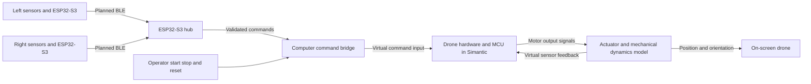

# Current system architecture

**Decision — September 16, 2026:** use **ESP32-S3 hands and hub**, with an **STM32H743 virtual drone candidate**. Physically build the controller only. The sequence is **controller simulation in Simantic → physical controller prototype → drone hardware/MCU simulation → mechanical simulation and screen display**. Drone feasibility tests may run now without marking controller milestones complete. The [project checkpoints](../README.md#full-implementation-checkpoints) govern execution.

ESP32 parts and wiring are defined in the [controller guides](controller/README.md).

## Goal 1: a working controller

Start with one simulated flex input and one ESP32-S3 firmware target. Expand to two hands with external motion sensors, enable logic and an ESP32-S3 hub. The bench target is ESP32-S3-DevKitC-1 with ESP32-S3-WROOM-1-N8R2, powered through USB. Validate commands in a host monitor before building the physical prototype.

The physical controller uses the same validated application logic, with measured sensor calibration and actual BLE, power and wearable tests. C7 ends with reliable commands arriving at the computer and a demonstrated fault/recovery procedure.

The hand nodes and hub are simulated during S0–S3 and physical during C0–C7. The drone stays virtual throughout. Simantic covers modeled hardware and MCU execution; the mechanical engine and display implementation remain to be selected.

## Responsibilities and boundaries

| Element | Responsibility | Implementation status |
|---|---|---|
| Left ESP32-S3 | Five flex channels, external motion sensing, enable; identity and acquisition progress | USB bench target selected; battery design pending |
| Right ESP32-S3 | Independent five flex channels, external motion sensing and calibration | Same bench target; distinct hand identity |
| ESP32-S3 hub | Validate both hands, calibration, freshness and bounds; send combined commands | Two-peer BLE and application firmware pending |
| Host command bridge | Validate records and connection health; gate commands with operator controls; adapt to virtual drone input | USB-to-UART bench diagnostics; production protocol pending |
| Simantic drone model | Execute flight-control firmware with required peripherals and feedback | STM32H743/KakuteH7 ArduCopter candidate; see [drone simulation plan](drone-simulation.md) |
| Output adapter | Observe/decode actual simulated MCU outputs and map channels to virtual actuators | Signal protocol and API pending |
| Dynamics model | Turn actuator outputs into thrust/torque, integrate rigid-body state and generate sensor feedback | Model, parameters and engine pending |
| Display | Render dynamics state and show controller/simulation health | Implementation pending |

The display does not independently move the drone from a gesture. Every commanded motion must pass through the drone MCU outputs and mechanical model. Any simplified model must state what it approximates; a processor catalog entry is not an exact flight-controller board model.

## ESP32 bench interfaces

| Interface | Starting circuit |
|---|---|
| Both hands | Thumb/index/middle/ring/little = GPIO1/2/4/5/6, ADC1 channels 0/1/3/4/5 |
| Each flex input | Own-board 3V3 → flex → ADC node; separate 47 kΩ and 100 nF shunts to GND; validate ESP32 ADC attenuation/calibration |
| Left enable / hub calibration | GPIO7 on the respective boards; filtered active-low button |
| External motion sensors | One Adafruit #5543 LSM6DS3TR-C + LIS3MDL breakout per hand; SDA GPIO8, SCL GPIO9 |
| Power | USB bench first; wearable charger/regulator, monitor and switch require a new design |
| Battery measurement | GPIO10 reserved only; no direct battery connection |
| USB / UART | Reserve GPIO19/20 for native USB and GPIO43/44 for UART0; use board USB-to-UART connector initially |

Use the [controller build guide](controller/build-guide.md) for exact header pins and ADC limits. GPIO3 is avoided because it is a strapping pin. Board header positions are not GPIO numbers. A complete ESP32-S3 wearable schematic remains a checkpoint. Verify received board revisions before wiring.

## Command and control contract

The proposed transport-independent record carries protocol version, hand/hub identity as applicable, session, sequence, acquisition progress, sample freshness, roll/pitch/yaw, throttle, enable, validity and fault status. The planning convention is roll/pitch/yaw in **[-1, 1]** and throttle in **[0, 1]**. Exact gesture mapping, throttle interpretation, serialization, sample rate and accepted age/skew limits must be frozen in S3 and measured again on the prototype.

The DevKit USB-to-UART bridge is the initial physical bench path; the simulator can use a modeled UART adapter when qualified. Neither establishes native ESP32 USB-driver compatibility. Freeze the production transport and test equivalent records across both boundaries. BLE remains the planned hand link; Wi-Fi or ESP-NOW would require a separate transport decision and tests.

The hub invalidates the whole command when either required hand is unhealthy or stale. The host independently rejects malformed, out-of-range, duplicate, old-session or stale records. Host arrival time alone cannot make an old sensor acquisition fresh. Record clock units and timestamp conversion explicitly.

The hand enable grants gesture input only within an explicitly started virtual run. It does not autonomously arm or restart the virtual drone. The host provides stop/reset controls. Startup, disconnect, stale input and restart enter a defined inhibited state; recovery requires a deliberate operator action and fresh valid data. Specify whether each stop condition pauses/resets the simulation or invokes a virtual failsafe, and verify the corresponding motor and display response. Never silently continue the last valid gesture indefinitely.

## Drone output and feedback contract

Complete D1 before integration after C7. The current feasibility work examines STM32H743/KakuteH7 ArduCopter; it is a virtual candidate, not a purchase requirement. Reaching firmware startup or attaching a sensor fixture does not establish a healthy closed loop.

Observe the chosen firmware's motor outputs at the modeled peripheral boundary. Decode their timing/protocol into actuator commands. A separate mechanical model converts these commands into force and torque and advances position, velocity, attitude and angular velocity. Return modeled IMU and any other firmware-required sensor readings to Simantic. Render the same state on screen.

Freeze motor order, rotation, signal units, coordinate frames, simulation time step and clock synchronization before integrated runs. Save command inputs, MCU outputs, sensor feedback and motion state on a shared simulation timeline. See the [drone simulation plan](drone-simulation.md) for D1–D4 acceptance.

## Open decisions and evidence

| Decision | Required evidence |
|---|---|
| ESP32-S3 runtime, ADC, external IMU/I²C and chosen BLE stack | New firmware-driven tests; see [Simantic plan](controller/simantic-plan.md) |
| Gesture mapping, transport and freshness limits | Versioned interface specification, deterministic traces and measured prototype behavior |
| Controller power and fit | New wearable power schematic, measured battery/ADC range, runtime and fit; DevKit requires an external charger |
| Drone MCU/firmware and actuator output protocol | Reproducible boot, supported peripherals, command input and observable outputs |
| Mechanical model, renderer and feedback fidelity | Declared model assumptions, reference scenarios, clock and coordinate tests |

Keep automated checks with firmware and summarize their results in pull requests. Full controller qualification and the integrated drone demonstration remain pending.
