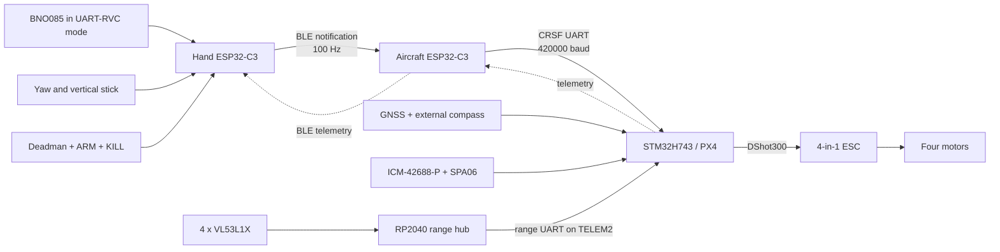
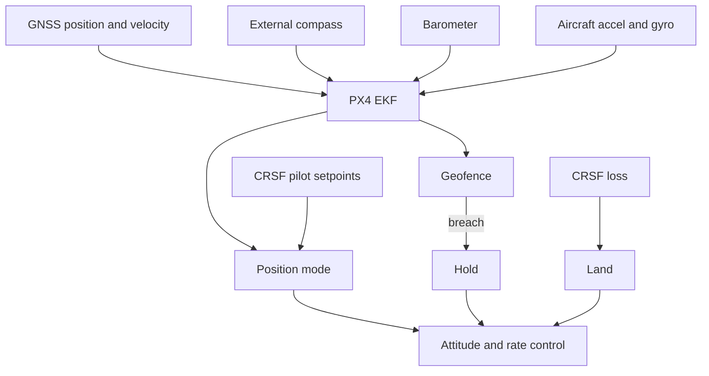
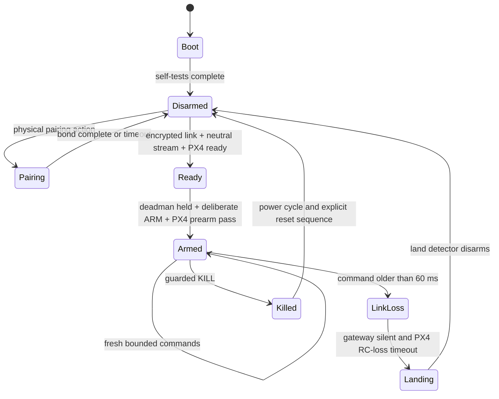

# System Architecture

Research baseline: 2026-09-10

## Architecture Decision

Build the first flying prototype around three control processors, then add a
fourth non-radio processor for collision sensing after the base aircraft flies:

| Location | Processor | Purpose |
|---|---|---|
| Hand controller | XIAO ESP32-C3 | BNO085 acquisition, gesture mapping, physical safety inputs, BLE peripheral |
| Aircraft receiver gateway | XIAO ESP32-C3 | BLE central, command validation, CRSF receiver emulation |
| Flight controller | STM32H743 on Holybro Kakute H7 Mini v1.5 | PX4 estimation, safety, control, DShot, logging |
| Aircraft range hub | XIAO RP2040 | Address and sample four VL53L1X sensors; send range-only frames to H7 |

This is a direct H7 design. There is no F7 interim flight controller and no
custom STM32H753 board in the critical path to first flight. The off-the-shelf
H743 board provides the H7 headroom the project wants while avoiding a custom
flight-control PCB bring-up.

## End-to-End Design



The laptop and QGroundControl are setup tools, not part of the live pilot path.
Use USB for bootloader installation, calibration, parameter setup, log download,
and props-off verification.

## Authority Boundaries

| Subsystem | Owns | Must not own |
|---|---|---|
| Hand C3 | Neutral calibration, BNO085 filtering, bounded pilot axes, buttons, BLE security and transmission | Aircraft attitude, position, arming decision, motor mixing |
| Aircraft C3 | Bonding, allowlist, packet integrity and age, CRSF packing, limited telemetry forwarding | Stabilization, geofence, autonomous landing, direct ESC output |
| H7/PX4 | Sensor fusion, prearm checks, flight modes, RC-loss behavior, geofence, control allocation, DShot | Gesture interpretation or BLE reconnection policy |
| Range hub | ToF address assignment, sampling, validation, health flags, range UART | BLE, RC channels, arming, setpoints, motor output |
| ESC | Motor commutation from H7 DShot commands | Flight policy, radio policy, or position safety |

The gateway stops CRSF output when BLE commands are stale. PX4 independently
detects receiver loss and executes the configured action. This gives two
freshness checks without pretending that the ESP32-C3 is a second flight
controller.

## Position and Boundary



The first outdoor envelope has three different boundaries:

| Boundary | Initial value | Meaning |
|---|---:|---|
| Pilot operating target | 10 m radius, 3 m high | Normal movement remains comfortably inside the fence |
| PX4 geofence | 15 m radius, 5 m high | H7 commands Hold after a detected breach |
| Physically clear test site | At least 25 m radius | Contains GPS error, stopping distance, wind, and fence overshoot |

The geofence is not a hard wall. It reacts after the estimated position crosses
the limit. It also requires valid position. Indoors, GNSS and BLE RSSI cannot
enforce this boundary; use a netted physical enclosure and prop guards.

The staged collision layer uses four narrow range sensors to let PX4 slow or
stop Position-mode motion toward detected obstacles. It covers only forward,
right, rear, and left. Initial collision-assisted commands are axis-locked,
movement into sectors with no data is disabled, and the sensors do not replace
the geofence or physical containment. See the
[collision-prevention design](h7-ble/collision-prevention.md).

## Control Contract

The hand sends pilot intent, not motor values. Version 1 uses this fixed
little-endian payload:

```text
CommandFrameV1 (18 bytes)
offset  size  field
0       1     protocol_version
1       1     flags: deadman, arm, kill, calibrated, fault
2       2     sequence_u16
4       4     sender_tick_ms_u32 (diagnostics only)
8       2     pitch_i16       -1000..1000
10      2     roll_i16        -1000..1000
12      2     vertical_i16    -1000..1000
14      2     yaw_i16         -1000..1000
16      2     CRC16-CCITT over bytes 0..15
```

The receiver uses its own monotonic clock to determine packet age. Clocks are
not synchronized, so the sender timestamp is never used for the safety timeout.

## CRSF Channel Contract

| Channel | Meaning |
|---|---|
| CH1 | Roll |
| CH2 | Pitch |
| CH3 | Vertical/throttle input |
| CH4 | Yaw |
| CH5 | Deliberate arm request |
| CH6 | Position-mode selector |
| CH7 | Link-valid diagnostic |
| CH8 | Guarded kill switch |

Calibrate and verify every channel in QGroundControl with propellers removed.
The exact switch thresholds are configuration, not assumptions embedded in a
cable diagram.

## Safety State



Reconnection never restores an armed state. KILL is deliberately separate from
deadman release: KILL immediately stops thrust and can make the vehicle fall;
deadman release invokes a flight-stack-managed landing.

## ExpressLRS Upgrade

```text
BLE phase:   aircraft C3 TX/RX/GND -- receiver plug -- H7 TELEM1
ELRS phase:  ELRS RX TX/RX/GND/5V  -- same plug ----- H7 TELEM1
```

Only one receiver is connected at a time. Never Y-connect two TX outputs. PX4
continues to receive CRSF, so channel mapping, geofence, position mode, and
failsafe policy remain unchanged when ExpressLRS replaces BLE.

## Verification Strategy

1. Host tests cover frame encoding, CRC, sequence wrap, range checks, and state
   transitions.
2. Two C3 boards pass BLE latency, packet-loss, disconnect, and reconnect tests
   without motors.
3. PX4 SITL validates mapping, position-mode behavior, geofence, and link loss.
4. The real H7 passes bootloader, sensor, UART, and output tests with props off.
5. One motor and the actual team propeller pass a thrust-stand test.
6. Enclosed tether-free hops precede outdoor GNSS Position-mode tests.
7. Range sensors pass target, FoV, freshness, direction, and braking tests before
   collision assistance is enabled.
8. Free flight begins only after every acceptance gate in the safety plan passes.

Detailed implementation is in the [H7 BLE build specification](h7-ble/README.md).
The authoritative board-pad, MCU-GPIO, sensor, and motor mapping is in the
[pin-level architecture](h7-ble/pin-architecture.md).
