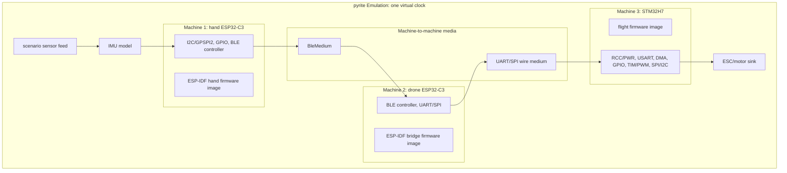
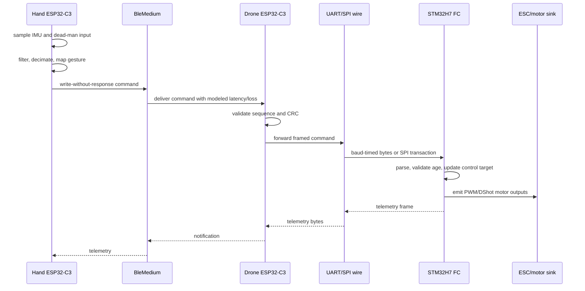
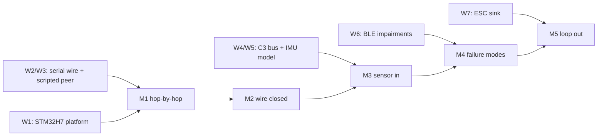

# Architecture Design

This design keeps human-interface logic, radio bridging, and real-time flight
control as separate responsibilities.

## Responsibility Split

| Subsystem | Processor | Owns | Does not own |
|---|---|---|---|
| Hand controller | ESP32-C3 | IMU sampling, filtering, gesture mapping, command packet generation, local safety input | Motor mixing, flight stabilization |
| Drone radio bridge | ESP32-C3 | BLE connection, packet validation, command forwarding, telemetry forwarding | Gesture interpretation, motor control |
| Flight controller | STM32H7 | Failsafe, control loops, estimator, mixer, PWM/DShot outputs | BLE stack, hand gesture classification |
| Simulation harness | pyrite / rn-engine | Virtual clock, multi-machine lockstep, scenario inputs, impairment injection, trace capture | Product firmware policy |

## End-To-End Control Path

```mermaid
flowchart LR
    trace[Scenario IMU trace] --> imu[IMU device model]
    imu --> handDriver[Hand C3 IMU driver]
    handDriver --> gesture[Gesture filtering and mapping]
    gesture --> cmd[Command frame]
    cmd --> bleTx[Hand C3 NimBLE peripheral]
    bleTx --> medium[BleMedium with impairments and pcap tap]
    medium --> bleRx[Drone C3 NimBLE central or peripheral]
    bleRx --> bridge[BLE to serial bridge firmware]
    bridge --> wire[Virtual UART or SPI wire]
    wire --> h7Rx[STM32H7 USART/SPI + DMA]
    h7Rx --> fc[Flight-control firmware]
    fc --> mixer[Mixer and output scheduler]
    mixer --> esc[ESC / motor sink]

    fc --> telemetry[Telemetry frame]
    telemetry --> wire
    bridge --> bleRx
```



## Simulation Boundary



## Command Frame Contract

The hand controller should send commands, not motor outputs.

```text
CommandFrame {
    sequence_number
    local_timestamp
    mode
    enable
    roll_request
    pitch_request
    yaw_request
    throttle_or_altitude_request
    crc
}
```

The drone side should reject frames that are stale, duplicated, corrupt, or
outside the expected mode/state transition rules.

## Recommended Protocol Shape



## Key Design Rules

- Keep BLE command traffic one-way and low-latency: use write-without-response
  or notifications, not request/response control loops.
- Keep flight stabilization on the STM32H7, not the glove.
- Use per-hop sequence numbers and local age checks; do not compare timestamps
  across independent clocks.
- Use framed serial data with a start marker, length, and CRC, or use a proven
  framing scheme such as MAVLink or COBS.
- Simulate failure first: BLE cut, stale frames, garbage serial data, FIFO
  overflow, and sensor silence should all become CI scenarios.

## Build Order



