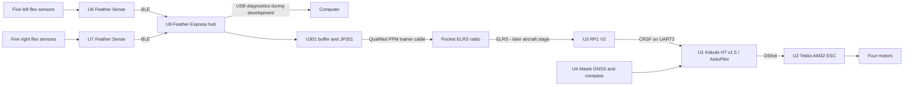

# Current system architecture

Baseline: the September 14, 2026 [PalmPilot BOM](reference/PalmPilot_BOM.pdf).
Build priority: qualify the two-hand controller and its ground hub on the bench,
then integrate the aircraft. The [root README](../README.md) tracks completion.

## First deliverable: a working controller

The controller consists of two Feather Sense hand nodes and one Feather Express
ground hub. Start with one hand and one flex input. Progress to ten flex inputs,
onboard motion sensing, calibrated mapping and two simultaneous BLE links.
The hub first reports commands over USB and generates a scoped trainer signal
with its output jumper open. Qualify the Pocket interface before connecting it.

The initial controller milestone ends with verified inputs on the Pocket and
measured manual takeover. The aircraft can remain unassembled for this work.
Receiver/flight-controller channel checks follow as a separate bench stage.

## Hardware and ownership

| Location | Selected hardware | Responsibility |
|---|---|---|
| Left hand | U6 Feather nRF52840 Sense #4516; five flex #1070; SW4 ENABLE | Acquire and validate A0-A4, onboard motion, battery and enable state; transmit new samples |
| Right hand | U7 Feather nRF52840 Sense #4516; five flex #1070 | Acquire and validate independent A0-A4, onboard motion and battery; transmit new samples |
| Ground hub | U8 Feather nRF52840 Express #4062; SW5 CALIBRATE | Validate both nodes, manage calibration/profiles, combine bounded pilot intent, generate trainer frames and health signals |
| Trainer interface | SN74LVC1G125DBVR on carrier; series resistor; JP301 | Drive a proposed 3.3 V PPM signal with output disabled at reset; expose measurement points |
| Operator radio | RadioMaster Pocket M2 ELRS/FCC | Physical sticks, deliberate arm/mode controls, gesture authority gate and independent manual takeover |
| Aircraft | RP1 V2; full-size Kakute H7 v1.5; Tekko F4 50A AM32; 4S pack | Receive CRSF; run ArduPilot estimation, stabilization, arming and failsafes; command motor power |

The Sense boards contain the hand motion sensors. Their internal traces need no
extra user wiring. No onboard XIAO gateway, BNO085 module or ToF hub belongs to
this BOM. Dronetag and the Finder buzzer are aircraft support devices; they are
not involved in wearable command generation.

## Pin and power contract

| Interface | Connection |
|---|---|
| Both hands | Thumb/index/middle/ring/little = A0/A1/A2/A3/A4 respectively |
| Every flex input | Own-board 3V -> flex -> ADC node; 47k and 100nF from node to own-board GND |
| Left enable | U6 D5 through the filtered SW4 circuit |
| Hub calibration | U8 D6 through the filtered SW5 circuit |
| Hub trainer | U8 D5 -> buffer A; U8 D9 -> active-low /OE |
| Three power switches | Own-board EN to own-board GND when OFF; open when ON |
| Trainer cable | Mono TS tip = buffered PPM through JP301; sleeve = hub/Pocket ground |
| Aircraft receiver | RP1 TX -> FC R3; RP1 RX <- FC T3 |
| Aircraft navigation | Matek TX -> R4; RX <- T4; CL -> SCL; DA -> SDA |

Each Feather has its own protected #1578 single-cell battery and onboard
Micro-USB charger. Their battery and 3V rails are independent. The Pocket has
its own radio cells. The hub and Pocket share only trainer signal ground;
neither is wired to aircraft battery or ground. The aircraft 5V rail powers its
peripherals, and the 4S pack powers the ESC.

Use the [Rev A schematics](../hardware/schematics/README.md) for resistor values,
connector views and every terminal. GPIO names are not connector cavity numbers.

## Command and authority boundary

The hand nodes send sensor state and health. The hub converts those states to
pilot commands. The radio supplies aircraft arm and mode channels; the hub must
not turn a finger gesture into an independent aircraft arming path.

The proposed eight-slot trainer frame has four command slots (TR1-TR4), a
hand-data-valid slot (TR5), an application heartbeat (TR6), and two neutral
reserved slots. These trainer slots are not the same namespace as final ELRS
output channels. In particular, TR5 is not the aircraft arm channel.

Gesture authority requires the physical Pocket enable, a present trainer stream,
valid hand data, recent heartbeat changes and no latched fault. Release of the
Pocket enable returns to manual sticks. Recovery requires a new deliberate
enable action. A stopped or repeating stale hub stream must not preserve gesture
authority simply because the ELRS radio link remains healthy.

The [firmware plan](controller/firmware-plan.md) defines implementation work and
the [validation plan](controller/validation.md) defines the evidence required.
No controller firmware or radio model has been implemented or tested in this
repository yet.

## Open design decisions

| Item | Present status | Evidence needed |
|---|---|---|
| Pocket trainer input voltage tolerance | Not established from the located Pocket documentation | Actual input specification or competent circuit-level verification; keep JP301 open meanwhile |
| Hand sample freshness / loss thresholds | To be frozen during firmware work | Measured sampling, BLE and control latency, then fault-injection results |
| Gesture-to-axis mapping | To be selected and tested | Explicit mode/throttle semantics, calibration and independent manual override |
| Battery operating window | To be measured | Valid sensor/ADC behavior before regulator dropout; low-battery inhibition threshold |
| Wearable fit and retention | Prototype work | Comfortable movement, sliding sensor guides and strain-relieved connectors |
| Aircraft navigation and propulsion | Later stage | Sensor support, compass placement, measured current/thrust and structural qualification |

## Baseline changes from earlier work

The [historical design](archive/README.md) used XIAO controllers, BLE directly to
the aircraft, a Kakute H7 Mini, PX4 and 3S propulsion. The attached BOM selects
Feather hand nodes, a trainer-connected ground hub, ELRS, the full-size Kakute
H7, ArduPilot and 4S propulsion. The user now prioritizes the controller build.

The Rev A schematic deliberately moves the BOM's provisional aircraft UART1/3
allocation to exposed UART3/4 pads. This avoids the 9V VTX connector in the
receiver harness. It does not affect the controller-first work.

## Source evidence

- [Baseline BOM and provenance](reference/README.md).
- [Hand electronics research](schematic-research-hands.md).
- [Trainer electrical and EdgeTX research](schematic-research-trainer.md).
- [Aircraft pinout research](schematic-research-aircraft.md).

Research findings specify interfaces. Completed hardware tests are recorded
separately in [implementation records](implementation-records/README.md).
