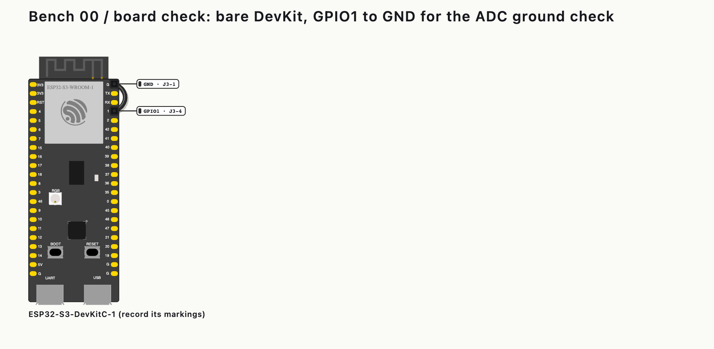

# Bench 00: board check (one bare DevKit)

**Mirrors:** A0 / the toolchain self-test: the same binaries run on the board as in the simulator.
**Test plan:** B0. **Board:** whichever DevKit becomes LEFT.
**Before:** nothing.

## Wiring



[SVG](wiring.svg) · [wiring.json](wiring.json) (open it in pinplanner with `node cli/pinplanner.ts link <path>`)

### Parts and jumpers

| # | part | from | to | what it does |
|---|---|---|---|---|
| 1 | jumper, black | DevKit GPIO1 (J3-4) | DevKit GND (J3-1) | GPIO1 -> GND, ADC ground check only |

The jumper is only for step 4; take it off before bench 01.

## Steps

1. **Identity:** record the module marking and suffix, the PCB revision, flash and PSRAM
   size, the USB port labels, and which port enumerates as the USB-to-UART bridge. Check the header
   silkscreen against the pin table in `docs/wiring/README.md`. A board whose headers differ
   (the Freenove) needs its own map written down before bench 01.
2. **Back up the factory flash** before writing anything:

   ```sh
   "$IDF_PYTHON_ENV_PATH/bin/python" -m esptool --chip esp32s3 -p $PORT read_flash 0 ALL tmp/bench/factory-<board>.bin
   ```

3. **ADC reference app** (the app `firmware/tools/selftest.py` runs in simulation):

   ```sh
   python3 firmware/tools/palmpilot.py build simulation/simantic/hardware-validation/esp32s3-adc
   python3 firmware/tools/palmpilot.py pack  simulation/simantic/hardware-validation/esp32s3-adc
   "$IDF_PYTHON_ENV_PATH/bin/python" -m esptool --chip esp32s3 -p $PORT -b 460800 \
       write_flash 0x0 tmp/palmpilot/esp32s3-adc/flash.bin
   ```

   On the console, `info` reports the fixture `palmpilot-adc-v1`.
4. **Ground check:** USB off, fit the jumper GPIO1 (J3-4) to GND (J3-1), USB on. Run the app's capture
   script as its README describes (`capture_serial.py --channel 0 --attenuation 3 --count 64
   --input-mv 0`). Compare with the committed record
   `simulation/simantic/hardware-validation/esp32s3-adc/evidence/physical-ground-2026-09-16/`
   (raw 0-6 at attenuation 3 on that board). pinplanner warns that GPIO1 is tied to GND with no
   resistor; that is fine here because this app never drives the pin.
5. USB off, remove the jumper. Flash `hand:left` (bench 01, Firmware) and check `boot`, `info` and
   `ready` with nothing connected: expect the `motion_init` error and floating, unhealthy channels.
   This shows the hand image boots on this board before anything is wired to it.

## Record

The identity record, the factory flash backup (keep it out of git), the capture directory, and the
app ELF sha256 values.
