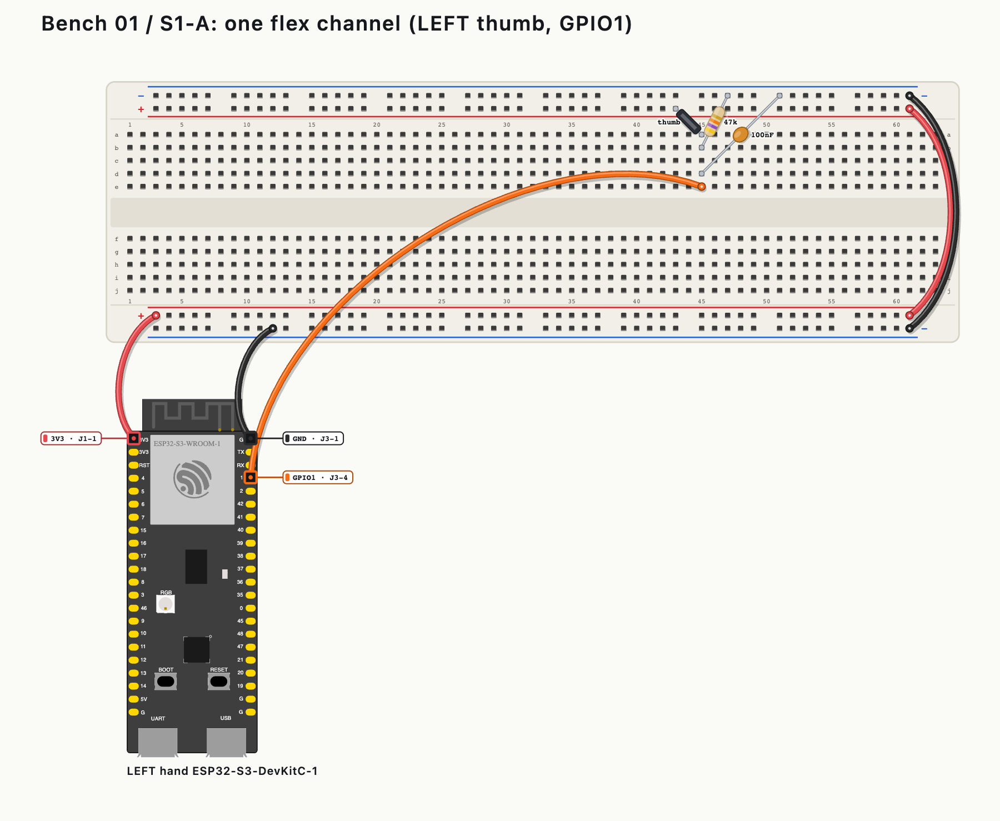

# Bench 01: one flex channel (LEFT thumb)

**Mirrors:** S1-A (`firmware/tests/s1a_acquisition.py`), the single-channel part: pin map, ADC
calibration, ticks and acquisition advancing, calibrated millivolts, open and shorted faults.
**Test plan:** B1.
**Board:** LEFT. **Before:** bench 00 passed on this board.

## Wiring



[SVG](wiring.svg) · [wiring.json](wiring.json) (open it in pinplanner with `node cli/pinplanner.ts link <path>`)

### Parts and jumpers

| # | part | from | to | what it does |
|---|---|---|---|---|
| 1 | jumper, red | DevKit 3V3 (J1-1) | bottom + rail, by column 3 | LEFT 3V3 -> bottom + rail |
| 2 | jumper, black | DevKit GND (J3-1) | bottom - rail, by column 12 | LEFT GND -> bottom - rail |
| 3 | jumper, red | bottom + rail, by column 61 | top + rail, by column 61 | bottom + rail -> top + rail |
| 4 | jumper, black | bottom - rail, by column 61 | top - rail, by column 61 | bottom - rail -> top - rail |
| 5 | flex sensor (thumb) | top + rail, by column 43 | hole 45a | LEFT 3V3 -> thumb flex -> node |
| 6 | 47k resistor | hole 45b | top - rail, by column 47 | thumb node -> 47k -> GND |
| 7 | 100nF capacitor | hole 45d | top - rail, by column 51 | thumb node -> 100nF -> GND |
| 8 | jumper, orange | hole 45e | DevKit GPIO1 (J3-4) | thumb node -> GPIO1 (ADC1_CH0) |

The four other finger strips stay empty. Every part already sits where the finished hand
has it, so later stages only add parts.

## Firmware

`hand:left`, the LEFT build of the image the S1 suites run in simulation.

```sh
python3 firmware/tools/palmpilot.py build hand:left
python3 firmware/tools/palmpilot.py pack  hand:left     # prints the app ELF sha256: record it
. firmware/tools/env.sh
"$IDF_PYTHON_ENV_PATH/bin/python" -m esptool --chip esp32s3 -p $PORT -b 460800 \
    write_flash 0x0 tmp/palmpilot/hand-left/flash.bin
```

## Steps

Set the numeric limits in your test record **before** powering up (CLAUDE.md section 7).
The values below marked PROVISIONAL are starting points from the firmware, not qualified limits.

### Unpowered

1. USB unplugged. Continuity: DevKit GPIO1 (J3-4) to hole 45e; DevKit 3V3 (J1-1) to both + rails;
   DevKit GND (J3-1) to both - rails. **No** continuity between any + rail and any - rail.
2. Measure the 47k and the 100nF before fitting them, and the flex sensor straight and fully bent.
   Record all three. The 25k straight / 100k bent in docs/wiring/README.md are catalogue figures, not limits.

### Powered

3. Plug a data USB cable into the DevKit port marked **UART** and start the console:

   ```sh
   "$IDF_PYTHON_ENV_PATH/bin/python" firmware/tools/bench.py $PORT
   ```

   Press RESET (EN). Expect `boot` with `"fixture":"palmpilot-hand-v1"`, then
   `{"type":"error","op":"motion_init"}` (no IMU yet: expected here), then `ready` with `"side":0,"name":"LEFT"`.
4. `info`: `flex_gpio` `[1,2,4,5,6]`, `enable_gpio` 7, `adc_attenuation` 3, `adc_bits` 12,
   `adc_calibrated` 1. Record the line.
5. `stats`, wait about 1 s, `stats` again: `ticks` and `acq` advance by about 100 per second,
   `overruns` stays 0.
6. Meter: 3V3 rail to - rail; then hole 45e to - rail with the thumb straight, and again fully bent.
   Record both. Bending raises the flex resistance, so the node voltage **falls** when bent.
7. Thumb straight: `stream 100`, then thumb bent: `stream 100`. Summarise the log:

   ```sh
   python3 firmware/tools/bench_summary.py tmp/bench/<log> --last 100
   ```

   Check channel 0 (`thumb`): `status` 0 in both positions; the mean mV agrees with the meter within your
   declared limit (suggested starting point: +-50 mV, PROVISIONAL); raw stays inside 40..4040.
   Channels 1-4 are unwired and floating here: ignore them, and expect `healthy` 0.

### Faults and settling

8. **Open:** pull the flex lead out of the + rail. `sample`: `status[0]` 1 (`FLEX_FAULT_OPEN`, raw
   below 40), `fault_mask` bit 0 set. Put it back: `status[0]` returns to 0.
9. **Short:** with a spare jumper, join hole 45c to the top + rail (the node straight to 3V3, nothing
   in between). `sample`: `status[0]` 2 (`FLEX_FAULT_SHORT`, raw above 4040). In simulation this case
   is MODEL-ONLY; this is its first physical check. Remove the jumper: back to 0.
10. **Settling:** press RESET and immediately send `stream 30`. Note how many samples (10 ms each) pass
    before channel 0 is within 1% of its settled value. The firmware assumes 50 ms (PROVISIONAL).

## Record

DevKit marking, module suffix, PCB revision, USB port names; the app ELF sha256 from
`pack`; the bench log; meter readings; part values; a photo of the board.

## Not established here

Five-channel identity and coupling (bench 02), anything on the IMU, ENABLE or calibration. A broken
wire between the node and the MCU can still float; the 47k only pulls the board side of the node down.
