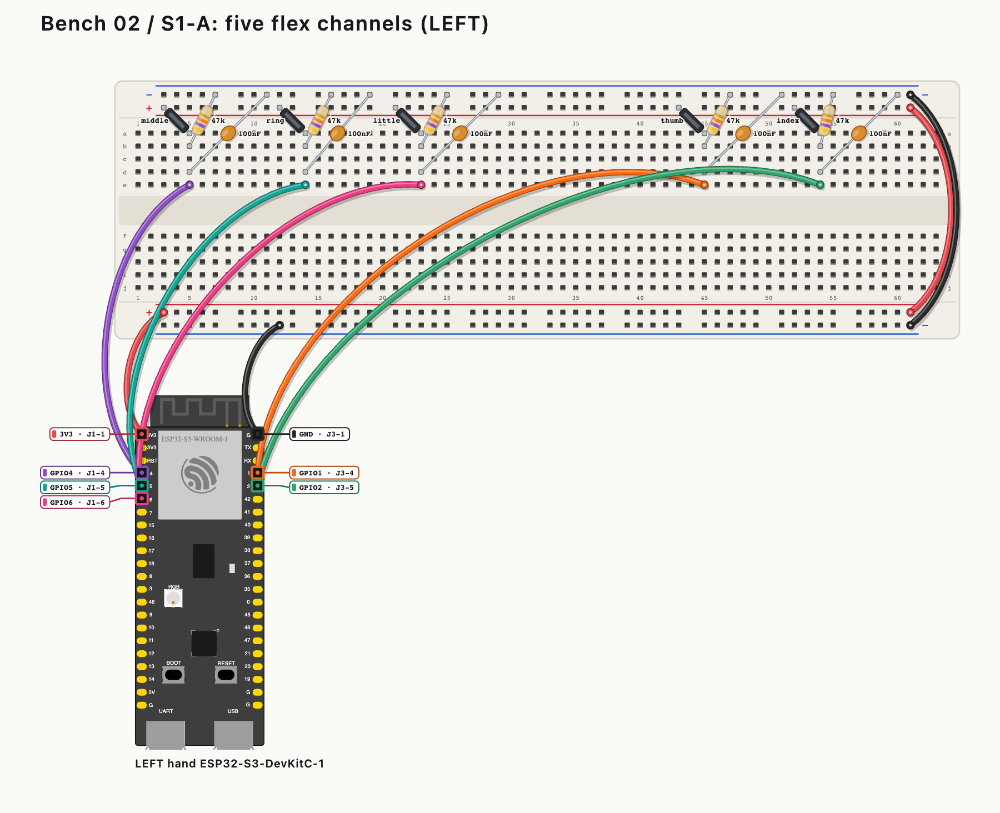

# Bench 02: five flex channels (LEFT)

Mirrors: S1-A, the rest: channel identity, all channels healthy in range, one channel open marks
only its own bit, recovery. Test plan: B2.
Board: LEFT. Before: bench 01 passed.

## Wiring

[SVG](wiring.svg) · [wiring.json](wiring.json) (open it in pinplanner with `node cli/pinplanner.ts link <path>`)

### Parts and jumpers added in this stage

| # | part | from | to | what it does |
|---|---|---|---|---|
| 1 | flex sensor (middle) | top + rail, by column 3 | hole 5a | LEFT 3V3 -> middle flex -> node |
| 2 | 47k resistor | hole 5b | top - rail, by column 7 | middle node -> 47k -> GND |
| 3 | 100nF capacitor | hole 5d | top - rail, by column 11 | middle node -> 100nF -> GND |
| 4 | jumper, purple | hole 5e | DevKit GPIO4 (J1-4) | middle node -> GPIO4 (ADC1_CH3) |
| 5 | flex sensor (ring) | top + rail, by column 12 | hole 14a | LEFT 3V3 -> ring flex -> node |
| 6 | 47k resistor | hole 14b | top - rail, by column 16 | ring node -> 47k -> GND |
| 7 | 100nF capacitor | hole 14d | top - rail, by column 19 | ring node -> 100nF -> GND |
| 8 | jumper, teal | hole 14e | DevKit GPIO5 (J1-5) | ring node -> GPIO5 (ADC1_CH4) |
| 9 | flex sensor (little) | top + rail, by column 21 | hole 23a | LEFT 3V3 -> little flex -> node |
| 10 | 47k resistor | hole 23b | top - rail, by column 25 | little node -> 47k -> GND |
| 11 | 100nF capacitor | hole 23d | top - rail, by column 29 | little node -> 100nF -> GND |
| 12 | jumper, pink | hole 23e | DevKit GPIO6 (J1-6) | little node -> GPIO6 (ADC1_CH5) |
| 13 | flex sensor (index) | top + rail, by column 52 | hole 54a | LEFT 3V3 -> index flex -> node |
| 14 | 47k resistor | hole 54b | top - rail, by column 55 | index node -> 47k -> GND |
| 15 | 100nF capacitor | hole 54d | top - rail, by column 60 | index node -> 100nF -> GND |
| 16 | jumper, green | hole 54e | DevKit GPIO2 (J3-5) | index node -> GPIO2 (ADC1_CH1) |

## Firmware

Same image as the previous stage; reflash only if the firmware changed (compare the app ELF sha256). Otherwise as bench 01: `hand:left`.

## Steps

1. Unpowered: continuity from each DevKit pin to its node strip: GPIO2 (J3-5) to 54e, GPIO4 (J1-4) to 5e,
   GPIO5 (J1-5) to 14e, GPIO6 (J1-6) to 23e. No continuity between any two node strips.
2. Power up, console as in bench 01. All fingers straight, `stream 100`, then summarise:
   every channel `status` 0 and `0 not healthy`. The array order is
   thumb, index, middle, ring, little (GPIO1, 2, 4, 5, 6), not the order on the breadboard.
3. Identity: bend one finger at a time, `sample` each time. Only that finger's mV falls; record by
   how much, and how much the other four move (coupling). Set the coupling limit before you start.
4. Alternating: bend thumb, middle and little, keep index and ring straight; `stream 100`; then swap.
   Each channel holds its own level (settling between channels).
5. Noise: hold still, `stream 200`, summarise. Record each channel's spread (max - min) in raw counts.
   Calibration rejects a capture whose spread exceeds 120 raw (PROVISIONAL), so a channel already near
   that here needs looking at before bench 04.
6. One open: pull the middle finger's flex lead. `sample`: `status` `[0,0,1,0,0]`, `fault_mask` 4
   (only bit 2), `healthy` 0. Replace it: healthy again. Repeat for each finger.

## Record

The log, coupling and noise per channel, the straight / bent millivolts per finger.

## Not established here

Radio load: coupling also needs checking under BLE load. The hand advertises from boot, but a link
under load only exists from bench 11; repeat step 5 there.
