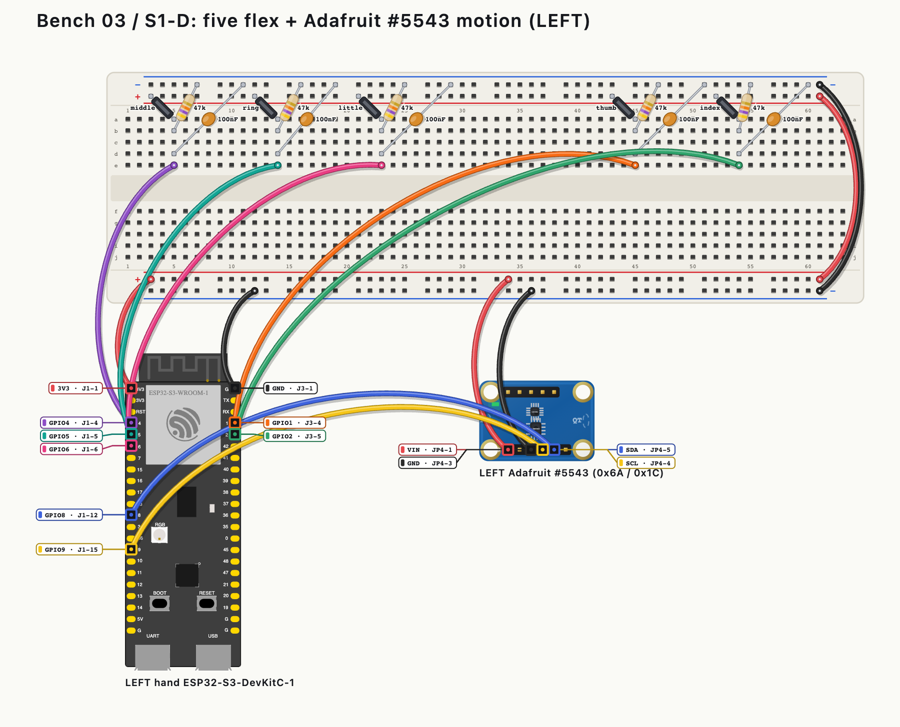

# Bench 03: external motion module (LEFT)

Mirrors: S1-D (`s1d_motion.py`): identities, reads, gravity at rest, a silent device reported as
a fault and never as data, recovery. Test plan: B2.
Board: LEFT. Before: bench 02 passed.

## Wiring

[SVG](wiring.svg) · [wiring.json](wiring.json) (open it in pinplanner with `node cli/pinplanner.ts link <path>`)

### Parts and jumpers added in this stage

| # | part | from | to | what it does |
|---|---|---|---|---|
| 1 | jumper, red | bottom + rail, by column 34 | #5543 VIN (JP4-1) | LEFT 3V3 -> IMU VIN |
| 2 | jumper, black | bottom - rail, by column 36 | #5543 GND (JP4-3) | LEFT GND -> IMU GND |
| 3 | jumper, blue | DevKit GPIO8 (J1-12) | #5543 SDA (JP4-5) | I2C SDA <-> GPIO8 (breakout pull-ups) |
| 4 | jumper, yellow | DevKit GPIO9 (J1-15) | #5543 SCL (JP4-4) | I2C SCL GPIO9 -> IMU (100 kHz) |

The breakout's `3Vo`, `INT1`, `INT2`, `INTM`, `DRDY` and the address pads stay unconnected. The breakout
has its own I2C pull-ups; do not add another set.

## Firmware

Same image as the previous stage; reflash only if the firmware changed (compare the app ELF sha256). The firmware probes the sensor at boot, so press RESET after wiring it.

## Steps

1. Unpowered: continuity GPIO8 (J1-12) to `SDA`, GPIO9 (J1-15) to `SCL`; bottom rails to `VIN` / `GND`.
2. Power up and press RESET. There is no `motion_init` error this time. `info`: `motion_init` 1,
   `i2c_sda` 8, `i2c_scl` 9.
3. `motion`: `accel_gyro` 0 and `mag_status` 0 (0 = OK, 1 = bus error, 2 = wrong identity,
   3 = no new data); `id_accel_gyro` 106 (0x6A), `id_mag` 61 (0x3D).
4. Breakout flat and still: `accel` about `[0, 0, 16384]` (1 g = 16384); the sign depends on which
   side faces up. `gyro` near 0: record the offsets. Repeat `motion` a few times; the values must change
   (fresh data, not a stuck register).
5. Axes: stand the breakout on each edge in turn and record which `accel` axis carries gravity and
   with which sign. This is the mounting record; bench 06 needs it.
6. Silent device: pull the `SDA` jumper. `motion`: `accel_gyro` nonzero, and the hand must not keep
   presenting old data as fresh (`sample` / `control` report the motion fault). Put it back: `accel_gyro`
   returns to 0 without a reset.

## Not established here

Wrong `WHO_AM_I` and the data-ready gating are simulation-only (register fixtures). No drift, noise or
magnetic calibration is qualified here; record magnetometer readings but do not rely on heading.
