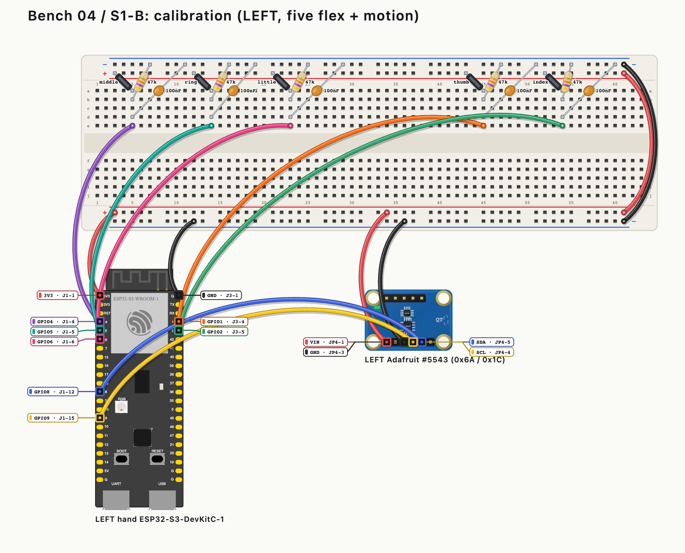

# Bench 04: calibration (LEFT)

Mirrors: S1-B (`s1b_calibration.py`): extended / curled capture, neutral orientation, finish,
curl normalisation, and every rejection case. Test plan: B2.
Board: LEFT. Before: bench 03 passed (calibration needs the IMU: `cal finish` refuses until a
neutral orientation has been captured).

## Wiring

[SVG](wiring.svg) · [wiring.json](wiring.json) (open it in pinplanner with `node cli/pinplanner.ts link <path>`)

### Parts and jumpers added in this stage

| # | part | from | to | what it does |
|---|---|---|---|---|

No wiring change from bench 03.

## Firmware

Same image as the previous stage; reflash only if the firmware changed (compare the app ELF sha256).

## Steps

Calibration lives in RAM until `cal save` (bench 07). A reset or reflash loses it.

1. `profile`: `valid` 0. `sample`: `curl_milli` is `-1` on every channel (no calibration, never 0).
2. All five fingers straight and still: `cal extended`. Expect `capturing`, then
   `{"type":"capture","end":"extended","result":0,...}` with a `spread` and `mean` per channel.
3. All five fully curled and still: `cal curled`, result 0. Every curled mean must be below its
   extended mean.
4. Breakout flat and still: `cal neutral`, result 0.
5. `cal finish`: `{"type":"calibration","result":0,...}`. `profile`: `valid` 1, both ends recorded.
6. `sample` with fingers straight: `curl_milli` 0 (inside the 30 milli deadband). Fully curled: 1000.
   Half bent: somewhere between; record the values.
7. Rejections. After each, `profile` shows `valid` 0 and `curl_milli` returns to -1. `cal reset`
   clears the profile between cases. Result codes: 1 fault, 2 unstable, 3 travel, 4 inverted,
   5 incomplete.
   - Move the fingers during `cal extended`: result 2.
   - Capture `cal curled` with the fingers straight, then `cal finish`: 3 (less than 200 raw of
     travel, PROVISIONAL).
   - Capture extended while curled and curled while extended, then finish: 4.
   - Pull a flex lead during `cal extended`: 1.
   - `cal reset` then `cal finish`: 5.
8. Recalibrate (steps 2-5) before the next bench.

## Record

Each finger's extended and curled raw means and the travel between them. The travel and spread limits get
frozen from these numbers, not from the simulation's calculated voltages.

## Not established here

Saving, loading and integrity: bench 07. A comfortable range across several people and sessions.
