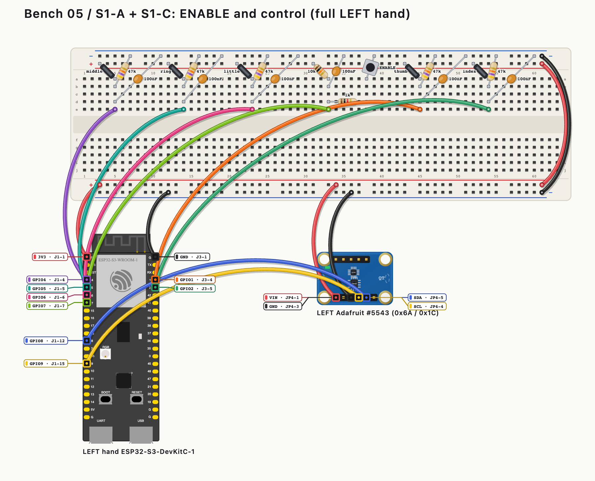

# Bench 05: ENABLE and the control state machine (full LEFT hand)

**Mirrors:** S1-A (ENABLE debounce) and S1-C (`s1c_control.py`): states, the throttle-low
interlock, latched faults, stalled acquisition, service mode, HOLD and PRECISION flags.
**Test plan:** B3.
**Board:** LEFT. **Before:** bench 04 passed. This is the finished LEFT wiring.

## Wiring

[SVG](wiring.svg) · [wiring.json](wiring.json) (open it in pinplanner with `node cli/pinplanner.ts link <path>`)

### Parts and jumpers added in this stage

| # | part | from | to | what it does |
|---|---|---|---|---|
| 1 | 10k resistor | top + rail, by column 31 | hole 33a | LEFT 3V3 -> 10k -> ENABLE node (pull-up) |
| 2 | 100nF capacitor | hole 33b | top - rail, by column 35 | ENABLE node -> 100nF -> GND (debounce) |
| 3 | 1k resistor | hole 33d | hole 38d | ENABLE node -> 1k -> switch |
| 4 | push button (ENABLE) | hole 38a | top - rail, by column 39 | normally-open ENABLE switch -> GND |
| 5 | jumper, lime | hole 33e | DevKit GPIO7 (J1-7) | ENABLE node -> GPIO7, active low |

## Firmware

Same image as the previous stage; reflash only if the firmware changed (compare the app ELF sha256). Recalibrate after any reset (bench 04, steps 2-5) unless a profile was saved.

## Steps

`control` prints `state`, `valid`, `fault`, `inhibit` and the outputs. States: `selftest`, `service`,
`waiting`, `permitted`, `fault`, `recovery`. `fault`: 1 sensor, 2 uncalibrated, 3 stale, 4 motion.
`inhibit`: 1 no-press, 2 throttle-high, 3 calibrating, 4 fault.

1. Unpowered: hole 33a to the + rail reads 10k. Pressing the button, hole 33e to the - rail reads about
   1k (the 1k and the switch).
2. Powered, meter on GPIO7: released about 3.3 V (HIGH); pressed about 0.3 V (LOW).
3. **Debounce (S1-A):** `sample` released: `enable` 0; held: `enable` 1; released again: 0. The
   debounce is 2 samples (20 ms, PROVISIONAL). If a scope is available, capture the press edge on GPIO7
   and record the bounce time against that.
4. **Held at boot:** hold ENABLE, press RESET, recalibrate, keep holding: `control` stays `waiting`,
   `valid` 0, `inhibit` 1 (no-press). Release then press again: `permitted`, `valid` 1.
5. Release: `waiting`, `valid` 0.
6. **Throttle-low interlock:** make a fist (LEFT four-finger curl is throttle), then press ENABLE:
   refused, `inhibit` 2 (throttle-high; limit 50 milli, PROVISIONAL). Open the hand, release, press:
   `permitted`.
7. **Latched fault:** while permitted, pull a flex lead: `fault`, `valid` 0, `fault` 1. Put the lead
   back while still holding ENABLE: still invalid (`recovery`); holding never self-recovers. Release:
   `waiting`. Press: `permitted`.
8. **Stalled acquisition:** while permitted, `stall 50` (50 sweeps, 0.5 s): `valid` 0 with `fault` 3
   (stale, not sensor). Release and press again to recover.
9. **Service mode:** `cal extended` while waiting: state `service`, `inhibit` 3; finish the
   calibration to leave it.
10. **Gestures:** open hand: `hold` 0, `precision` 0. Curl only the thumb: `precision` 1 (the thumb is
    not part of throttle). Full fist: `hold` 1. Half curl: `throttle_milli` partial, `hold` 0.
11. **Disconnected lead:** pull the GPIO7 jumper and record what `sample` reports. The pin
    has no pull-up of its own then, so the reading is not defined: write down what you see. A short
    to GND looks exactly like a press; note that limitation in the record.

## Not established here

Wearable power and mechanics. Those stay out of scope until a reviewed power design exists.
