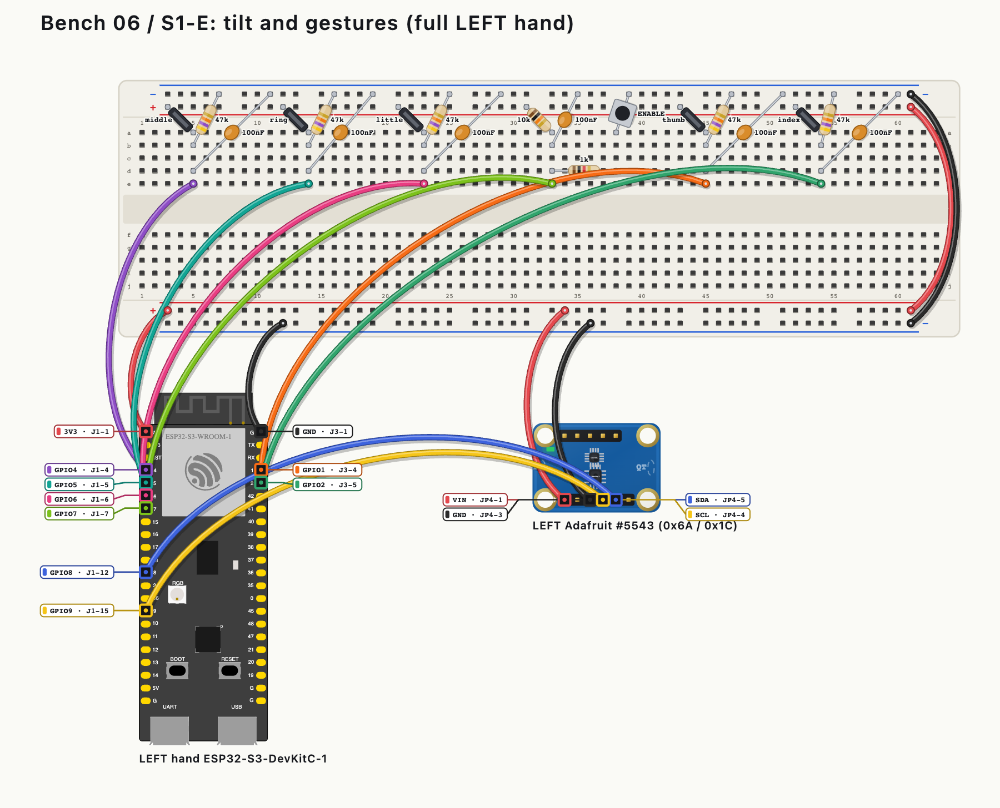

# Bench 06: tilt mapping and gestures (full LEFT hand)

Mirrors: S1-E (`s1e_attitude.py`): neutral, deadband, saturation, axis separation, PRECISION and
HOLD flags, motion fault, rejected neutral while accelerating, tilted neutral.
Test plan: B3 (the test plan lists S1-E under B2; on the bench it needs ENABLE, so it runs after B3).
Board: LEFT. Before: bench 05 passed.

## Wiring

[SVG](wiring.svg) · [wiring.json](wiring.json) (open it in pinplanner with `node cli/pinplanner.ts link <path>`)

### Parts and jumpers added in this stage

| # | part | from | to | what it does |
|---|---|---|---|---|

No wiring change from bench 05. Hold the #5543 breakout (or the board it sits on) to tilt it; the
mounting record from bench 03 tells you which way is roll and which is pitch.

## Firmware

Same image as the previous stage; reflash only if the firmware changed (compare the app ELF sha256). Calibrated, ENABLE pressed (`permitted`).

## Steps

`control` reports `roll_milli` and `pitch_milli` in [-1000, 1000]. The measure is sin(tilt), not
degrees; saturation is sin(30 deg) and the deadband sin(3 deg), both PROVISIONAL.

1. Breakout level as when `cal neutral` was taken: roll and pitch 0. A tilt of 1-2 degrees: still 0.
2. Tilt right about 30 degrees and beyond: roll saturates at +1000 (or -1000: record the sign for your
   mounting). Left: the opposite. Forward and back: pitch +-1000.
3. While rolling, pitch stays near 0, and the reverse. Record the cross-axis value at full tilt.
4. About 15 degrees gives a value between the deadband and saturation; about 22 degrees a larger one.
5. PRECISION: curl the thumb at full tilt: `precision` 1, and the hand still reports full roll
   (the hub halves the axes, not the hand). Release: `precision` 0.
6. HOLD: full fist: `hold` 1, tilt still reported. Half curl: partial throttle, `hold` 0.
7. Motion fault: pull the `SDA` jumper: `valid` 0, `fault` 4. Restore, release and press to recover.
8. Moving neutral: shake the breakout while sending `cal neutral`: refused (gravity outside
   +-20%, PROVISIONAL).
9. Tilted neutral: hold a 15 degree tilt, `cal neutral`, `cal finish`: that tilt now reads level and
   level reads as the opposite tilt. Recapture neutral level before moving on.

## Not established here

Yaw: the hub turns the LEFT roll into yaw (bench 12). Hand tremor and comfortable travel: those limits get
frozen from measurements across people.
