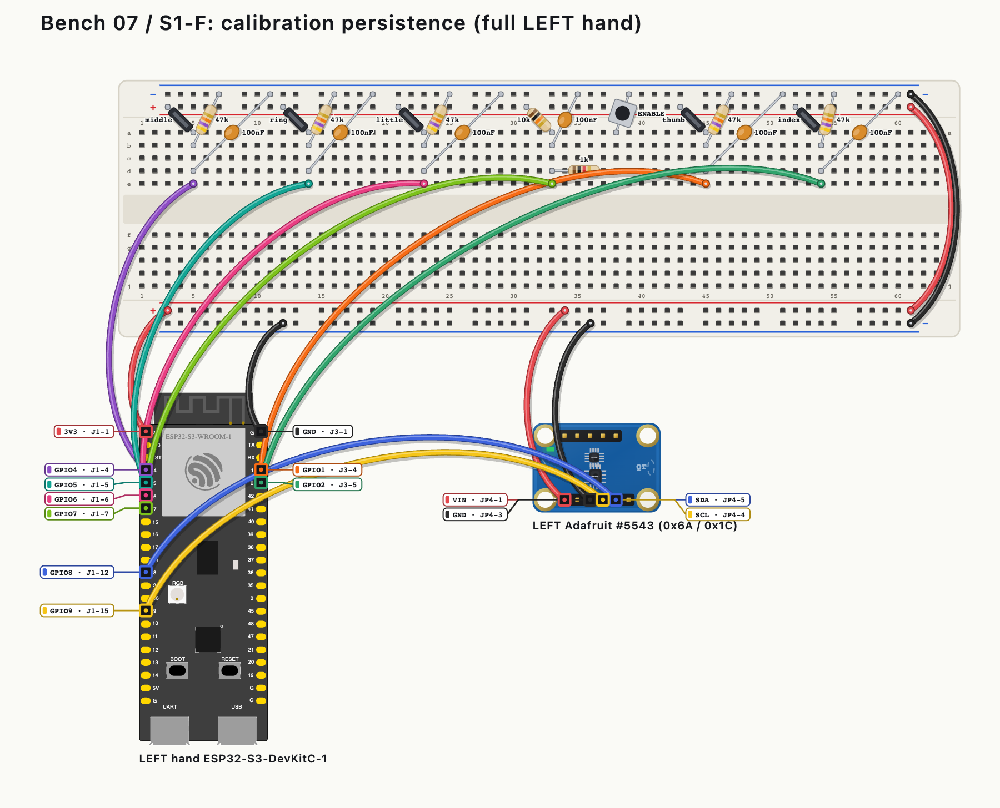

# Bench 07: calibration persistence (full LEFT hand)

**Mirrors:** S1-F (`s1f_persistence.py`): save, reset, load, erase, CRC rejection, restore across a
reboot. **Test plan:** B2 (save and reboot), run here on the finished LEFT hand.
**Board:** LEFT. **Before:** bench 06 passed.

## Wiring

[SVG](wiring.svg) · [wiring.json](wiring.json) (open it in pinplanner with `node cli/pinplanner.ts link <path>`)

### Parts and jumpers added in this stage

| # | part | from | to | what it does |
|---|---|---|---|---|

No wiring change from bench 05.

## Firmware

Same image as the previous stage; reflash only if the firmware changed (compare the app ELF sha256).

## Steps

`storage` replies carry `status`: 0 ok, 1 unavailable, 2 missing, 3 size, 4 version, 5 side, 6 CRC,
7 write. Saving and erasing are refused while `permitted` (a flash write stalls the scheduler), so
**release ENABLE first**.

1. Calibrate (bench 04, steps 2-5). `cal save`: `status` 0.
2. `cal reset`: `profile` `valid` 0. `cal load`: `status` 0, `calibrated` 1, and `profile` shows the
   same ends and neutral as before the save.
3. `cal erase`: `status` 0. `cal load`: `status` 2 (missing).
4. Recalibrate, `cal save`, then `cal corrupt` (flips the stored CRC). `cal load`: `status` 6, and the
   corrupted profile is not adopted.
5. Recalibrate, `cal save`, then `reboot`: the next `boot` has `reset_reason` 3 (software reset), and
   the hand comes up calibrated without recapturing.
6. **Physical only:** unplug USB, wait, plug back: calibrated at boot again (`reset_reason` 1, power-on).
7. **Interrupted write (optional):** pull USB during `cal save`. On the next boot the profile
   must either load whole or be rejected (CRC); never a half-written profile used as valid. Recover
   with `cal erase` and a fresh calibration.

## Not established here

Flash wear and write timing under the control loop.
