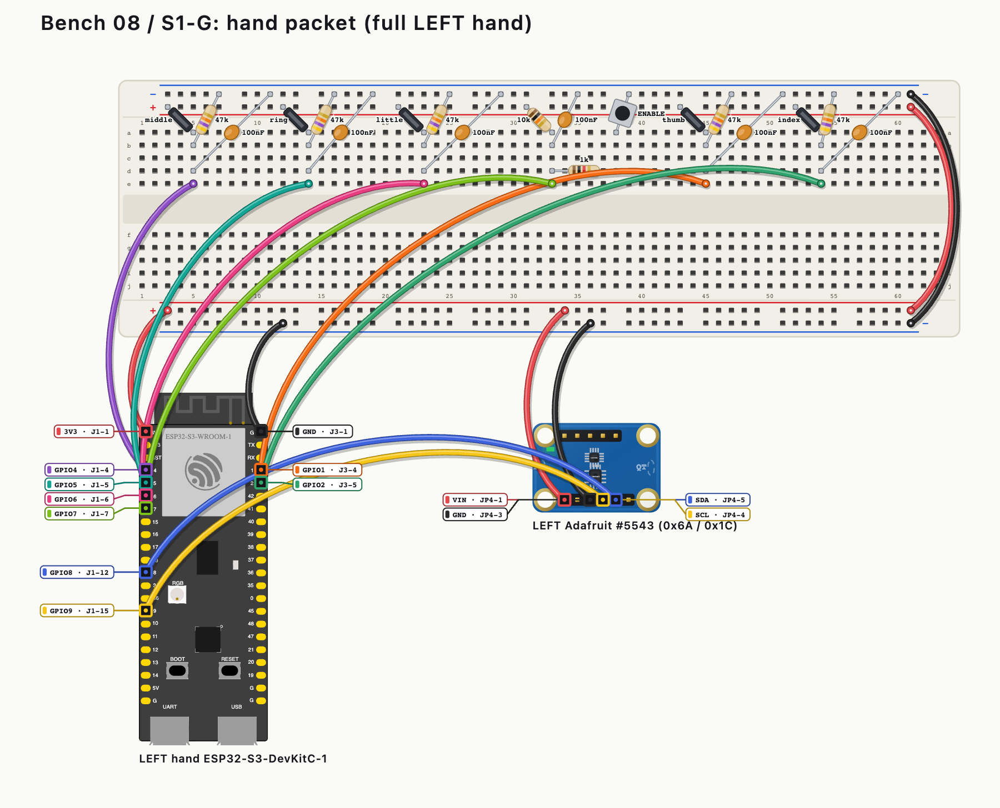

# Bench 08: the hand packet (full LEFT hand)

Mirrors: S1-G (`s1g_packet.py`): size, independent decode, corruption rejected, session and
sequence, side, flags, bounds, and packets that keep flowing while sampling is stopped.
Test plan: groundwork for B5 (payload only). Board: LEFT. Before: bench 07 passed.

## Wiring



[SVG](wiring.svg) · [wiring.json](wiring.json) (open it in pinplanner with `node cli/pinplanner.ts link <path>`)

### Parts and jumpers added in this stage

| # | part | from | to | what it does |
|---|---|---|---|---|

No wiring change from bench 05.

## Firmware

Same image as the previous stage; reflash only if the firmware changed (compare the app ELF sha256).

## Steps

`packet` prints the 59-byte packet as hex. Decode it with the independent decoder S1-G uses:

```sh
python3 firmware/tests/packet_decode.py <hex>
```

1. Uncalibrated (`cal reset`): `flag_names` has `usb_power` but not `calibrated` or `valid`; `side` 0.
2. Calibrated: `calibrated` and `motion_ok` set. Fingers straight: every `curl` 0.
3. Change one hex digit of a captured packet and decode it: `REJECTED: CRC mismatch`. Drop the last two
   digits: rejected on length.
4. `packet` twice about 1 s apart: `session` the same, `sequence` up by about 50 (one per 20 ms update).
   `reboot`: a new `session`.
5. Release then press ENABLE: `valid` and `enable` set. Release: `valid` clears.
6. Full tilt and full fist: `roll` and `pitch` stay within +-1000 and `throttle` within 0..1000.
7. Stop sampling for 0.5 s and read two packets inside it. Typing is too slow, so script it:

   ```sh
   "$IDF_PYTHON_ENV_PATH/bin/python" firmware/tools/bench.py $PORT --send "stall 50" --send packet --send packet --for 2
   ```

   Between the two packets `sequence` still advances, `acquisition` and `timestamp` do not, and `fault`
   is 3. A `packet` after the stall shows `acquisition` moving again. (Keep stalls under the 1 s
   watchdog here; bench 09 trips it on purpose.)

## Not established here

The BLE transport itself (MTU, rate, bonding, reconnect): bench 11.
