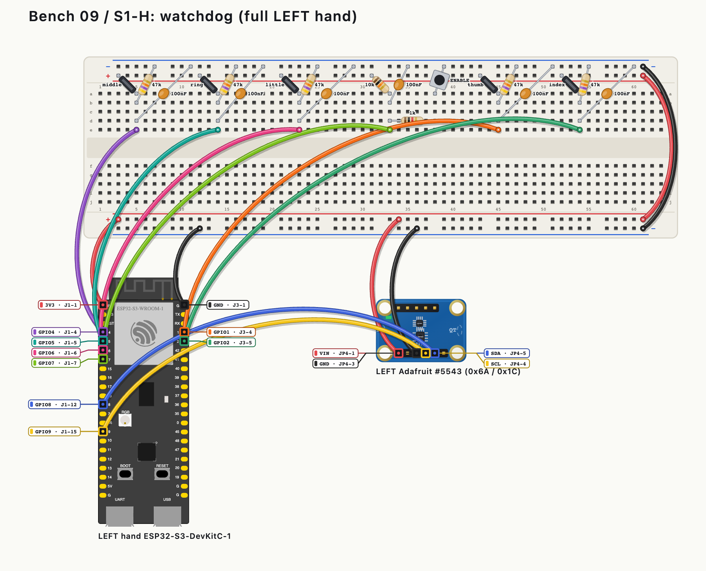

# Bench 09: the task watchdog (full LEFT hand)

Mirrors: S1-H (`s1h_watchdog.py`): the watchdog is fed only by real work, not fed while sampling
is stalled, and its timeout fires. Test plan: the B2 watchdog item; FW-06.
Board: LEFT. Before: bench 08 passed.

## Wiring



[SVG](wiring.svg) · [wiring.json](wiring.json) (open it in pinplanner with `node cli/pinplanner.ts link <path>`)

### Parts and jumpers added in this stage

| # | part | from | to | what it does |
|---|---|---|---|---|

No wiring change from bench 05.

## Firmware

Same image as the previous stage; reflash only if the firmware changed (compare the app ELF sha256). The bench build sets `trigger_panic` false, so a timeout is reported instead of resetting
the chip.

## Steps

1. `stats`: `watchdog` 1, `watchdog_trips` 0. Twice, 1 s apart: `watchdog_feeds` advances while healthy.
2. Stall for 0.5 s (under the 1 s timeout) and read `stats` inside it:

   ```sh
   "$IDF_PYTHON_ENV_PATH/bin/python" firmware/tools/bench.py $PORT --send stats --send "stall 50" --send stats --send stats --for 2
   ```

   During the stall `watchdog_feeds` stops although the console still answers; no trip; the command
   goes invalid. Afterwards feeds resume.
3. `stall 200` (2 s): `watchdog_trips` becomes 1 and ESP-IDF prints its task watchdog message; the
   firmware stays alive and feeding resumes.

## Open: physical only

The production behaviour, a panic and reset on timeout, needs a build with `trigger_panic` true.
This firmware has no option for that yet, so that check is BLOCKED until one exists. With it, the
next `boot` would show the task watchdog `reset_reason`.
