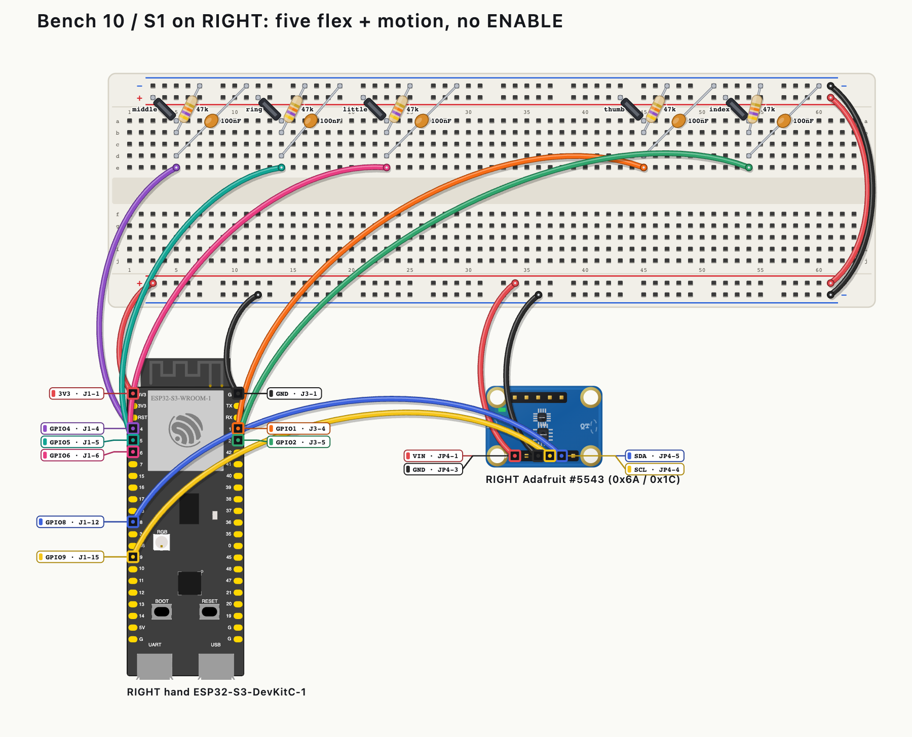

# Bench 10: the RIGHT hand

Mirrors: S1-A, S1-B, S1-D to S1-H on the RIGHT build. Test plan: B4.
Board: RIGHT, a second DevKit. Before: benches 01-09 passed on LEFT. A LEFT result does not pass
the RIGHT board.

## Wiring



[SVG](wiring.svg) · [wiring.json](wiring.json) (open it in pinplanner with `node cli/pinplanner.ts link <path>`)

### Parts and jumpers

| # | part | from | to | what it does |
|---|---|---|---|---|
| 1 | jumper, red | DevKit 3V3 (J1-1) | bottom + rail, by column 3 | RIGHT 3V3 -> bottom + rail |
| 2 | jumper, black | DevKit GND (J3-1) | bottom - rail, by column 12 | RIGHT GND -> bottom - rail |
| 3 | jumper, red | bottom + rail, by column 61 | top + rail, by column 61 | bottom + rail -> top + rail |
| 4 | jumper, black | bottom - rail, by column 61 | top - rail, by column 61 | bottom - rail -> top - rail |
| 5 | jumper, red | bottom + rail, by column 34 | #5543 VIN (JP4-1) | RIGHT 3V3 -> IMU VIN |
| 6 | jumper, black | bottom - rail, by column 36 | #5543 GND (JP4-3) | RIGHT GND -> IMU GND |
| 7 | jumper, blue | DevKit GPIO8 (J1-12) | #5543 SDA (JP4-5) | I2C SDA <-> GPIO8 (breakout pull-ups) |
| 8 | jumper, yellow | DevKit GPIO9 (J1-15) | #5543 SCL (JP4-4) | I2C SCL GPIO9 -> IMU (100 kHz) |
| 9 | flex sensor (middle) | top + rail, by column 3 | hole 5a | RIGHT 3V3 -> middle flex -> node |
| 10 | 47k resistor | hole 5b | top - rail, by column 7 | middle node -> 47k -> GND |
| 11 | 100nF capacitor | hole 5d | top - rail, by column 11 | middle node -> 100nF -> GND |
| 12 | jumper, purple | hole 5e | DevKit GPIO4 (J1-4) | middle node -> GPIO4 (ADC1_CH3) |
| 13 | flex sensor (ring) | top + rail, by column 12 | hole 14a | RIGHT 3V3 -> ring flex -> node |
| 14 | 47k resistor | hole 14b | top - rail, by column 16 | ring node -> 47k -> GND |
| 15 | 100nF capacitor | hole 14d | top - rail, by column 19 | ring node -> 100nF -> GND |
| 16 | jumper, teal | hole 14e | DevKit GPIO5 (J1-5) | ring node -> GPIO5 (ADC1_CH4) |
| 17 | flex sensor (little) | top + rail, by column 21 | hole 23a | RIGHT 3V3 -> little flex -> node |
| 18 | 47k resistor | hole 23b | top - rail, by column 25 | little node -> 47k -> GND |
| 19 | 100nF capacitor | hole 23d | top - rail, by column 29 | little node -> 100nF -> GND |
| 20 | jumper, pink | hole 23e | DevKit GPIO6 (J1-6) | little node -> GPIO6 (ADC1_CH5) |
| 21 | flex sensor (thumb) | top + rail, by column 43 | hole 45a | RIGHT 3V3 -> thumb flex -> node |
| 22 | 47k resistor | hole 45b | top - rail, by column 47 | thumb node -> 47k -> GND |
| 23 | 100nF capacitor | hole 45d | top - rail, by column 51 | thumb node -> 100nF -> GND |
| 24 | jumper, orange | hole 45e | DevKit GPIO1 (J3-4) | thumb node -> GPIO1 (ADC1_CH0) |
| 25 | flex sensor (index) | top + rail, by column 52 | hole 54a | RIGHT 3V3 -> index flex -> node |
| 26 | 47k resistor | hole 54b | top - rail, by column 55 | index node -> 47k -> GND |
| 27 | 100nF capacitor | hole 54d | top - rail, by column 60 | index node -> 100nF -> GND |
| 28 | jumper, green | hole 54e | DevKit GPIO2 (J3-5) | index node -> GPIO2 (ADC1_CH1) |

The same wiring as the LEFT hand without the ENABLE circuit; GPIO7 stays unconnected. Build it in the
same order: thumb, the other four fingers, then the breakout, checking each as on LEFT.

## Firmware

```sh
python3 firmware/tools/palmpilot.py build hand:right
python3 firmware/tools/palmpilot.py pack  hand:right     # prints the app ELF sha256: record it
. firmware/tools/env.sh
"$IDF_PYTHON_ENV_PATH/bin/python" -m esptool --chip esp32s3 -p $PORT -b 460800 \
    write_flash 0x0 tmp/palmpilot/hand-right/flash.bin
```

## Steps

1. `ready`: `"side":1,"name":"RIGHT"`. `info` as on LEFT.
2. Repeat on RIGHT: bench 01 (steps 1-10), bench 02, bench 03, bench 04, bench 06 steps 1-4 and 7-9,
   bench 07, bench 08 (expect `side` 1), bench 09.
3. Skip what needs ENABLE: bench 05 and the ENABLE parts of benches 06 and 08. RIGHT has no button;
   its state goes to `waiting` when healthy and calibrated, which is what the hub needs from it.
4. `cal save` a good calibration on RIGHT; bench 11 runs it without a console.

## Record

As for LEFT, with this board's identity. Keep LEFT and RIGHT records separate.
