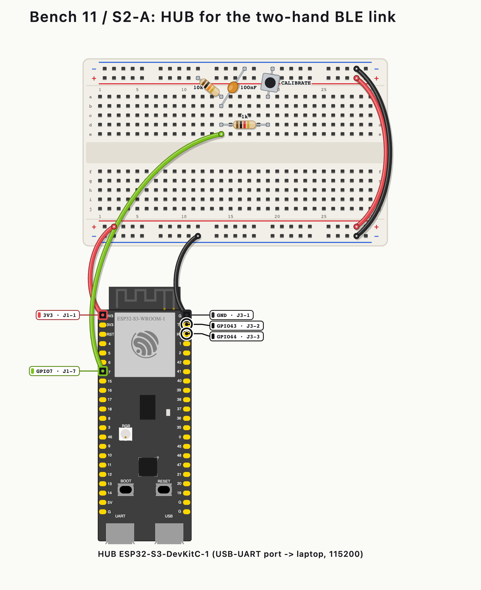

# Bench 11: both hands linked to the hub (S2-A)

Mirrors: S2-A (`s2a_link.py`): both hands linked, MTU, packet rate, nothing rejected, distinct
sessions. Test plan: B5. Before: benches 01-10 passed.

## Wiring



[SVG](wiring.svg) · [wiring.json](wiring.json) (open it in pinplanner with `node cli/pinplanner.ts link <path>`)

### Parts and jumpers

| # | part | from | to | what it does |
|---|---|---|---|---|
| 1 | jumper, red | DevKit 3V3 (J1-1) | bottom + rail, by columns 2-3 | HUB 3V3 -> bottom + rail |
| 2 | jumper, black | DevKit GND (J3-1) | bottom - rail, by columns 11-12 | HUB GND -> bottom - rail |
| 3 | jumper, red | bottom + rail, by columns 28-29 | top + rail, by columns 28-29 | bottom + rail -> top + rail |
| 4 | jumper, black | bottom - rail, by columns 28-29 | top - rail, by columns 28-29 | bottom - rail -> top - rail |
| 5 | 10k resistor | top + rail, by columns 11-12 | hole 14a | HUB 3V3 -> 10k -> CALIBRATE node (pull-up) |
| 6 | 100nF capacitor | hole 14b | top - rail, by columns 16-17 | CALIBRATE node -> 100nF -> GND (debounce) |
| 7 | 1k resistor | hole 14d | hole 19d | CALIBRATE node -> 1k -> switch |
| 8 | push button (CALIBRATE) | hole 19a | top - rail, by columns 19-20 | normally-open CALIBRATE switch -> GND |
| 9 | jumper, lime | hole 14e | DevKit GPIO7 (J1-7) | CALIBRATE node -> GPIO7, active low |

Bench 11 and 12 use all three boards:

| board | wiring | firmware |
|---|---|---|
| LEFT | [bench 05](../05-s1c-enable-control/wiring.png) (finished LEFT hand) | `hand:left` |
| RIGHT | [bench 10](../10-right-hand/wiring.png) | `hand:right` |
| HUB | this page | `hub` |

No wire runs between boards; they talk over BLE only. Run each hand from its own USB supply (a phone
charger or power bank) where possible, so no ground is shared through a laptop. Both hands need a saved
calibration (bench 07) so they come up calibrated without a console.

## Firmware

HUB:

```sh
python3 firmware/tools/palmpilot.py build hub
python3 firmware/tools/palmpilot.py pack  hub     # prints the app ELF sha256: record it
. firmware/tools/env.sh
"$IDF_PYTHON_ENV_PATH/bin/python" -m esptool --chip esp32s3 -p $PORT -b 460800 \
    write_flash 0x0 tmp/palmpilot/hub/flash.bin
```

## Steps

Limits from S2-A (PROVISIONAL): both linked within 5 s; MTU at least 62; at least 45 accepted packets
per second per hand; zero rejected.

1. Hub console. Power both hands. `status` until both `hands` show `connected` 1 and `ready` 1; note the
   time from power-on.
2. `mtu` at least 62 on both.
3. `status`, wait 1 s, `status`: each hand's `accepted` grows by at least 45. Every `rejected` counter
   (`unlinked`, `format`, `side`, `replay`) stays 0.
4. The two `session` values differ. On each hand's console (if attached), `link` shows `connected` 1
   and `subscribed` 1.
5. The hub prints `command` lines at 50 per second. With both hands ready and ENABLE not pressed, the
   reason is `not_enabled`.
6. Loss: unplug RIGHT: within about 100 ms the reason becomes `right_stale` or
   `right_missing`. Plug back: it links again by itself. Repeat for LEFT. Summarise with
   `bench_summary.py` to read the times.
7. Repeat bench 02 step 5 (noise) on a hand while it is linked; this is the BLE-load part of the coupling check.

## Not established here

RF range, interference and coexistence: the simulation's radio is lossless and this bench is short
range. Bonding and unknown-peer rejection need a peer this firmware does not have yet.
