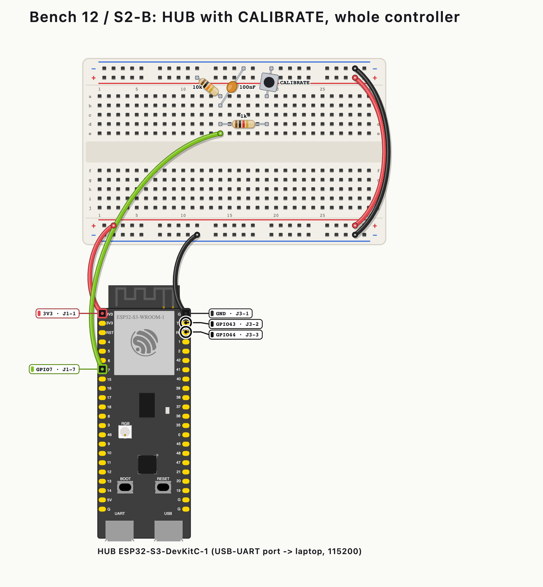

# Bench 12: the whole controller (S2-B)

**Mirrors:** S2-B (`s2b_controller.py`): mapping, slew, HOLD, PRECISION, deadman, faults, the latch,
a hand reboot, hub CALIBRATE. **Test plan:** B5.
**Before:** bench 11 passed.

## Wiring

[SVG](wiring.svg) · [wiring.json](wiring.json) (open it in pinplanner with `node cli/pinplanner.ts link <path>`)

### Parts and jumpers

| # | part | from | to | what it does |
|---|---|---|---|---|
| 1 | jumper, red | DevKit 3V3 (J1-1) | bottom + rail, by columns 2-3 | HUB 3V3 -> bottom + rail |
| 2 | jumper, black | DevKit GND (J3-1) | bottom - rail, by columns 11-12 | HUB GND -> bottom - rail |
| 3 | jumper, red | bottom + rail, by columns 28-29 | top + rail, by columns 28-29 | bottom + rail -> top + rail |
| 4 | jumper, black | bottom - rail, by columns 28-29 | top - rail, by columns 28-29 | bottom - rail -> top - rail |
| 5 | 10k resistor | top + rail, by columns 11-12 | hole 14a | HUB 3V3 -> 10k -> CALIBRATE node (pull-up) |
| 6 | 100nF capacitor | hole 14b | top - rail, by columns 16-17 | CALIBRATE node -> 100nF -> GND (debounce) |
| 7 | 1k resistor | hole 14d | hole 19d | CALIBRATE node -> 1k -> switch |
| 8 | push button (CALIBRATE) | hole 19a | top - rail, by columns 19-20 | normally-open CALIBRATE switch -> GND |
| 9 | jumper, lime | hole 14e | DevKit GPIO7 (J1-7) | CALIBRATE node -> GPIO7, active low |

Bench 11 and 12 use all three boards:

| board | wiring | firmware |
|---|---|---|
| LEFT | [bench 05](../05-s1c-enable-control/wiring.png) (finished LEFT hand) | `hand:left` |
| RIGHT | [bench 10](../10-right-hand/wiring.png) | `hand:right` |
| HUB | this page | `hub` |

No wire runs between boards; they talk over BLE only. Run each hand from its own USB supply (a phone
charger or power bank) where possible, so no ground is shared through a laptop. Both hands need a saved
calibration (bench 07) so they come up calibrated without a console.

## Firmware

As bench 11.

## Steps

The hub's `command` line is the controller's output: `valid`, `reason`, `roll`, `pitch`, `yaw`,
`throttle`, `hold`, `precision`. Log everything with `bench.py` on the hub and read times with
`bench_summary.py`, which uses the hub's own clock (`t_us`). Limits from S2-B (PROVISIONAL): a valid
command within 0.2 s of a deliberate press; no step over 80 (attitude) or 30 (throttle) between
consecutive commands; fault to invalid within 150 ms; after any loss of validity, invalid until ENABLE
is released and pressed again.

1. Both hands open and level. Release, then press ENABLE: `valid` 1 within 0.2 s.
2. **Mapping:** tilt RIGHT: `roll`; tilt RIGHT forward/back: `pitch`; tilt LEFT sideways: `yaw`;
   curl LEFT's four fingers: `throttle`. Record the signs. Each settles at the value the hand reports.
3. **Slew:** snap from level to full tilt; `bench_summary.py` shows no step above 80 (30 on throttle).
4. **PRECISION:** curl the LEFT thumb: `precision` 1 and the axes halve. **HOLD:** RIGHT fist: `hold` 1.
5. **Deadman:** release ENABLE: `valid` 0 (`not_enabled`). Press again: valid.
6. **Fault:** pull a RIGHT flex lead: invalid within 150 ms (`right_not_ready`). Put it back while
   holding ENABLE: still invalid (`await_release`). Release and press: valid.
7. **Frozen sampling:** on the RIGHT console, `stall 40`: reason `right_frozen` while packets keep
   arriving. Recover by release and press.
8. **Hand reboot:** press RESET on RIGHT: invalid at once, and still invalid after it relinks until
   ENABLE is released and pressed.
9. **Hub CALIBRATE:** release ENABLE, hold both hands level, press and hold CALIBRATE: a
   `calibrate` line reports both hands, and `reason` is `calibrating` while held. Release, then press
   ENABLE: the new neutral reads level.

## Not established here

Human-hand comfort, real RF loss and interference, and anything on the host side (bench 13).
