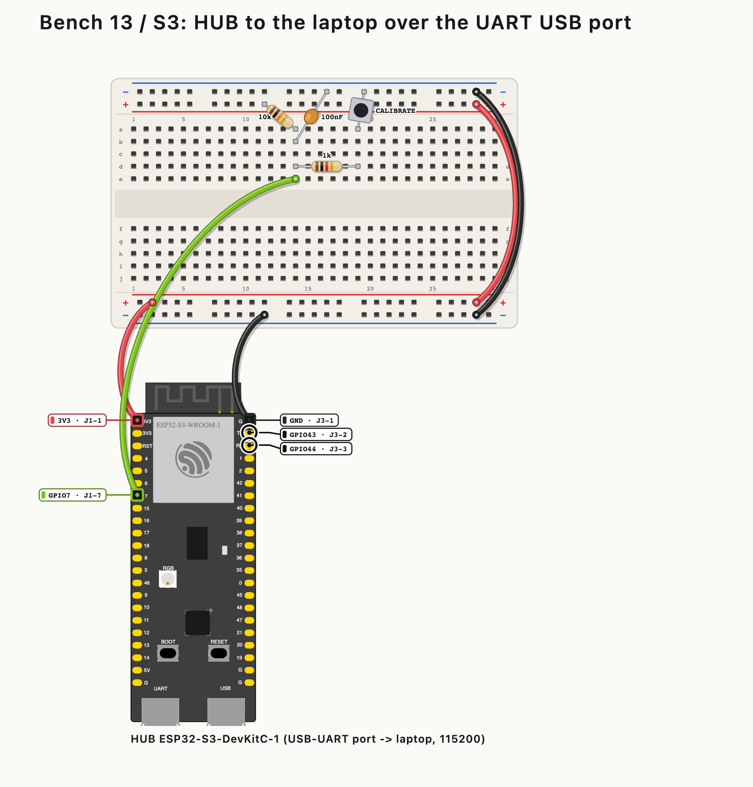

# Bench 13: hub to the laptop (S3)

**Mirrors:** S3-A and S3-B (`s3a_drone.py`, `s3b_replay.py`) at the boundary they share: the hub's
command stream on UART0. **Test plan:** B6.
**Before:** bench 12 passed.

## Wiring

[SVG](wiring.svg) · [wiring.json](wiring.json) (open it in pinplanner with `node cli/pinplanner.ts link <path>`)

### Parts and jumpers

| # | part | from | to | what it does |
|---|---|---|---|---|
| 1 | jumper, red | DevKit 3V3 (J1-1) | bottom + rail, by columns 2-3 | HUB 3V3 -> bottom + rail |
| 2 | jumper, black | DevKit GND (J3-1) | bottom - rail, by columns 11-12 | HUB GND -> bottom - rail |
| 3 | jumper, red | bottom + rail, by columns 28-29 | top + rail, by columns 28-29 | bottom + rail -> top + rail |
| 4 | jumper, black | bottom - rail, by columns 28-29 | top - rail, by columns 28-29 | bottom - rail -> top - rail |
| 5 | 10k resistor | top + rail, by columns 11-12 | hole 14a | HUB 3V3 -> 10k -> CALIBRATE node (pull-up) |
| 6 | 100nF capacitor | hole 14b | top - rail, by columns 16-17 | CALIBRATE node -> 100nF -> GND (debounce) |
| 7 | 1k resistor | hole 14d | hole 19d | CALIBRATE node -> 1k -> switch |
| 8 | push button (CALIBRATE) | hole 19a | top - rail, by columns 19-20 | normally-open CALIBRATE switch -> GND |
| 9 | jumper, lime | hole 14e | DevKit GPIO7 (J1-7) | CALIBRATE node -> GPIO7, active low |

The hub's UART USB port is the link to the laptop: the on-board USB-to-UART bridge on UART0 at
115200 baud. Nothing else is wired; GPIO43/44 are ringed because the bridge uses them.

## Firmware

As bench 11.

## Steps that can run today

1. Log the hub with `bench.py` for at least 60 s with valid commands flowing. `bench_summary.py`:
   50 commands per second on the hub clock and no sequence gaps.
2. Every line is one JSON object; `valid` is 0 whenever `reason` is not `ok`.
3. Unplug the hub's USB, plug it back: the stream resumes with a new `boot`; the first commands are
   invalid until ENABLE is released and pressed.

## Blocked

In simulation, S3 decodes these lines with the computer bridge (`simulation/drone/rc_link.py`) and
drives ArduCopter. That bridge only talks to the simulator today: there is no host program that reads
a physical hub's serial port, applies the receiver-side expiry and feeds ArduCopter. The laptop-side checks need that independent host decoder
(see docs/demo.md); until it exists, this bench stops at the checks above,
and S3 on hardware is BLOCKED.
