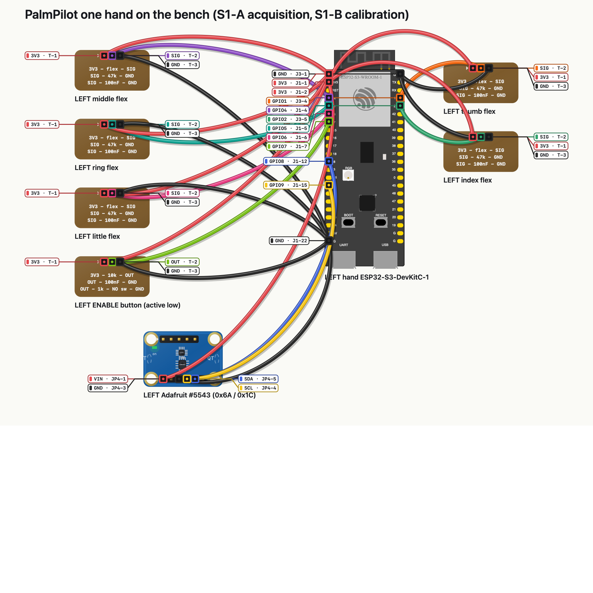

# Controller wiring

Wiring diagrams for the PalmPilot controller, drawn with
[pinplanner](https://github.com/simantic-dev/pinplanner). The pin assignments are
the frozen map in CLAUDE.md section 2 and [build-guide.md](../build-guide.md). The
header positions match the build guide's table. Nothing here has been checked on
hardware.

## One hand on the bench: S1-A and S1-B

`one-hand-s1.wiring.json` ([SVG](one-hand-s1.svg)) is the LEFT hand on an
ESP32-S3-DevKitC-1:
- the five flex channels (S1-A acquisition);
- the Adafruit #5543 motion breakout, whose resting orientation S1-B captures;
- the ENABLE button.

The RIGHT hand is the same without the button. The two-hand and hub wiring comes
after S1.

pinplanner has no resistors or capacitors, so each brown block stands for one
small circuit from the build guide, with three connections: 3V3, the signal and GND.
- **Flex block:** 3V3 to the flex sensor to the signal node, then 47 kOhm and
  100 nF in parallel from the node to GND.
- **Button block:** 10 kOhm from 3V3 to the signal, 100 nF from the signal to GND,
  and 1 kOhm plus a normally-open switch from the signal to GND.

The blocks show which DevKit pins each circuit uses, not where its parts sit.

Leave unconnected: GPIO10 (battery sense, reserved), the breakout's 3Vo and
interrupt pins, GPIO19/20, GPIO43/44, and GPIO0/3/45/46. Power the hand from its
own USB. Never join supplies across boards.

### Jumper table

| # | wire | header pins | colour | tests |
|---|---|---|---|---|
| 1 | thumb:SIG -> esp:GPIO1 | thumb:T-2 -> esp:J3-4 | orange | thumb flex -> GPIO1 (ADC1_CH0) |
| 2 | esp:3V3 -> thumb:3V3 | esp:J1-2 -> thumb:T-1 | red | LEFT 3V3 -> thumb flex |
| 3 | esp:GND -> thumb:GND | esp:J3-1 -> thumb:T-3 | black | thumb 47k + 100nF -> LEFT GND |
| 4 | index:SIG -> esp:GPIO2 | index:T-2 -> esp:J3-5 | green | index flex -> GPIO2 (ADC1_CH1) |
| 5 | esp:3V3 -> index:3V3 | esp:J1-2 -> index:T-1 | red | LEFT 3V3 -> index flex |
| 6 | esp:GND -> index:GND | esp:J3-1 -> index:T-3 | black | index 47k + 100nF -> LEFT GND |
| 7 | middle:SIG -> esp:GPIO4 | middle:T-2 -> esp:J1-4 | purple | middle flex -> GPIO4 (ADC1_CH3) |
| 8 | esp:3V3 -> middle:3V3 | esp:J1-1 -> middle:T-1 | red | LEFT 3V3 -> middle flex |
| 9 | esp:GND -> middle:GND | esp:J1-22 -> middle:T-3 | black | middle 47k + 100nF -> LEFT GND |
| 10 | ring:SIG -> esp:GPIO5 | ring:T-2 -> esp:J1-5 | teal | ring flex -> GPIO5 (ADC1_CH4) |
| 11 | esp:3V3 -> ring:3V3 | esp:J1-1 -> ring:T-1 | red | LEFT 3V3 -> ring flex |
| 12 | esp:GND -> ring:GND | esp:J1-22 -> ring:T-3 | black | ring 47k + 100nF -> LEFT GND |
| 13 | little:SIG -> esp:GPIO6 | little:T-2 -> esp:J1-6 | pink | little flex -> GPIO6 (ADC1_CH5) |
| 14 | esp:3V3 -> little:3V3 | esp:J1-1 -> little:T-1 | red | LEFT 3V3 -> little flex |
| 15 | esp:GND -> little:GND | esp:J1-22 -> little:T-3 | black | little 47k + 100nF -> LEFT GND |
| 16 | esp:3V3 -> imu:VIN | esp:J1-2 -> imu:JP4-1 | red | LEFT 3V3 -> IMU VIN |
| 17 | esp:GND -> imu:GND | esp:J1-22 -> imu:JP4-3 | black | LEFT GND -> IMU GND |
| 18 | esp:GPIO8 <-> imu:SDA | esp:J1-12 <-> imu:JP4-5 | blue | I2C SDA <-> GPIO8 (breakout pull-ups) |
| 19 | esp:GPIO9 -> imu:SCL | esp:J1-15 -> imu:JP4-4 | yellow | I2C SCL GPIO9 -> IMU (100 kHz) |
| 20 | button:OUT -> esp:GPIO7 | button:T-2 -> esp:J1-7 | lime | ENABLE -> GPIO7, active low (10k pull-up) |
| 21 | esp:3V3 -> button:3V3 | esp:J1-1 -> button:T-1 | red | LEFT 3V3 -> 10k pull-up |
| 22 | esp:GND -> button:GND | esp:J1-22 -> button:T-3 | black | 100nF + switch -> LEFT GND |

Wires 2 and 5 and 16 share esp:J1-2.
Wires 3 and 6 share esp:J3-1.
Wires 8 and 11 and 14 and 21 share esp:J1-1.
Wires 9 and 12 and 15 and 17 and 22 share esp:J1-22.

## Re-rendering

The three blocks and the breakout are defined on pinplanner branch
`agent/palmpilot-controller` (`tools/gen_misc.py`): `flex-divider-47k`,
`button-active-low-rc` and `adafruit-5543`. The breakout's pin order comes from
Adafruit's board file. With that branch checked out:

    node cli/pinplanner.ts check <this folder>/one-hand-s1.wiring.json
    node cli/pinplanner.ts svg   <this folder>/one-hand-s1.wiring.json -o <this folder>/one-hand-s1.svg

The PNG is the SVG rendered by macOS Quick Look:
`qlmanage -t -s 1800 -o . one-hand-s1.svg`.
