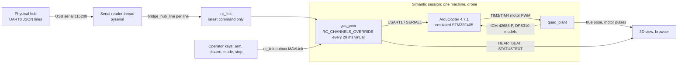

# Laptop demo: physical controller, simulated drone

**Status: PLAN.** It describes how to bring up a live demonstration and what is
still missing. Nothing in it is a test result except where a result is cited.
It marks no milestone complete. The steps are Part C of the
[test plan](test-plan.md#part-c--physical-controller-simulated-drone). Every hardware row is **not tested
physically**.

The demonstration: an operator wears the two physical hand controllers, the
physical hub is plugged into a laptop, and the laptop shows a simulated drone
flying. The drone is ArduCopter 4.7.1 on an emulated flight controller in
Simantic, closed through `quad_plant`. The flight controller is the Matek F405-Wing
(STM32F405), chosen because it simulates about 3× faster than the Pixhawk 6X
(`PALMPILOT_DRONE=h7` still selects that). No physical drone is in scope
([CLAUDE.md §1](../CLAUDE.md)).

The hard rule from the project scope applies throughout. The screen shows the
state of the mechanical model. That model is driven only by the motor pulses
ArduCopter writes to the emulated F405's timers. Nothing on screen moves
directly from a gesture.

## 1. What already works, and what this plan relies on

| Link in the chain | Evidence status | Where |
|---|---|---|
| Two hands → BLE → hub → command line on UART0 | PASS in simulation (S2-A, S2-B; the #270 radio fix shipped in engine 0.6.6). **Not tested physically** | `firmware/tests/s2*.py` |
| Hub line → RC channels → MAVLink `RC_CHANNELS_OVERRIDE` on ArduCopter SERIAL1 | PASS in simulation (S3-A 18/18, S3-B 38/38); ArduCopter reports the channels back within ±5 µs | `simulation/drone/rc_link.py`, `gcs_peer.py`, `firmware/tests/s3a_drone.py`, `s3b_replay.py` |
| Motor PWM from the F405 timers → airframe → IMU/baro back into ArduCopter | PASS in simulation; `shake.py` decoded pulses match `SERVO_OUTPUT_RAW` within 1 µs | `quad_plant.py`, `imu_plant.py`, `baro_plant.py` |
| Gesture flight in AltHold: climb, hold, roll, pitch, yaw, descend, land | Observed in simulation with the real hand and hub firmware (`fly.py`). The ArduPilot SITL cross-check on the same airframe matches within about 0.4° and 0.05 m/s once the RC range is calibrated | `firmware/probes/drone-flight/fly.py`, `simulation/drone/sitl_reference.py` |
| Attitude estimate after a manoeuvre | **Open issue.** The emulated flight controller's estimate drifts 1–2.5° from truth, so the vehicle stays slightly tilted and keeps drifting. Native SITL does not | commit `c036681` |
| Real hub on a real serial port → simulated ArduCopter | **Does not exist yet.** The bridge runs only inside the simulation | §3 |
| Screen view of the drone | **Does not exist yet** | §4 |

Two configuration facts from the simulation work are needed for every run:

- ArduCopter's default RC1–4 range is 1100–1900 µs; the bridge sends
  1000–2000 µs. Without calibration, or `RC1..4_MIN=1000`, `RC1..4_MAX=2000`,
  stick inputs are inflated by about 25%.
- `FLTMODE_CH=0`. The bridge holds ch5 at 1500 µs, which would otherwise force
  a flight mode.

Arming is a deliberate host action. ENABLE grants gesture permission only; it
never arms ([CLAUDE.md §5](../CLAUDE.md)).

## 2. Physical setup

```text
  LEFT hand (worn)                RIGHT hand (worn)
  ESP32-S3 DevKit                 ESP32-S3 DevKit
  5 flex  GPIO1/2/4/5/6           5 flex  GPIO1/2/4/5/6
  #5543 IMU  SDA 8 / SCL 9        #5543 IMU  SDA 8 / SCL 9
  ENABLE  GPIO7 (active low)
  USB power (own cable)           USB power (own cable)
          \                          /
           \---------- BLE ---------/
                       |
                 HUB  ESP32-S3 DevKit
                 CALIBRATE GPIO7 (active low)
                       | USB, UART0 port, 115200 baud, JSON lines
                    LAPTOP
```

- **Pins and circuits:** use the frozen pin map in [CLAUDE.md §2](../CLAUDE.md)
  and the [wiring guide](wiring/README.md), which has the per-board drawings.
- **Hub to laptop:** use the board's USB connector wired to the USB-to-UART
  bridge (UART0, GPIO43/44), not the native USB port (GPIO19/20). The hub
  prints its commands on UART0. The macOS device name depends on the bridge
  chip (for example `/dev/cu.usbserial-*`, `/dev/cu.wchusbserial*` or
  `/dev/cu.usbmodem*`). Use the `cu.` device, not `tty.`. Confirm the
  connector on the received board at C0.
- **Hand power:** the [wiring guide](wiring/README.md) keeps every board on USB power until a
  wearable power circuit is designed and reviewed. For
  the demo, each hand is powered through **its own** USB cable into its own
  board's USB-to-UART connector, from the laptop or a powered USB hub. The
  cables also give access to each hand's console for calibration.
  - No LiPo, no 5 V to any ADC pin, GPIO10 disconnected. Never wire 3V3 or GND
    between boards.
  - The firmware reports *"USB bench power; battery unavailable"*. It never
    reports a battery value.
  - A USB power bank plugged into each board's USB connector would remove the
    tethers. It is still USB input, but it is **not** the reviewed C3 wearable
    power design, and it has no battery monitoring. Using one is a decision for
    the project owner, not a default in this plan.

## 3. Laptop data path

### What exists

Inside the simulation, `ControllerSim` (`firmware/tools/controller.py`) captures
the simulated hub's UART0. On every line it calls `bridge_hub_line()`, which
passes each `{"type":"command",...}` record to `rc_link.apply_command()`.
`gcs_peer.py` is a `ScriptedUartPeer` connected to ArduCopter's USART1
(SERIAL1). Every 20 ms of virtual time it sends `rc_link.channels` as
`RC_CHANNELS_OVERRIDE`, unless:

- the last command was invalid (`rc_link.failsafe`); or
- more than 5 peer ticks (100 ms virtual) have passed without a command.

That second check is the receiver-local expiry.

### Recommended design: one demo runner process



One Python process (`.venv-simantic`) does the following:

1. Starts a Simantic session with **only the drone machine**. It uses
   `build_drone_platform(plant=True)` and the same `uart` medium between
   `drone.usart1` and `drone.gcs` that `ControllerSim(drone=True)` uses. The
   three ESP32-S3 machines are dropped, so the BLE and RNG candidates are not
   needed. `ControllerSim(hands=False)` and `palmpilot.py drone` already start this
   session; `firmware/probes/drone-flight/demo_speed.py` uses them.
2. Runs a reader thread on the hub's serial port. The thread opens the port
   with DTR and RTS deasserted. On common ESP32 DevKits those lines drive the
   EN/IO0 auto-reset circuit, so opening the port could reset the hub. This is
   unverified on the actual boards. The thread passes each line to the
   unchanged `controller.bridge_hub_line()`. Non-command lines (`boot`,
   `ready`, `status`, ROM output) are already ignored, and a malformed line
   becomes `apply_command(None)`, which means failsafe. About once a second it
   writes `status\n` to the hub and shows the link fields.
3. Advances the simulation in short slices (`run_for(0.02)`). After each slice
   it publishes a snapshot of `quad_plant.PLANT` to the viewer.
4. Does the parameter setup and arming from `fly.py`. It sends `FRAME_CLASS=1`,
   `FRAME_TYPE=1`, `ARMING_SKIPCHK`, `FLTMODE_CH=0` and the RC range above,
   reboots, waits for standby and EKF alignment, and then waits for the
   operator. Parameters are set in every session. The emulated F405's
   parameter storage is not assumed to persist between sessions (not checked).

Why this design rather than a TCP bridge:

- It reuses the path that already passes in simulation: `bridge_hub_line` →
  `rc_link` → `gcs_peer`, including the receiver-local expiry tested in S3-A
  ("overrides stop within 0.2 s of the last hub line").
- `rc_link` keeps only the newest command. When the laptop falls behind, hub
  lines overwrite one another and do not queue, so input latency does not
  build up.
- The viewer reads the plant in the same process, at slice boundaries, with no
  extra transport.

**Alternative, verified to connect: the engine's UART host bridge.** The SDK's
uart medium passes a `hostBridge` value through to the engine. With
`{"type": "uart", "connect": ["drone.usart1"], "hostBridge": "tcp:5770"}` on
engine 0.6.3 / SDK 0.3.1, the engine served USART1 on TCP 5770 (it logged
`[uart] usart1 ↔ tcp:5770`). A separate pymavlink client then received
ArduCopter's HEARTBEAT (quadrotor, standby), STATUSTEXT and RC_CHANNELS. The
RC_CHANNELS echoed the client's overrides exactly (1111/1222/1333/1444 µs).
This was a throwaway feasibility run, not a test.

The bridge would then be an ordinary MAVLink client, and a ground station
could share the link through a router such as MAVProxy. The costs:

- the override rate and the expiry move to wall-clock time, while ArduCopter
  runs in slower virtual time;
- the tested `rc_link`/`gcs_peer` path would be replaced, not reused;
- the plant still has to be read in-process for the 3D view.

The host bridge is a better fit for a ground-station display than for the RC
path. See §4.

### Real-time pacing and what happens when the laptop is slow

- **Speed of the drone-only session.** Measured with `demo_speed.py` on
  2026-11-01: the F405 and `quad_plant` alone, hub command lines fed through
  `bridge_hub_line` every 20 ms of virtual time, the simulation run in 20 ms slices
  as the runner would. Apple M4 (10 cores), load average about 3–4, engine 0.6.6.
  Two runs gave the same figures to within 0.1 s per phase:

  | Phase | Wall s per simulated s |
  |---|---|
  | Boot, parameters, reboot, EKF alignment (22.5 s simulated) | 0.8 (17.9 s wall) |
  | Standby, disarmed | 1.2 |
  | Mode change to AltHold | 2.7–2.8; one 20 ms slice took about 1.5 s |
  | First second after arming | 6.8–7.1 |
  | Armed on the ground | 1.6 |
  | Flight: climb, hover, roll, pitch, yaw, descend | 1.38–1.59, overall **1.47** |

  The pauses at the mode change and at arming are not explained. Earlier
  drone-only runs under a load average of 20–90 took 1.7–2.8 s per simulated
  second in flight, so host load matters. The four-machine run (hands and hub
  simulated) is about 3.7× slower than real time. The demo laptop itself is not
  measured.
- **Pacing.** `Sim.run_for` free-runs. The engine has a `RealTime` session
  setting, which the CLI exposes as `--real-time`, but SDK 0.3.1 does not pass
  it on. The runner can set it on the session spec the same way the harness
  sets `SerialExecution`; that is untested. A simpler option is to sleep
  whenever simulated time gets ahead of wall time. Either way, pacing can only
  slow the simulation down. If the drone session stays slower than real time,
  the drone moves in slow motion. The viewer must then show the real-time
  factor rather than imply live speed.
- **Expiry in slowed time.** The bridge's expiry is 5 virtual ticks (100 ms
  virtual). At the measured 1.47× that is roughly 150 ms of wall
  time after the last hub line. When overrides stop, ArduCopter keeps using the
  last overrides for `RC_OVERRIDE_TIME`. That is 3.0 s by default (checked in
  the ArduPilot 4.7.1 source), so it can be about 4.4 s of wall time before RC
  failsafe. S3-A measured failsafe within 4 s of virtual time, disarmed.
  Lowering `RC_OVERRIDE_TIME` is the obvious mitigation. It is unverified and
  needs a simulated in-flight test with limits set first.
- **RC failsafe action.** The default is `FS_THR_ENABLE=1` (RTL). Without a
  position estimate ArduCopter is expected to land instead. This has **not
  been exercised in flight** in this simulation.
- **Simulator stall.** The reported four-machine stall was a lock-order
  deadlock between ESP32-S3 core threads, fixed by renode-infrastructure #340 (merged upstream, not in engine 0.6.6). The drone-only session
  has no ESP32-S3 machine, so that mechanism does not apply. Long drone-only
  runs have not been soaked. The runner should detect simulated time not
  advancing and mark the view as stalled.

## 4. Visualisation

| Option | Shows | Needs | Hard rule |
|---|---|---|---|
| **(b) 3D view of `quad_plant`** (recommended) | True position, attitude and motor pulses of the simulated airframe; armed state and mode from ArduCopter's HEARTBEAT; hub command validity as a separate status line; simulated time and real-time factor | A small page served from the runner. State from the runner over Server-Sent Events from Python's standard `http.server`, so no new Python dependency. A three.js renderer loaded from a CDN. A local NED frame: grid floor, take-off marker, altitude readout, trail | Complies. The pose is integrated from the motor pulses read from TIM3/TIM4 |
| (a) QGroundControl / Mission Planner | ArduCopter's **own estimate**: attitude indicator, altitude, armed state and mode, messages | Two-way MAVLink to the ground station. Either a UDP 14550 tee in `gcs_peer`, or a second ArduCopter UART on a `hostBridge` TCP port (for example USART3/SERIAL3 with `SERIAL3_PROTOCOL=2`; its DMA request lines are not wired in the board overlay today). No map position: GPS is not modelled, and a simulated GPS is a separate model that would also change the estimator's behaviour | Complies. It shows the flight controller's estimate, which includes the open 1–2.5° drift |
| (c) Both | Truth and estimate side by side | Both of the above | Complies |

**Recommendation: (b) as the demo view.** It renders the same mechanical state
that closes the loop. It needs no GPS, and it can show the simulation's health
and real-time factor, which is required if the simulation runs slower than
real time. Add (a) later as an engineering view if the estimate itself is of
interest. Without GPS a ground station's map has no position to show. A
displayed command, a hand pose or a hub value must never move the drone model.

### What the screen can show, and how late

Every value below exists in the session today; the view that draws them does not.

| Shown | Source | Rate available | Notes |
|---|---|---|---|
| Drone position (north, east, altitude) and velocity | `quad_plant.PLANT.pos`, `.vel` | Every slice; the plant steps at each IMU read | Truth from the physics, NED metres from the take-off point |
| Drone attitude: roll, pitch, yaw | `PLANT.euler_deg()` | Every slice | Truth. Drawn as the 3D model's orientation |
| Four motor pulses (µs) | `PLANT.pulses`, read from the F405 timer compare registers | Every slice | Propeller speed or a bar per motor. This is the evidence that the motion comes from the motors |
| On the ground or airborne | `PLANT.on_ground` | Every slice | |
| Armed, flight mode, system state | ArduCopter HEARTBEAT (`rc_link.heartbeat`) | 1 Hz | Disarmed, AltHold, failsafe |
| ArduCopter's messages | STATUSTEXT (`rc_link.statustext`) | As sent | "EKF3 IMU0 initialised", arming refusals, failsafe |
| ArduCopter's own attitude estimate | ATTITUDE (`rc_link.latest`) | On request (`fly.py` asks for 20 Hz) | Shows the open 1–3° estimate drift next to the truth |
| RC channels ArduCopter received | RC_CHANNELS | 10 Hz | Stick positions as the flight controller sees them |
| Hub command and its validity | the latest hub line (`rc_link.channels`, `rc_link.failsafe`) | 50 Hz | Status line only; it never moves the drone |
| Simulated time, real-time factor, stall | `sim.time()` against wall time | Every slice | Required, so slow motion is never shown as live |

No position estimate, GPS or map is available: GPS is not modelled.

**Delay.** A new hub line reaches ArduCopter at the next 20 ms slice, so input is
never queued. After that, the drone's own response plays out at the simulation's
speed. Measured in `demo_speed.py` (F405 alone, 1.47 s wall per simulated second):

| Stick step | Airframe reaches 90% of its change | On screen |
|---|---|---|
| Roll right (one third of full stick) | 0.44 s simulated, +9.3° | about 0.65 s |
| Pitch forward (one third) | 0.46 s simulated, −9.5° | about 0.68 s |
| Back to level after the roll | 0.38 s simulated | about 0.56 s |
| Throttle up for a climb | 1.78 s simulated to +0.9 m/s | about 2.6 s |

About two thirds of each figure is the flight controller and airframe responding,
as they would on a real drone; the rest is the simulation running 1.47× slow.
Because the simulation falls further behind wall time the longer it runs, the
view must show simulated time and the real-time factor. Not included and not
measured: the physical hands, BLE and hub (packets every 20 ms), USB serial, and
the browser's frame time. The pauses at the mode change and at arming (§3) freeze
the view for up to about 1.5 s and 7 s.

## 5. Operator procedure

### Before the demo

1. Build and flash the same binaries that pass in simulation:
   `hand:left`, `hand:right` and `hub` (`firmware/tools/palmpilot.py build`).
2. Calibrate each hand over its own USB console. Send `cal extended` with the
   hand open, `cal curled` with a fist, `cal neutral` with the hand level, then
   `cal finish`. If the result is valid, send `cal save`. The hand restores the
   profile from NVS at boot, which passes in simulation (S1-F). **Physical
   persistence is not qualified** (test plan B2).

### Demo sequence

1. **Laptop first.** Start the demo runner. ArduCopter boots, takes the
   parameters, reboots and aligns, which is about 22.5 s of simulated time and
   took about 18 s of wall time in `demo_speed.py`. The view
   shows *disarmed, waiting for hub*.
2. **Hub.** Plug the hub into the laptop. The runner sees `{"type":"ready"}`
   and starts polling `status`.
3. **Hands.** Power both hands. Each restores its calibration and advertises,
   and the hub links both. `status` should show `ready=1` and a rising
   `accepted` count for both hands. Until ENABLE, commands read `valid=0` with
   reason `not_enabled`, or `await_release` after a fault.
4. **Neutral.** The operator holds both hands level and relaxed. Someone
   presses hub CALIBRATE. While it is held the command is invalid
   (`calibrating`), and the neutral orientation of both hands is captured.
5. **Enable.** Open the left hand (throttle below 5%; the firmware refuses a
   new ENABLE otherwise), then press and **hold** ENABLE. ENABLE is a deadman:
   commands are valid only while it is held. The view shows `valid=1`.
6. **Arm.** The laptop operator selects AltHold and arms with a deliberate key
   press. The runner should refuse to arm unless the hub command is valid and
   the throttle is low.
7. **Fly.** In AltHold, mid-curl holds altitude. More curl climbs, less curl
   descends, and an open hand descends at the maximum rate. Right-hand tilt
   rolls and pitches; left-hand roll tilt yaws. A right fist (HOLD) levels the
   attitude and freezes throttle. A left thumb curl (PRECISION) halves
   attitude authority. Expect the slow sideways drift from the open estimate
   issue, and correct it with the right hand.
8. **Land.** Reduce the curl to descend (`fly.py`: 25% curl descends at about
   1.5 m/s and lands). After touchdown, open the hand fully.
9. **Disarm** from the laptop, then release ENABLE.
10. **Shutdown.** Stop the runner, which saves the flight log. Unplug the
    hands, then the hub.

### Failure behaviour

"Implemented" means the code exists and the cited simulation result passes.
Nothing in this table is tested physically.

| Event | What happens | Status |
|---|---|---|
| A hand stops sending (power, BLE loss) | Hub marks it stale after 100 ms on its own clock and sends `valid=0`. The bridge stops overrides at once. ArduCopter holds the last overrides for `RC_OVERRIDE_TIME`, then goes to RC failsafe. The hub latches until ENABLE is released and pressed again | Hub and bridge: PASS in simulation (S2-B, S3-A, S3-B). ArduCopter failsafe: seen disarmed only (S3-A) |
| ENABLE released in flight | Same path as above. Releasing the deadman in flight triggers failsafe after `RC_OVERRIDE_TIME` | Same as above |
| Hand sampler frozen, radio alive | Hub reason `*_frozen`, `valid=0` | PASS in simulation (S3-B stalled sampler) |
| Hub unplugged or serial error | No lines arrive, and the bridge expiry stops overrides after 5 virtual ticks. The runner must catch the serial exception, show it and keep the session alive. That handling is **not built** | Expiry: PASS in simulation (S3-A, by cutting the hub line) |
| Hub reset | Hands relink. The command stays invalid until a new ENABLE press, because a reset cannot restore permission | Reboot recovery: PASS in simulation (S2) |
| Malformed line | `apply_command(None)`, which means failsafe | Implemented, `controller.bridge_hub_line` |
| Laptop slower than real time | Slow-motion flight, about 1.5× on the measured laptop. No input backlog (latest command wins). Expiry and failsafe stretch in wall time (§3) | Speed measured (§3); behaviour reasoned, not tested |
| Simulator stalls | No motion and no overrides, and the stalled view must not look live. **Detection not built** | — |

## 6. Gap list

Effort is a rough single-person estimate.

| # | Gap | Effort | Notes |
|---|---|---|---|
| 1 | **Demo runner**: drone-only session; pyserial reader with DTR/RTS handling and error display; pacing; parameter setup including the RC range; operator keys (arm, disarm, mode, stop); stall detection; flight log | 1–2 days | Reuses `build_drone_platform`, `gcs_peer`, `rc_link`, `bridge_hub_line` and `fly.py`'s setup. Add `pyserial` to `.venv-simantic`; it is not installed |
| 2 | **3D view** (option b) with a status panel | 1–2 days | Standard-library SSE plus a three.js page |
| 3 | **Speed**: drone-only F405 measured at 1.47× in flight (§3). Still to do: the pauses at the mode change and at arming; try SD logging off (`LOG_BACKEND_TYPE`) and IMU noise off; measure on the demo laptop | 0.5–2 days; outcome uncertain | Unless it reaches real time, show it as slow motion |
| 4 | **Failsafe tuning and test**: lower `RC_OVERRIDE_TIME`; simulate hand loss, ENABLE release and hub loss **in flight**, with limits set before the run | 1 day | In-flight failsafe and landing without a position estimate are unexercised |
| 5 | **Physical controller**: build both hands and the hub to the [wiring](wiring/README.md); flash; physical calibration; two physical BLE links; hub serial to laptop | Dominated by test plan B1–B6 | Every physical row: **not tested**. The BLE result in simulation is a lossless-medium result with no RF claim |
| 6 | Ground-station view (option a), optional | 0.5–1 day | UDP tee in `gcs_peer`, or a second UART `hostBridge`, which needs USART3 DMA wiring in the board overlay; unverified |
| 7 | Open attitude-estimate drift (1–2.5°) | Unknown | Investigation in progress. It shows as slow drift the pilot must correct |

What this plan does **not** establish:

- that the physical hands and hub behave like their simulated firmware;
- the physical part of the latency (hands, BLE, hub, USB serial);
- that the simulation can run at real time. On the measured laptop it does not;
- any physical-drone flight property. The airframe is a provisional 1 kg
  quad, not a measured vehicle.
