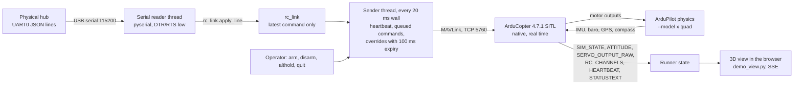

# Laptop demo: physical controller, simulated drone

The demo works: the physical gloves and hub, on breadboards, fly the simulated drone in
the 3D view (`simulation/drone/demo_view.py`). What is left is listed in the gap list
(§6), and the formal checks are Part C of the
[test plan](test-plan.md#part-c--physical-controller-simulated-drone).

The demonstration: an operator wears the two physical hand controllers, the physical hub
is plugged into a laptop, and the laptop shows a simulated drone flying. No physical drone
is in scope.

Decision, 2026-11-01: the demo drone is ArduCopter 4.7.1 as native SITL, built from
the 4.7.1 release commit and run on the laptop in real time with ArduPilot's own quad
physics. It replaces the emulated F405 for the demo only: in Simantic the F405 runs flight
1.47× slower than real time and pauses for seconds at the mode change and at arming (§3).
The emulated F405 stays the drone of the simulation suites (S3, D2), where the real
`matekf405-wing` binary is the point.

The hard rule still applies, in this form: the screen shows the airframe's true state,
and that airframe moves only because ArduCopter's motor outputs drive ArduPilot's
physics. Nothing on screen moves directly from a gesture. What the demo no longer has is
an emulated MCU between ArduCopter and the motors.

## 1. What already works, and what this plan relies on

| Link in the chain | Evidence status | Where |
|---|---|---|
| Two hands → BLE → hub → command line on UART0 | PASS in simulation (S2-A, S2-B). Physically observed on breadboards 2026-11-11 and -17: 50 packets/s per hand, 0 rejected; one open fault, a hand that stops sending while linked ([bench-bringup.md](bench-bringup.md)) | `firmware/tests/s2*.py` |
| Hub line → RC channels → MAVLink `RC_CHANNELS_OVERRIDE` | PASS in Simantic (S3-A 18/18, S3-B 38/38). The demo runner uses the same `rc_link` code with a wall-clock 20 ms sender and the same 100 ms expiry: overrides stopped 0.061–0.064 s after the last line and resumed within 5 ms (scripted runs) | `rc_link.py`, `gcs_peer.py`, `sitl_live.py` |
| Real hub on a serial port → runner | Implemented (`sitl_live.py serial`, `demo_view.py --hub`). Tested with a fake hub on a pseudo-terminal (valid, invalid, malformed and missing lines, arm refusal, arming, flight, failsafe, recovery), and on 2026-11-17 with the physical hub over its CP2102N USB-UART: take-off, flight in ALT HOLD, and a failsafe RTL when a hand went stale. Not measured: latency through the physical chain. The runner does not reopen a port that disappears | `sitl_live.py`, `demo_view.py` |
| Gesture flight in AltHold | SITL: the scripted flight passes 27/27 checks (§3). Replaying the emulated F405's last gesture flight (real hand and hub firmware) into SITL on the same airframe: in the commanded phases climb and descent agree within 0.03 m/s, roll within about 0.5°, pitch within 0.3° and yaw rate within about 4°/s. In the level phases after a roll or pitch the F405 stays 1.3–2.5° tilted, SITL within 0.7° | `sitl_live.py`, `sitl_reference.py` |
| Attitude estimate after a manoeuvre | SITL with GPS: the airframe returns to within 0.25° of level after every manoeuvre. Without GPS, two scripted runs stayed 2.1–2.6° off after a roll; a replay without GPS did not (§3). The emulated F405 (no GPS) shows 1–2.5° | §3 |
| Screen view of the drone | Built: `demo_view.py` serves a three.js view of SITL's state at http://localhost:8765, with a scripted virtual pilot or a physical hub (`--hub PORT`). Checked in Chrome on 2026-11-01: 1.00× real time; about 120 frames/s on an M4 at 1.5× resolution, worst frame 16.6 ms | §4 |

Settings every run needs, set by the runner at each start (`-w` wipes SITL's parameters):
`FRAME_CLASS=1`, `FRAME_TYPE=1`, `FLTMODE_CH=0` (the bridge holds ch5 at 1500 µs),
`ARMING_SKIPCHK=0xFFFFE`, and `SIM_RC_FAIL=1`, so that, as on the bench, ArduCopter has
no RC receiver and only the bridge's overrides. SITL's `copter.parm` already sets RC1–4 to
1000–2000 µs.

Arming is a deliberate host action. ENABLE grants gesture permission only; it never arms.

## 2. Physical setup

```text
  LEFT hand (worn)                RIGHT hand (worn)
  ESP32-S3 DevKit                 ESP32-S3 DevKit
  5 flex  GPIO1/2/4/5/6           5 flex  GPIO1/2/4/5/6
  #5543 IMU  SDA 8 / SCL 9        #5543 IMU  SDA 8 / SCL 9
  ENABLE  GPIO7 (active low)
  USB power (own cable)           USB power (own cable)
          \                          /
           \---------- BLE ---------/
                       |
                 HUB  ESP32-S3 DevKit
                 CALIBRATE GPIO7 (active low)
                       | USB, UART0 port, 115200 baud, JSON lines
                    LAPTOP
```

- Pins and circuits: the [wiring guide](wiring/README.md#pins), which has the pin map
  and the per-board drawings.
- Hub to laptop: use the board's USB connector wired to the USB-to-UART
  bridge (UART0, GPIO43/44), not the native USB port (GPIO19/20). The hub
  prints its commands on UART0. The macOS device name depends on the bridge
  chip (for example `/dev/cu.usbserial-*`, `/dev/cu.wchusbserial*` or
  `/dev/cu.usbmodem*`). Use the `cu.` device, not `tty.`. Confirm the
  connector on the received board at C0.
- Hand power: the [wiring guide](wiring/README.md) keeps every board on USB power until a
  wearable power circuit is designed and reviewed. For
  the demo, each hand is powered through its own USB cable into its own
  board's USB-to-UART connector, from the laptop or a powered USB hub. The
  cables also give access to each hand's console for calibration.
  - No LiPo, no 5 V to any ADC pin, GPIO10 disconnected. Never wire 3V3 or GND
    between boards.
  - The firmware reports *"USB bench power; battery unavailable"*. It never
    reports a battery value.
  - A USB power bank plugged into each board's USB connector would remove the
    tethers. It is still USB input, but it is not the reviewed C3 wearable
    power design, and it has no battery monitoring. Using one is a decision for
    the project owner, not a default in this plan.

## 3. Laptop data path

### The runner



```sh
tmp/ardupilot-venv/bin/python simulation/drone/sitl_live.py scripted          # built-in flight, PASS/FAIL per step
tmp/ardupilot-venv/bin/python simulation/drone/sitl_live.py serial /dev/cu.usbserial-XXXX
tmp/ardupilot-venv/bin/python simulation/drone/demo_view.py                  # 3D view, virtual pilot
tmp/ardupilot-venv/bin/python simulation/drone/demo_view.py --hub /dev/cu.usbserial-XXXX
```

`demo_view.py` is the runner with the 3D view (http://localhost:8765). Without `--hub`, a
scripted virtual pilot flies a three-minute tour (take-off, pirouette, a circuit round a
tree, a climb, a figure eight, strafes, a fast pass, return, landing) in a 2.5 m/s SITL
breeze, and repeats it. The pilot chooses stick positions from the drone's true state,
turns them into two hand poses, and a Python stand-in for the hand and hub mapping turns
the poses back into hub command lines, with the proposed values from
[gesture-mapping.md](gesture-mapping.md): 3° deadband, 30° saturation, slew 4.0/s attitude
and 1.5/s throttle. The stand-in is not `hand_core`/`hub_core`, and the virtual pilot is
not a person. In the first recorded tour it landed 1.7 m from the pad centre, with at
most 18.6° of tilt and 6.9 m/s.

One process does the following:

1. Starts `tmp/ardupilot/build/sitl/bin/arducopter` with `--model x --speedup 1 -w` and
   the settings in §1, and connects to its MAVLink port.
2. A reader thread keeps the newest message of each type. A sender thread does what
   `gcs_peer.py` does in the simulation, in wall time: a heartbeat every second, queued
   commands, and `RC_CHANNELS_OVERRIDE` every 20 ms unless the last command was invalid
   or no command has arrived for 5 ticks (100 ms).
3. In `serial` mode, a third thread reads the hub's port with DTR and RTS low (on common
   DevKits those lines drive EN/IO0, so opening the port could reset the hub; unverified
   on our boards). Every line goes to `rc_link.apply_line`, the same function the
   simulation's bridge uses: command records update the channels, other records are
   ignored, and a malformed command is a failsafe.
4. Operator words on standard input: `arm` (refused unless the hub command is valid with
   the throttle low; it selects AltHold first), `disarm`, `althold` (takes control back
   after a radio failsafe), `quit`. A status line is printed twice a second.

pyserial 3.5 is installed in `tmp/ardupilot-venv` only.

### Sensors: with or without GPS

The runner defaults to SITL's full sensor set (`SITL_SENSORS=full`). `SITL_SENSORS=board`
keeps only the Matek board's IMU and barometer.

| | Full (default) | Board |
|---|---|---|
| Level after manoeuvres (truth, mean over the second half of each 3 s step) | within 0.25° every time | 2.1–2.6° after the 1/3 roll and the full roll (two runs); other steps within 1.2° |
| Full roll stick | 29.97° (ANGLE_MAX is 30°) | 31.4–31.6° true, while ArduCopter's estimate read about 30° |
| Radio failsafe in flight | RTL: returns to where it was armed, waits, lands at 0.5 m/s, disarms | LAND ("RTL failed: requires position"), disarms |
| Ready to arm after start | 44.5 s (waits for "is using GPS") | 8.5–8.7 s |
| Scripted checks | 27/27 | 24/27; the three failures are the tilt rows above |

Full was chosen as the default because the drone then holds level and returns home on
failsafe. The board setting matches the emulated F405's sensors and is the one to use
when comparing against it. That the no-GPS tilt error is the same mechanism as the
emulated F405's open estimate drift is likely but not shown: the replay of the F405
flight into SITL without GPS stayed within 0.7°.

### Speed

Every SITL run so far held real time: 1.000 SITL seconds per wall second over each
~105 s scripted flight (five runs), with SITL using 2–7% of one core on an Apple M4. There
are no pauses at the mode change or at arming. Not measured: the demo laptop, and a
heavily loaded host.

### The emulated F405, for comparison

`ControllerSim(hands=False)` and `palmpilot.py drone` run the Simantic drone machine
alone. `firmware/probes/drone-flight/demo_speed.py` measured it on 2026-11-01 (M4, load
average 3–4, engine 0.6.6, two runs agreeing within 0.1 s per phase):

| Phase | Wall s per simulated s |
|---|---|
| Boot, parameters, reboot, EKF alignment (22.5 s simulated) | 0.8 (17.9 s wall) |
| Standby, disarmed | 1.2 |
| Mode change to AltHold | 2.7–2.8; one 20 ms slice took about 1.5 s |
| First second after arming | 6.8–7.1 |
| Armed on the ground | 1.6 |
| Flight | 1.38–1.59, overall 1.47 |

A stick step therefore reaches the screen about 1.47× later than in SITL, and the view
freezes at the mode change and at arming. Those pauses are not explained. The engine's
UART host bridge (`"hostBridge": "tcp:5770"` on a uart medium) also connected a plain
pymavlink client to the emulated F405 in a feasibility run on engine 0.6.3; it was not
pursued.

## 4. Visualisation

| Option | Shows | Needs | Hard rule |
|---|---|---|---|
| (b) 3D view (built; grass blades, leaf-card trees, clouds; Hermite/slerp interpolation on a 70 ms delayed clock; spring-damped cameras) | The airframe's true position, attitude and motor outputs (props spin from `SERVO_OUTPUT_RAW`); armed state and mode; ArduCopter's messages; the hub command and, with the virtual pilot, the two hand poses; an artificial horizon, heading tape and the estimate-minus-truth attitude; real-time factor; cameras: auto, chase, pilot's eye, orbit, top | `demo_view.py` runs SITL, keeps the newest state and serves it over Server-Sent Events (standard library) to `view/page.html` + `view/view.js` (three.js 0.160.0 from jsDelivr). `--record` saves each tour for a replay page | Complies. The pose is SITL's physics state, driven by ArduCopter's motor outputs. The scenery (field, trees, hangar) is decoration with no physics |
| (a) Ground station (QGroundControl, Mission Planner) | ArduCopter's own estimate: attitude, altitude, mode, messages, and with GPS a map position | A second MAVLink connection to SITL. SITL serves further TCP ports (5762, 5763) for its other serial ports; not tried | Complies |
| (c) Both | Truth and estimate side by side | Both | Complies |

### What the screen can show, and how late

`Drone.state()` in `sitl_live.py` returns all of this on every call:

| Shown | MAVLink source | Rate requested | Notes |
|---|---|---|---|
| Position north, east, altitude, and velocity | `SIM_STATE` | 50 Hz | SITL's physics truth, metres from the take-off point |
| Roll, pitch, yaw | `SIM_STATE` | 50 Hz | Truth; the 3D model's orientation |
| Four motor outputs (µs) | `SERVO_OUTPUT_RAW` | 50 Hz | Evidence that the motion comes from the motors |
| ArduCopter's attitude estimate | `ATTITUDE` | 50 Hz | Next to the truth, it shows any estimate error |
| RC channels ArduCopter received | `RC_CHANNELS` | 50 Hz | The sticks as the flight controller sees them |
| Armed, flight mode | `HEARTBEAT` | 1 Hz | Disarmed, AltHold, RTL, LAND |
| ArduCopter's messages | `STATUSTEXT` | As sent | "Radio Failsafe", arming refusals |
| Hub command, valid or not | `rc_link` | Every hub line | Status only; it never moves the drone |
| Real-time factor | `ATTITUDE.time_boot_ms` against wall time | Continuous | 1.000 in every run so far |

Delay, from the first hub line of a new command, over the scripted runs:

| Stick step | ArduCopter reports the new value | Airframe at 90% of its change |
|---|---|---|
| Roll right, 1/3 stick (to about +9°) | 22–50 ms | 0.44–0.50 s |
| Pitch forward, 1/3 stick (to about −9°) | 24–48 ms | 0.45–0.47 s |
| Full roll right (to 30°) | 22–48 ms | 0.39–0.42 s |

The first column is the bridge and MAVLink hop, bounded by the 20 ms override period and
the 50 Hz report rate. The second is ArduCopter and the airframe responding, as a real
quad would, and it is shown in real time. Not included and not measured: the physical
hands, BLE and hub (a packet and a command every 20 ms), the USB serial link, and the
browser's frame time.

### The view's modes (2026-11-17)

| Option | What it does |
|---|---|
| (none) | A scripted virtual pilot flies a tour; "Take the hands" gives the keyboard the virtual hands |
| `--manual` | Keyboard only from the start, no virtual pilot (`E` ENABLE, `R` arm, `W/S` throttle, arrows tilt, `A/D` yaw, `F` disarm) |
| `--hub PORT` | The physical hub's command lines fly the drone. The runner also asks the hub for `hands` (10 Hz) and `status` (1 Hz) and draws both hands' curl, tilt, per-finger bend, link, IMU and calibration state in the side panel; that telemetry never moves the drone. Arm/Disarm buttons (and `R`/`F`); arming selects ALT HOLD. The reason a command is invalid is shown under them |
| `--drone f405` | The emulated F405 and `quad_plant` instead of SITL ([simantic.md §6](simantic.md#6-the-live-3d-view-on-the-emulated-f405)); runs slower than real time |

The default camera ("Fixed", key 6) stands behind the drone and keeps the heading the
drone had when the page loaded, so stick right is screen right until the drone yaws.
`simulation/drone/compare.py` shows a SITL view and an F405 view side by side, sends the
same keys to both and times each one's response.

## 5. Operator procedure

### Before the demo

1. Build and flash the same binaries that pass in simulation:
   `hand:left`, `hand:right` and `hub` (`firmware/tools/palmpilot.py build`).
2. Calibrate each hand over its own USB console. Send `cal extended` with the
   hand open, `cal curled` with a fist, `cal neutral` with the hand level, then
   `cal finish`. If the result is valid, send `cal save`. The hand restores the
   profile from NVS at boot, which passes in simulation (S1-F). **Physical
   persistence is not qualified** (test plan B2).

### Demo sequence

1. Hub, then laptop. Plug the hub in and start
   `sitl_live.py serial <port>`. SITL is ready to arm after about 45 s with GPS. The
   status line shows `hub invalid` until the hands are linked and ENABLE is held.
2. Hands. Power both hands. Each restores its calibration and advertises, and the
   hub links both. Until ENABLE, commands read `valid=0` with reason `not_enabled`, or
   `await_release` after a fault.
3. Neutral. The operator holds both hands level and relaxed. Someone presses hub
   CALIBRATE. While it is held the command is invalid (`calibrating`), and the neutral
   orientation of both hands is captured.
4. Enable. Open the left hand (throttle below 5%; the firmware refuses a new ENABLE
   otherwise), then press and hold ENABLE. ENABLE is a deadman: commands are valid
   only while it is held. The status line shows `hub valid`.
5. Arm. The laptop operator types `arm`. The runner refuses unless the hub command
   is valid and the throttle is low, and selects AltHold before arming.
6. Fly. In AltHold, mid-curl holds altitude. More curl climbs, less curl descends,
   and an open hand descends at the maximum rate. Right-hand tilt rolls and pitches;
   left-hand roll tilt yaws. A right fist (HOLD) levels the attitude and freezes
   throttle. A left thumb curl (PRECISION) halves attitude authority.
7. Land. Reduce the curl to descend (in SITL, throttle 250 descends at about 1 m/s
   and lands). After touchdown, open the hand fully.
8. Disarm with `disarm`, then release ENABLE.
9. Shutdown. `quit`. Unplug the hands, then the hub.

If a radio failsafe starts (§ below), wait for `hub valid` and type `althold` to take
control back.

### Failure behaviour

ArduCopter starts its radio failsafe `RC_FS_TIMEOUT` (1.0 s by default, checked in the
4.7.1 source) after the overrides stop. The previous version of this plan named
`RC_OVERRIDE_TIME` (3 s); the runs below show the 1 s figure. With GPS the failsafe
action is RTL; without a position estimate it is LAND (`FS_THR_ENABLE=1`). Nothing in
this table is tested physically.

| Event | What happens | Evidence |
|---|---|---|
| ENABLE released, or a hand lost, in flight | Hub sends `valid=0`; the bridge stops overrides at once; radio failsafe after about 1 s; RTL (or LAND), lands and disarms | SITL scripted: RTL 1.01 s after release, disarmed, worst tilt 3.1°; board sensors: LAND 0.99 s. Hub side: S2-B, S3-A, S3-B in simulation |
| Hub silent or garbled for less than 1 s | Overrides pause after the 100 ms expiry; ArduCopter keeps the last overrides; no failsafe | SITL scripted: 0.5 s silence, last override 0.061–0.064 s after the last line, resumed within 5 ms. Pseudo-terminal: 0.3 s of malformed lines, no failsafe |
| Hub unplugged | Overrides stop; radio failsafe after about 1 s; RTL. When the hub is back, `althold` returns control | Pseudo-terminal: lines stopped for about 2 s, "Radio Failsafe", RTL; after `althold` the drone held 4.9 m and then landed under hub control |
| Serial error (port vanishes) | The reader prints the error and stops; the drone fails safe as above. It does not reopen the port | Implemented, not exercised |
| Hub reset | Hands relink. The command stays invalid until a new ENABLE press | Reboot recovery: PASS in simulation (S2) |
| SITL exits or hangs | Not detected | Gap |

## 6. Gap list

Effort is a rough single-person estimate.

| # | Gap | Effort | Notes |
|---|---|---|---|
| 1 | Runner: reopen the port after a serial error; save a flight log in `serial` mode; detect SITL exiting or hanging | 0.5–1 day | Hub `status` and both hands' telemetry are shown (§4) |
| 2 | Physical controller: run the bench procedures (test plan B1–B6) with recorded results; find why a hand sometimes stops sending while linked | Unknown | Built and flown on breadboards ([bench-bringup.md](bench-bringup.md)) |
| 3 | Ground-station view (option a), optional | 0.5 day | A second MAVLink client on SITL; not tried |
| 4 | Estimate drift without GPS | Unknown | Seen on the emulated F405 and once in SITL without GPS; not seen in SITL with GPS |

What this plan does not establish:

- the physical part of the latency (hands, BLE, hub, USB serial), or that a USB-UART
  bridge behaves like the pseudo-terminal used in the test;
- that SITL behaves like the `matekf405-wing` binary on an STM32F405: no MCU, timers or
  board drivers are simulated, and the airframe is ArduPilot's default 3 kg quad rather
  than `quad_plant`'s 1 kg one;
- any physical-drone flight property.
