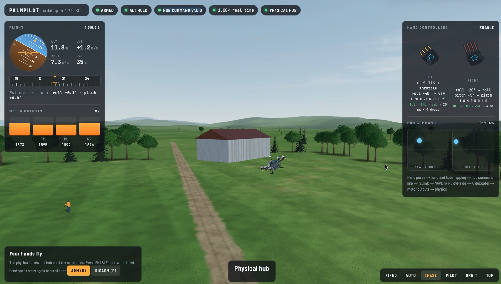

# Laptop demo

Wear the two gloves, plug the hub into a laptop, and fly a simulated quad on screen.



The drone is ArduCopter 4.7.1 running as ArduPilot's native simulator (SITL), in real
time, with ArduPilot's own quad physics. The view shows the airframe's true state, and
that airframe moves only because ArduCopter's motor outputs drive the physics.

## What you need

- The two gloves and the hub, wired as in [wiring/](wiring/README.md), each powered over
  its own USB cable. Never join 3V3 or GND between boards.
- The hub's USB cable on the board's USB-UART port (UART0), not the native USB port. On
  macOS it appears as `/dev/cu.usbserial-*`.
- An ArduPilot SITL build of Copter-4.7.1 in `tmp/ardupilot`, and a Python environment
  with pymavlink and pyserial (`tmp/ardupilot-venv`).

## Prepare the boards

1. Build and flash the firmware. For the settings used on the bench (ENABLE as a
   toggle, no thumb gestures; see [bench-bringup.md](bench-bringup.md#the-bench-profile)):

   ```sh
   python3 firmware/tools/palmpilot.py build hand:left_bench    # and hand:right_bench, hub:bench
   ```

   The plain `hand:left`, `hand:right` and `hub` builds are the designed behaviour the
   simulation tests check (ENABLE held as a deadman).

2. Calibrate each glove once, over its own USB console: `cal extended` with the hand
   open, `cal curled` with a fist, `cal neutral` with the hand flat and still, then
   `cal finish` and `cal save`. The glove restores it at every boot.
   `firmware/tools/bench/hands_ui.py` does the same with buttons and shows each finger's
   travel and noise.

## Run it

```sh
tmp/ardupilot-venv/bin/python simulation/drone/demo_view.py --hub /dev/cu.usbserial-XXXX
```

Then open http://localhost:8765. SITL is ready to arm about 45 s after start.

| Option | What flies the drone |
|---|---|
| `--hub PORT` | the physical gloves, through the hub |
| `--manual` | the keyboard |
| (none) | a scripted virtual pilot, on a three-minute tour; "Take the hands" gives you the keyboard |
| `--drone f405` | as above, but the drone is the emulated F405 in Simantic instead of SITL; slower than real time ([simulation.md](simulation.md#speed)) |

`simulation/drone/compare.py` shows a SITL view and an emulated-F405 view side by side,
flown by the same keys, and times how each responds.

## Fly

1. Open your left hand fully and press ENABLE. The panel under the Arm button turns to
   "valid"; if it does not, it says why (see below).
2. Click Arm (or press R). Arming selects ALT HOLD.
3. Curl your left four fingers past about 60% to take off. About half curl holds
   height; more climbs, less descends.
4. Tilt the right hand to move: forward and back for pitch, left and right for roll.
   Roll the left hand to turn.
5. To land, ease to about 25% curl. On the ground, open the hand, click Disarm (F) and
   press ENABLE again to turn it off.

With the keyboard (`--manual`): E ENABLE, R arm, W/S throttle, arrows tilt, A/D yaw,
Q hold height, F disarm. Hold Shift for full tilt.

## The screen

- Left panel: attitude, altitude, speed, heading, the four motor outputs, and the
  difference between ArduCopter's estimate and the true attitude.
- Right panel: both gloves as the hub sees them (curl, tilt, each finger, Bluetooth,
  IMU and calibration state), and the hub's stick command.
- Cameras, bottom right: Fixed (behind the drone, always facing the same way, so
  tilting right moves the drone right on screen until it yaws), Auto, Chase, Pilot,
  Orbit and Top; keys 1–6.

## When the command is invalid

The hub sends nothing to the drone while its command is invalid. The reason is shown
under the Arm button.

| Reason | Meaning | Fix |
|---|---|---|
| not enabled | ENABLE is off | open the left hand and press ENABLE |
| left / right not ready | that glove reports a fault: not calibrated, a flex channel open or shorted, or its IMU not answering | check the glove's console (`sample`, `motion`); reboot it; re-seat loose wires |
| left / right stale or missing | no recent packet from that glove | reset the glove; see the open issue in [bench-bringup.md](bench-bringup.md) |
| calibrating | the hub's CALIBRATE pin reads pressed | wire its pull-up, or use the `hub:bench` build, which ignores it |
| await release | a fault happened while enabled | press ENABLE again |

Arming is refused while the command is invalid or the throttle is above about 25%.

If the command goes invalid in flight, ArduCopter starts its radio failsafe after about
1 s and returns to where it was armed (RTL), lands and disarms. Measured in SITL: RTL
1.01 s after ENABLE was released. Once the command is valid again, ALT HOLD (H) takes
control back.

## How it works

```text
hub ── USB serial ──> serial reader ──> rc_link ──> sender, every 20 ms ── MAVLink ──> ArduCopter SITL
                                       (newest command,   (RC override; stops 100 ms     │
                                        same code as the   after the last valid line)    │ motor outputs
                                        simulation tests)                                v
                     3D view in the browser <── state, 50 Hz <──────────────── ArduPilot physics
```

`demo_view.py` starts SITL, reads the hub, sends RC overrides and serves the drone's
state to the page. It also asks the hub for `hands` and `status` to draw the gloves;
that telemetry never moves the drone. SITL is started with the full sensor set,
including GPS, so the drone holds level and can return home on failsafe.

Why SITL and not the emulated F405: the emulated F405 flies at about two thirds of real
time and pauses for several seconds after arming, which a pilot feels. SITL runs the
same ArduCopter release at exactly real time, using 2–7% of a core. The emulated F405
remains the drone of the automated tests.

Delay in SITL, from the hub line to the drone, in scripted runs:

| Stick step | ArduCopter has the new value | Airframe at 90% of its change |
|---|---|---|
| roll, 1/3 stick | 22–50 ms | 0.44–0.50 s |
| pitch, 1/3 stick | 24–48 ms | 0.45–0.47 s |
| full roll | 22–48 ms | 0.39–0.42 s |

The physical part (gloves, Bluetooth, hub, USB) is not included in these numbers and has
not been measured.

## Not done yet

- The runner does not reopen the hub's port if it disappears, does not save a flight
  log, and does not notice if SITL stops.
- A glove sometimes stops sending while it stays connected
  ([bench-bringup.md](bench-bringup.md)).
- The physical part of the delay is not measured.
