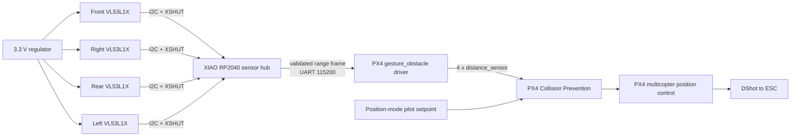

# Collision Sensing and Prevention Design

Research and availability check: 2026-09-10

The authoritative connector, board-pad, and MCU-GPIO allocation is the
[pin-level MCU and electrical architecture](pin-architecture.md). This document
defines the collision subsystem's behavior and validation requirements.

## Decision

Add a low-mass, four-direction time-of-flight (ToF) sensing subsystem after the
basic H7/BLE aircraft flies in the enclosure:

- Four Pololu VL53L1X carrier boards, facing forward, right, rear, and left.
- One Seeed Studio XIAO RP2040 as a non-radio sensor hub.
- One Pololu D24V5F3 3.3 V/500 mA regulator for the ToF rail.
- A dedicated full-duplex link from the sensor hub to Kakute H7 Mini `TELEM2`.
- A small custom PX4 driver that validates hub frames and publishes four
  oriented `distance_sensor` instances.
- PX4 Collision Prevention in Position mode, with no-data movement disabled.

The selected VL53L1X carrier is active/current, 13 x 18 x 2 mm, 0.5 g without
headers, and exposes the `XSHUT` pin needed to start several identical-address
sensors on one I2C bus. Pololu lists a typical 27-degree field of view, 4 cm
minimum range, and mode-dependent range/update limits. [[35]](sources.md#source-35)

This design preserves the flight-control boundary: the RP2040 measures range
but cannot arm, stabilize, choose a flight mode, or drive a motor. The H7 owns
all braking and safety decisions.

## Exact Safety Claim

The first sensor package provides **collision prevention in four covered body
directions during deliberately axis-locked, low-speed Position-mode flight**.
It does not provide general autonomous obstacle avoidance.

| Capability | Included? | Reason |
|---|---|---|
| Slow/stop before a detected obstacle | Yes, after validation | PX4 Collision Prevention constrains Position-mode motion from range data [[32]](sources.md#source-32) |
| Forward, right, rear, and left coverage | Yes | One sensor is mounted in each direction |
| Diagonal coverage | No | A VL53L1X has about 27-degree FoV, leaving large gaps between sensors |
| Automatic path planning around an object | No | PX4 Collision Prevention modifies/restricts pilot setpoints; it is not a planner |
| Ceiling or ground avoidance | No | PX4's collision map is horizontal; the barometer/geofence are not proximity sensors |
| Indoor electronic bounding box | No | Collision Prevention needs a valid Position-mode estimate; this build has GNSS position outdoors only |
| Detection of every wire, glass pane, dark surface, or moving object | No | ToF return quality depends on target size, angle, reflectivity, light, range, and occlusion |
| Replacement for prop guards, observer, net, geofence, or link failsafe | No | The sensor layer can fail and cannot contain every failure mode |

Do not label the prototype "collision-proof" or "autonomous." The truthful
description is "four-direction collision-assisted manual flight."

## Why This Package

### Evaluated options

| Option | Integration | Mass/coverage | Decision |
|---|---|---|---|
| One front VL53L1X | Native PX4 driver is available | Very light, but forward only | Useful bench proof, insufficient for the intended movement |
| Four VL53L1X carriers plus RP2040 hub | Custom hub and small PX4 serial driver | About 9-14 g installed; four narrow directions | **Selected for the first collision-assisted prototype** |
| Bitcraze Multi-ranger deck | Five VL53L1X sensors and reset expander on one 35 mm board | 2.3 g board; front/rear/left/right/up | Good reference, but designed for the Crazyflie connector/power system and still has narrow diagonal gaps [[39]](sources.md#source-39) |
| Seven VL53L7CX wide-FoV carriers | Custom high-bandwidth hub/driver | Near-360 coverage with overlap; roughly 700 mA typical sensor current | Possible custom V2, but too much firmware, wiring, and power work for first movement [[40]](sources.md#source-40) |
| LightWare SF45/B | Direct UART into PX4 with a custom PX4 build | 320-degree scan, 59 g, 51 x 48 x 44 mm | Best supported V2 coverage option, but too heavy and expensive for the current 2.5-inch baseline [[41]](sources.md#source-41) |
| Depth camera/companion computer | MAVLink/ROS obstacle stream | Rich scene data; high compute, power, and integration load | Not first-flight hardware |

The RP2040 is used because the four VL53L1X devices start at the same I2C
address. It holds three sensors in shutdown, enables one at a time, assigns
addresses, and then reads all four. The XIAO RP2040 provides 11 GPIOs, I2C,
UART, 264 KB RAM, and a 21 x 17.8 mm board. [[36]](sources.md#source-36)

The hub also prevents a ToF I2C fault from sharing the H7's external compass
bus. It adds one processor, but creates a cleaner fault boundary than attaching
four experimental sensors to a flight-critical I2C bus.

## Architecture



| Subsystem | Owns | Must not own |
|---|---|---|
| VL53L1X carriers | Raw optical ranging | Filtering policy, movement permission, motor control |
| RP2040 hub | Address assignment, sensor schedule, raw validation, health flags, framed UART output | BLE, RC channels, arming, flight mode, setpoint changes |
| PX4 range driver | Frame CRC/age checks, orientation/FoV metadata, `distance_sensor` publication | Inferring that missing data means clear space |
| PX4 Collision Prevention | Speed restriction and stop distance in covered sectors | Geofence, autonomous route planning, indoor localization |
| Hand controller | Axis-lock command policy while this sensor set is selected | Overriding PX4 obstacle restrictions |

## Coverage and Control Contract

### Sensor orientation

Mount the sensors at body-frame yaw angles of 0, 90, 180, and 270 degrees. The
optical apertures must be outside the body skin or behind an optically qualified
window. Each sensor gets the exact tested horizontal FoV metadata; never widen
the advertised FoV in firmware to hide a physical blind spot.

```text
                         FRONT (0 deg)
                              ^
                              |
                 LEFT <--- aircraft ---> RIGHT
                (270 deg)      |          (90 deg)
                              v
                         REAR (180 deg)
```

Four 27-degree cones do not cover 360 degrees. Therefore:

1. Set `CP_GO_NO_DATA=0`. Unknown space is not clear space.
2. Set `CP_GUIDE_ANG=0` for the first tests so PX4 does not guide a command
   toward an unmeasured diagonal.
3. In collision-assisted mode, the hand controller transmits only the dominant
   horizontal axis. It uses hysteresis so noise cannot rapidly alternate axes.
4. Do not allow yaw and horizontal translation at the same time during initial
   testing. Center horizontal intent before yawing to a new heading.
5. Keep a separate operator-visible status indicating that all four directions
   are healthy before enabling collision-assisted movement.

This deliberately makes diagonal commands feel unavailable. That is the
correct behavior for the selected sensor geometry, not a software defect.

### Initial speed envelope

Use VL53L1X Short mode first because the manufacturer describes it as the mode
most resistant to ambient light, with up to about 1.3 m nominal range and 50 Hz
maximum sample rate. Longer modes can be characterized later, but their quoted
3-4 m range is in dark conditions. [[35]](sources.md#source-35)

Initial collision-assisted parameters:

| Parameter/policy | Starting value | Purpose |
|---|---:|---|
| `CP_DIST` | 0.6 m | Minimum distance from the sensor, not from the propeller tip |
| `CP_DELAY` | 0.3 s | Conservative initial sensing plus vehicle-response delay; replace with measurement |
| `CP_GUIDE_ANG` | 0 deg | Disable lateral guidance into blind sectors |
| `CP_GO_NO_DATA` | 0 | Block motion into sectors without fresh measurements |
| `MPC_POS_MODE` | Acceleration based | Required by PX4 Collision Prevention [[32]](sources.md#source-32) |
| `MPC_VEL_MANUAL` | 0.5 m/s | Low-speed sensor-validation envelope |
| `MPC_ACC_HOR_MAX` | 1.5 m/s^2 | Bounded acceleration/deceleration |
| Hand horizontal mapping | Dominant axis only | Keep commands inside measured cones |

A simple stopping-distance check at 0.5 m/s is:

```text
d_required ~= CP_DIST + velocity * delay + velocity^2 / (2 * deceleration)
           ~= 0.60 + 0.50 * 0.30 + 0.50^2 / (2 * 1.50)
           ~= 0.83 m
```

This is only a sanity check. PX4 also accounts for controller dynamics and
jerk. The actual `CP_DELAY`, reliable sensor range, braking distance, and body
clearance must be measured. PX4 states that typical vehicle tracking delay can
be 0.1-0.5 s. [[32]](sources.md#source-32)

If the sensor cannot reliably detect the test targets at least 1.2 m away in
the actual lighting, the 0.5 m/s profile fails. Reduce speed, improve the
sensor, or reject that environment; do not reduce `CP_DIST` to force a pass.

## Electronics

### Collision-sensor BOM

| Qty | Part | Function |
|---:|---|---|
| 5 | Pololu VL53L1X carrier, item 3415 | Four installed plus one matched spare [[35]](sources.md#source-35) |
| 1 | Seeed Studio XIAO RP2040 | Sensor initialization, schedule, validation, and UART framing [[36]](sources.md#source-36) |
| 1 | Pololu D24V5F3 3.3 V/500 mA regulator | Dedicated sensor rail from H7 5 V [[38]](sources.md#source-38) |
| 1 | 100 uF low-ESR capacitor, at least 6.3 V | Bulk decoupling at sensor rail entry |
| 5 | 100 nF ceramic capacitors | Hub plus four remote sensor connection points |
| 1 set | 28-30 AWG flexible wire and locking connectors | 5 V, 3.3 V, ground, I2C, XSHUT, and UART harnesses |
| 4 | Body-integrated nonconductive sensor mounts | Fixed orientation, aperture protection, and strain relief |

Do not fit optional 0.1-inch headers on flight hardware. Solder and
strain-relieve lightweight wires after the bench prototype passes.

### Power

```text
Kakute 5V_FC ----+---- Schottky diode ---- XIAO RP2040 5V
                 |
                 +---- D24V5F3 ---- 3V3_TOF ---- four VL53L1X VIN

All grounds are common. I2C is pulled to 3V3_TOF, never to 5 V.
```

Four carriers draw about 80 mA typical and up to 160 mA peak from 3.3 V using
the manufacturer values. Reserve 250 mA on the 3.3 V rail for sensors,
capacitors, temperature, and regulator tolerance. The selected regulator is
rated for 500 mA and is currently listed active/preferred. [[35]](sources.md#source-35)
[[38]](sources.md#source-38)

The XIAO is separately powered at 5 V so its load does not pass through the ToF
regulator. Recalculate the full Kakute 5 V budget and verify it during motor
operation. Brownout detection remains enabled.

### Hub pin map

| XIAO RP2040 pin | Connection | Rule |
|---|---|---|
| `D4/GPIO6` | All sensor SDA | 3.3 V I2C only |
| `D5/GPIO7` | All sensor SCL | 3.3 V I2C only |
| `D6/GPIO0` TX | Kakute `R2` | Hub range frames to H7 |
| `D7/GPIO1` RX | Kakute `T2` | H7 configuration/heartbeat to hub |
| `D0/GPIO26` | Front `XSHUT` | Drive low or high-impedance only |
| `D1/GPIO27` | Right `XSHUT` | Drive low or high-impedance only |
| `D2/GPIO28` | Rear `XSHUT` | Drive low or high-impedance only |
| `D3/GPIO29` | Left `XSHUT` | Drive low or high-impedance only |
| `D8/GPIO2`, `D9/GPIO4`, `D10/GPIO3` | Reserved | Use the XIAO's onboard LEDs for diagnostics; do not silently add flight functions |

The Pololu carrier's `XSHUT` pin is not 5 V tolerant. Configure the RP2040 pin
as open-drain behavior: output-low to shut down and input/high-impedance to
release. [[35]](sources.md#source-35)

Do not add I2C pull-ups until the four carriers' existing pull-up network has
been measured. Verify rise time, low level, and transaction integrity at the
selected bus speed with the final harness.

### H7 connection

Kakute H7 Mini exposes UART2 as `R2/T2`, mapped by PX4 as `TELEM2` and
`/dev/ttyS1`. [[10]](sources.md#source-10) Wire:

| Sensor hub | Kakute H7 Mini | Direction/rule |
|---|---|---|
| `D6/GPIO0` TX | `R2/PD6` | Hub to H7 through 100 ohm series resistor |
| `D7/GPIO1` RX | `T2/PD5` | H7 to hub through 100 ohm series resistor |
| GND | `GND` | Common reference |
| 5 V through series Schottky diode | `5V` | H7 powers hub |

Remove every MAVLink mapping from `TELEM2` before starting the custom range
driver. `TELEM1` remains exclusively CRSF and UART4 remains GNSS.

## Mechanical Integration

- Put each optical center on a surveyed body datum and record yaw/pitch error.
- Keep the full 27-degree cone clear of props, guards, landing gear, battery,
  wires, and flexing body parts over the full attitude envelope.
- Do not recess a sensor in a tunnel that narrows its FoV.
- Do not place clear plastic over the aperture unless the exact material,
  thickness, spacing, crosstalk, and calibration have passed testing.
- Shield the back of each carrier from conductive debris and prop strike, but
  leave the optical apertures unobstructed.
- Keep sensor and I2C wiring away from motor phases and the ESC battery loop.
- Make each sensor replaceable without removing the H7 or disturbing its
  vibration mount.

Add a body datum arrow and labels `F`, `R`, `B`, and `L` to prevent a repaired
sensor from being installed with the wrong orientation.

## Sensor-Hub Firmware

### Boot sequence

1. Start with all four `XSHUT` pins held low.
2. Verify 3.3 V rail and hub watchdog operation.
3. Release one sensor, confirm its identity at the default address, assign its
   volatile address (`0x30` through `0x33`), and verify the new address.
4. Repeat for the other sensors while already-addressed sensors remain enabled.
5. Configure the same mode, timing budget, and region of interest on all four.
6. Take stationary self-test readings with a clear/known bench target.
7. Mark the hub READY after the address/configuration pass and scheduler start.
   Set a valid bit only for a direction whose sensor and samples pass checks.

Address assignment must run after every power cycle. If one sensor does not
initialize, do not reuse another direction's value and do not mark the missing
direction clear.

### Runtime schedule

Target at least 20 fresh measurements per second from each direction. Schedule
opposite sensors together and alternate pairs to limit optical crosstalk:

```text
slot A: front + rear range, read, validate
slot B: right + left range, read, validate
repeat
```

If final-body testing shows interference, range only one sensor per slot and
lower the vehicle speed to match the resulting update rate. The hub records
per-sensor sample age, status, timeout count, signal/range status, and I2C
errors.

### Hub frame

Use a fixed 26-byte little-endian frame at 115200 baud:

```text
HubRangeFrameV1
offset  size  field
0       2     sync = 0xA55A
2       1     protocol_version = 1
3       1     payload_length = 20
4       2     sequence_u16
6       4     hub_tick_ms_u32 (diagnostic only)
10      2     front_mm_u16
12      2     right_mm_u16
14      2     rear_mm_u16
16      2     left_mm_u16
18      1     valid_mask: bit0 front, bit1 right, bit2 rear, bit3 left
19      1     hub_status: bit0 READY, bit1 BUS_RECOVERY; bits2..7 zero
20      2     sample_span_ms_u16
22      2     aggregate_sensor_error_count_u16 (wraps modulo 65536)
24      2     CRC16-CCITT over bytes 0..23
```

`0xFFFF` means unknown/no valid measurement. A valid bit must also be set before
PX4 may use a distance. The H7 uses its own monotonic receive timestamp for
freshness because the two MCU clocks are not synchronized.

Reserved valid/status bits must be zero. `READY` is required and
`BUS_RECOVERY` must be clear before the H7 accepts any distance. A single
sensor failure clears only that direction's valid bit; it does not invalidate
fresh measurements from the other directions.

Use CRC-16/CCITT-FALSE: polynomial `0x1021`, initial value `0xFFFF`, no input or
output reflection, and final XOR `0x0000`. Because the frame is little-endian,
the sync bytes on the wire are `5A A5`. Golden frame vectors must be shared by
the RP2040 and PX4 test suites.

The hub sends at 50 Hz even if sensor data is unchanged, but each direction's
valid bit is cleared when its sample age exceeds 100 ms. A watchdog reset,
I2C recovery, or address reinitialization clears READY and all valid bits first.

## PX4 Integration

Add a narrowly scoped `gesture_obstacle` serial driver to the pinned PX4 v1.17
tree and enable it in the Kakute H7 Mini board configuration. The driver:

1. Opens `/dev/ttyS1` at 115200 8N1.
2. Resynchronizes on `0xA55A` without accepting partial frames.
3. Checks version, length, CRC, sequence, reserved bits, range bounds, hub
   state, sample span, and local receive age.
4. Publishes one `distance_sensor` instance per valid direction with the exact
   body orientation and measured horizontal/vertical FoV.
5. Never republishes stale data and never converts invalid/no-return data to
   maximum range.
6. Exposes counters and last-update age through `gesture_obstacle status`.

PX4 maps oriented `distance_sensor` reports into its horizontal obstacle map.
The v1.17 collision-prevention documentation states that the map has 72
five-degree sectors and applies rangefinder data according to orientation and
horizontal FoV. [[32]](sources.md#source-32)

The stock PX4 tree contains a native VL53L1X I2C driver, but a direct H7
connection is not selected because four same-address devices require shutdown
control and would share the compass bus. [[34]](sources.md#source-34)

### Data-loss behavior

PX4 documents the following Collision Prevention behavior:

- Motion into a direction with no sensor data is blocked when
  `CP_GO_NO_DATA=0`.
- If one of multiple sensors disappears, its covered region becomes uncovered;
  other fresh sectors remain usable.
- If no range data arrives for more than 0.5 s, horizontal movement is forced
  to zero.
- If no range data arrives for 5 s, the vehicle switches to Hold.

These behaviors must be reproduced on the exact pinned build before flight.
They do not replace RC-loss Land, geofence Hold, low-battery response, or KILL.
[[32]](sources.md#source-32)

## Verification Plan

### Gate CP0: one-sensor bench proof

- Wire one VL53L1X to the RP2040 through the dedicated 3.3 V rail.
- Validate Short-mode update rate, range status, timeout recovery, and watchdog.
- Test matte white, matte black, wood, fabric, angled surfaces, a narrow pole,
  and clear glass at 0.1-1.5 m in indoor and direct-sun conditions.
- Record false-clear, false-near, no-return, jitter, and p99 sample age.

Acceptance: the team can state which targets/environments are supported and
demonstrates at least 1.2 m reliable range on every approved target condition.
Glass, wire, and other failed targets become explicit operating exclusions.

### Gate CP1: four-sensor hub

- Exercise every power-up order and at least 100 hub resets.
- Unplug and short each sensor signal one at a time through a current-limited
  fixture.
- Place objects in one FoV at a time and verify no direction swap.
- Place targets near cone edges and map the real mounted FoV.
- Run motors in a secured fixture and look for I2C/UART errors and false ranges.

Acceptance: no invalid sample is marked valid, directions never swap, p99
sample age is below 75 ms, and a failed sensor clears only its own valid bit
within 100 ms.

### Gate CP2: PX4 software-in-the-loop

Use PX4's documented Gazebo collision models, including:

```sh
make px4_sitl gz_x500_lidar_front
make px4_sitl gz_x500_lidar_2d
```

Validate covered/uncovered direction behavior, stale-data behavior,
`CP_GO_NO_DATA=0`, Hold after complete data loss, RC loss during obstacle
braking, geofence interaction, and KILL. [[32]](sources.md#source-32)
[[33]](sources.md#source-33)

### Gate CP3: props-off H7 integration

- Confirm `TELEM2` has no MAVLink conflict.
- Inspect all four `distance_sensor` instances and the fused obstacle map.
- Rotate the complete aircraft and verify reported body directions.
- Inject bad CRC, duplicate sequence, partial frame, implausible range, one
  stale direction, full hub silence, hub reset, and low supply voltage.
- Archive the exact PX4 build configuration and driver tests.

Acceptance: malformed/stale data never becomes clear-space data, each missing
direction becomes unavailable, and complete loss reproduces the documented PX4
stop/Hold behavior.

### Gate CP4: props-off setpoint restraint

Before free flight, carry or roll the powered, prop-free aircraft toward a
large padded target while commanding the corresponding axis. Perform this
outdoors with a valid GNSS Position-mode estimate, or in a controlled HIL setup
that supplies a validated position. Record range, raw pilot demand, and the
acceleration/velocity setpoint after Collision Prevention. This validates the
signal and constraint path without claiming indoor position hold.

Acceptance for every direction:

- Allowed speed/setpoint decreases monotonically as the target approaches.
- The allowed toward-target setpoint reaches zero at the expected separation.
- Removing one sensor prevents travel toward that missing direction.
- Releasing deadman still produces the tested RC-loss Land path.

### Gate CP5: outdoor GNSS Position mode

Use a large, flat, padded/matte breakaway target in a legally permitted clear
site with valid GNSS Position mode. Start below 0.2 m/s and at the minimum
stable height, with an observer at the battery disconnect. Expand only after
measured stopping distance is repeatable. Test each direction separately; do
not test diagonal travel.

Acceptance: ten consecutive approaches per direction stop without target
contact, false-clear event, oscillatory acceleration, position/EKF fault, or
range-data warning. Set final speed from the worst observed range and stopping
case with margin.

## Failure Analysis

| Failure | Required interpretation | Response |
|---|---|---|
| No optical return | Unknown, not clear | Clear that direction's valid bit; PX4 blocks it |
| One VL53L1X missing/stale | Direction unavailable | Other directions remain reported; failed direction blocked |
| I2C bus stuck | All directions unavailable | Hub recovery attempt with all valid bits clear; PX4 stops/Holds |
| Hub watchdog/reset | No valid range | UART goes silent/invalid until full reinitialization |
| UART corruption | Bad frame | H7 rejects by sync/length/CRC/sequence |
| Hub-to-H7 stale link | No range data | PX4 stop, then Hold per validated behavior |
| Wrong sensor orientation | Hazardous false map | Mechanical labels, props-off direction test, signed installation record |
| Prop/guard in FoV | Persistent false obstacle | Fail mechanical gate; change body/sensor location |
| Bright light/dark or angled target | Reduced/no range | Environment exclusion or lower speed; never assume nominal 4 m |
| Thin wire or transparent pane missed | Undetected obstacle | Clear site, observer, prop guards, and physical separation remain mandatory |
| PX4 Position estimate lost | Collision Prevention unavailable/degraded | PX4 position-loss behavior plus clear-site/enclosure containment |

## V2 Upgrade Path

For unrestricted horizontal movement, replace the four narrow sensors and hub
with a sensor that supplies near-continuous azimuth coverage. The cleanest
official PX4 path found is the LightWare SF45/B on `TELEM2`:

- 0.2-50 m specified range, up to 320-degree configurable scan.
- 59 g and 51 x 48 x 44 mm, excluding cable.
- About 300 mA typical at 5 V and less than 450 mA startup.
- Serial UART configured at 921600 baud for PX4.
- PX4 v1.17 contains the `lightware_sf45_serial` driver, but it must be enabled
  in a custom build. [[41]](sources.md#source-41)
  [[42]](sources.md#source-42) [[44]](sources.md#source-44)

This is not a drop-in part for the current airframe. It reopens body packaging,
center-of-gravity, 5 V power, battery, motor/propeller thrust, vibration, and
flight-time gates. Its remaining 40-degree blind sector must stay blocked with
`CP_GO_NO_DATA=0` or be covered by another validated sensor.

A camera/depth V2 also needs a companion computer and an end-to-end latency and
failure analysis. PX4 v1.17 warns that the documented external companion
Collision Prevention setup is currently untested, so it is not the default
prototype path. [[32]](sources.md#source-32)

## Indoor Position Dependency

PX4 Collision Prevention operates in Position mode. The current architecture
has GNSS/compass for outdoor position; the four horizontal range sensors do not
measure vehicle position and cannot create an indoor bounding box.

Indoor electronic collision-assisted flight therefore requires a separate,
validated local-position source. PX4 documents downward optical flow plus a
downward distance sensor for GNSS-denied velocity/position estimation, but the
Kakute H7 Mini integration and drift/loss behavior must be proven before it can
replace the physical enclosure. [[43]](sources.md#source-43)

Until that work is complete, indoor tests remain inside the net with prop
guards, regardless of what the horizontal sensors report.
