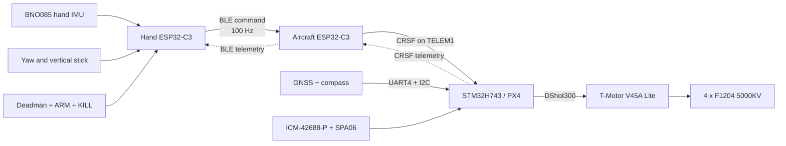
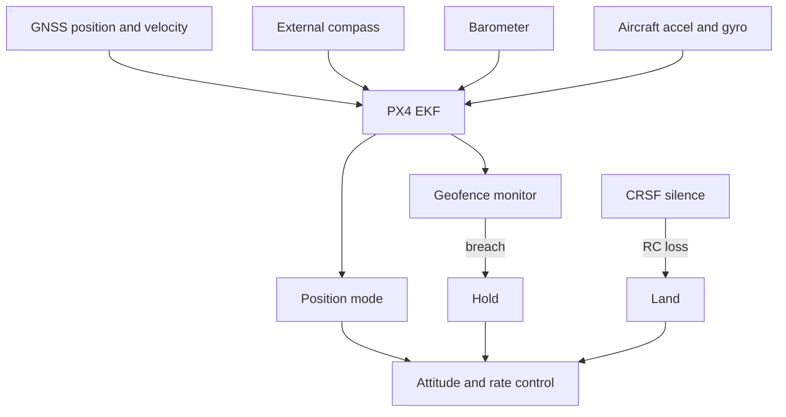

# Direct H7 BLE Flight Architecture

Research baseline: 2026-09-09

## Executive Decision

Use a Holybro Kakute H7 Mini v1.5 flight controller running a pinned PX4
v1.17.0 build. The board has an STM32H743 at 480 MHz, ICM-42688-P six-axis IMU,
SPA06 barometer, six UARTs, onboard flash, a regulated 5 V rail, 20 x 20 mm
mounting, and 5.5 g mass. Holybro currently lists the v1.5 version for sale,
and PX4 documents the board target and bootloader process. [[9]](sources.md#source-9)
[[10]](sources.md#source-10)

Pair it with a T-Motor V45A Lite four-in-one ESC. The current official product
page lists the part in stock at the research date, with 3-6S input and 45 A per
channel continuous, 55 A peak for 10 seconds, BLHeli_S, 30.5 x 30.5 mm mounting,
41.6 x 39.4 x 6.3 mm size, 13 g mass, and no ESC telemetry. [[11]](sources.md#source-11)

For the assumed guarded 2.5-inch body, start with four T-Motor F1204 5000KV
motors and a 3S 450 mAh standard LiPo. T-Motor specifies the motor for 2-3S and
2.5-3 inch builds, with a 1.5 mm shaft, 6.1 g mass excluding cable, 6 A peak
current, and 72 W maximum power for 60 seconds. [[12]](sources.md#source-12)

Keep the ESP32-C3 boards outside the flight-control fault domain:

- Hand C3: read BNO085 and controls, map gestures, enforce local state, and send
  encrypted BLE notifications.
- Aircraft C3: maintain the bonded BLE link, validate commands, and emulate a
  CRSF receiver.
- H7/PX4: make every aircraft safety and control decision.

Later, physically replace the BLE gateway with an ExpressLRS receiver on the
same H7 CRSF port. This is a transport change, not a second architecture.

## Why This H7

The H7 is not selected because basic stabilization requires 480 MHz. It is
selected because the project wants one platform for initial flight and later
position, logging, local-position sensors, and radio work.

| Choice | Outcome |
|---|---|
| F405/F7 | Can fly the craft, but rejected to avoid another flight-controller migration |
| Custom STM32H753 | Powerful but delays flight with PCB, power, clock, sensor-layout, bootloader, and PX4-port work |
| Kakute H7 Mini v1.5 / STM32H743 | Selected: compact H7 board with published PX4 support and current manufacturer availability |

H743 rather than H753 is intentional. The H753's additional cryptographic
hardware does not improve stabilization or geofencing. A supported H743 board
that can be tested now is more valuable than an unflown custom H753 design.

Compute headroom also does not invent position data. The bounding-volume
requirement still needs GNSS outdoors or a local-position system indoors.

## Responsibility Boundaries

| Subsystem | Owns | Must not own |
|---|---|---|
| Hand C3 | BNO085 parsing, calibration, filtering, gesture mapping, deadman/ARM/KILL inputs, BLE peripheral | Aircraft attitude, position, mixing, autonomous action |
| Aircraft C3 | BLE central, pairing, freshness, frame validation, CRSF packing, compact telemetry forwarding | Stabilization, geofence, motor output, automatic landing policy |
| H7/PX4 | Aircraft sensors, EKF, arming checks, flight modes, geofence, RC loss, control, DShot | Gesture recognition or BLE recovery |
| Four-in-one ESC | Commutate motors from H7 DShot commands | Flight or radio policy |

This boundary survives the ExpressLRS upgrade because the H7 continues to see
the same CRSF channels.

## End-to-End Architecture



QGroundControl connects by USB for setup, calibration, logs, and props-off
testing. A laptop is not required to keep the aircraft controlled in flight.

## First Flight Objective

The first useful movement is deliberately modest:

- Arm only after hand calibration, neutral controls, sensor checks, GNSS/home,
  battery checks, and PX4 prearm checks pass.
- Lift to approximately 0.5-1 m.
- Hold outdoor position with neutral controls in PX4 Position mode.
- Tilt the hand for bounded low-speed horizontal movement.
- Use the self-centering stick for climb/descent and yaw.
- Release deadman to invalidate the pilot stream and invoke RC-loss Land.
- Use guarded KILL only when immediate motor shutdown is safer than controlled
  flight.
- Stay within the 10 m by 3 m operating target, well inside the geofence.

## Position and Boundary Architecture

Use an ARK SAM GPS Mini. It combines a u-blox SAM-M10Q with an IIS2MDC
magnetometer, requires 5 V at 15 mA average/20 mA maximum, and presents UART
plus I2C. PX4 documents the unit. [[13]](sources.md#source-13)



PX4 supports cylindrical distance/height limits and polygonal inclusion or
exclusion regions. The action follows detection of a breach, so a fence is not
a hard wall. The physical clear area must extend beyond the fence by GNSS
uncertainty, stopping distance, control delay, and wind margin.
[[18]](sources.md#source-18) [[19]](sources.md#source-19)

### Initial outdoor values

| Control | Initial value | Purpose |
|---|---:|---|
| Pilot target | 10 m radius, 3 m high | Normal test volume |
| `GF_MAX_HOR_DIST` | 15 m | Software breach radius from home |
| `GF_MAX_VER_DIST` | 5 m | Software height ceiling |
| `GF_ACTION` | Hold | Brake and stop travel after breach; validate before considering Return |
| `MPC_ACC_HOR_MAX` | 2 m/s^2 | Limit horizontal acceleration/deceleration |
| `MPC_VEL_MANUAL` | 2 m/s | Limit Position-mode horizontal velocity |
| `MPC_Z_VEL_MAX_UP` | 1 m/s | Limit climb speed |
| `MPC_Z_VEL_MAX_DN` | 0.7 m/s | Limit descent speed |

PX4 Position mode maps roll/pitch sticks to horizontal acceleration, throttle
to vertical speed, and yaw to angular rate. Centered inputs hold 3D position,
and the mode requires global position. [[20]](sources.md#source-20)

At 2 m/s and 2 m/s^2 ideal deceleration, `v^2/(2a)` is 1 m. Real overshoot is
larger. The initial site must be clear for at least 25 m from home and must not
contain people, wires, trees, buildings, vehicles, or a property edge in that
margin.

### Indoor truth

GNSS is not a credible indoor position source. BLE RSSI is not a distance
measurement. For indoor movement:

- Fly only in a netted enclosure with prop guards.
- Use an observer at the battery disconnect.
- Treat the enclosure as the bounding box.
- Do not advertise an electronic indoor boundary.

A future indoor electronic box requires UWB/motion capture or validated optical
flow and range sensing, including a tested policy for sensor dropout and drift.

## BLE Link

The hand is BLE peripheral/GATT server. The aircraft is BLE central/GATT
client. Request LE 1M PHY, a 10 ms connection interval, peripheral latency 0,
and a 200 ms supervision timeout. ESP-IDF documents the connection parameter
units and constraints. [[2]](sources.md#source-2)

Send an 18-byte command notification at 100 Hz and limited telemetry at 20 Hz.
Use LE Secure Connections, bonding, a one-peer allowlist, and a short pairing
window requiring physical action while disarmed. With no display/keypad or OOB
channel, pairing is still susceptible to an active attacker during that window;
commission in a controlled RF environment and add authenticated OOB provisioning
for any product release. [[3]](sources.md#source-3)

The gateway accepts a command only when all checks pass:

- Exact length and supported protocol version.
- CRC16-CCITT over bytes 0-15.
- New modulo-16-bit sequence value.
- Axes in `-1000..1000` and a valid flag combination.
- Locally measured receive age below 60 ms.
- Encrypted connection from the bonded peer.
- Rearm interlock satisfied after every connection or reset.

On stale or invalid control, the gateway stops emitting CRSF. It never holds
the final pilot command indefinitely.

BLE has no guaranteed control distance. The intended first-flight operating
radius is 10 m, but this is a project limit, not a Bluetooth guarantee. Range
and loss behavior must be characterized with propellers removed at 1, 5, 10,
20, and 30 m, with body blocking, antenna rotation, Wi-Fi traffic, and motors
powered. RSSI may be logged but must not trigger a geofence.

## CRSF and ExpressLRS Boundary

PX4 CRSF control/telemetry support is not included by default. Build PX4 v1.17
for `holybro_kakuteh7mini_default`, disable `rc_input`, enable `crsf_rc`, free
`TELEM1` from MAVLink, and set `RC_CRSF_PRT_CFG` to `TELEM1`. The driver owns
the UART baud rate. [[16]](sources.md#source-16)

The aircraft C3 emits standard CRSF RC_CHANNELS_PACKED frames on a full-duplex
3.3 V UART. The official TBS specification defines the packed 16-channel
frame, CRC8 polynomial, and channel conversion. [[17]](sources.md#source-17)

```text
BLE phase:   aircraft C3 TX/RX/GND ---- CRSF plug ---- H7 TELEM1
ELRS phase:  ELRS RX TX/RX/GND/5V ----- same plug ---- H7 TELEM1
```

One receiver is installed at a time. Never Y-connect both transmitter outputs.
After a later ELRS swap, rerun every receiver-loss, reconnect, channel, mode,
and range test.

## Safety Layers

| Layer | Trigger | Initial response |
|---|---|---|
| Hand | KILL pressed | Set kill channel immediately and suppress arm request |
| Hand | Deadman released | Mark command invalid |
| Gateway | Valid KILL received | Latch and repeat kill-only CRSF; neutral axes and ARM low |
| Gateway | No valid command for 60 ms | Stop all CRSF RC frames |
| PX4 RC loss | CRSF absent for 0.5 s | Land with no extra failsafe delay |
| PX4 geofence | Estimated radius or height breached | Hold |
| PX4 position loss | Global estimate invalid | Use PX4 tested degradation/failsafe chain |
| PX4 battery | Configured voltage warning/critical thresholds | Warn, then Land |
| Mechanical | Software or RF behavior is wrong | Enclosure or clear-site margin contains aircraft |

Initial settings are `COM_RC_LOSS_T=0.5 s`, `COM_FAIL_ACT_T=0 s`, and
`NAV_RCL_ACT=Land`. PX4 supports several actions and may fall back differently
when position is invalid; the exact behavior must be tested on the pinned build.
[[18]](sources.md#source-18)

Do not use geofence Terminate or Disarm in initial testing. Immediate shutdown
turns a navigation problem into a fall. The guarded KILL control is reserved
for cases where continued thrust is the greater hazard. KILL is not an
independent radio because it also travels over BLE; link loss is handled by
gateway silence and PX4 RC-loss Land.

## Propulsion Sanity Check

The selected ESC is electrically oversized but available, documented, and
gives large current margin. It is mechanically larger than the H7 and must pass
the body-envelope gate before purchase.

T-Motor publishes F1204 5000KV data on 3S with a GF2540 propeller:

| Throttle | Thrust per motor | Current per motor |
|---:|---:|---:|
| 50% | 58.85 g | 1.41 A |
| 60% | 78.63 g | 2.07 A |
| 100% | 156.57 g | 5.63 A |

Those figures do not validate the team's propeller. For a provisional 160 g
aircraft, hover requires 40 g per motor and a 2:1 static ratio requires 80 g per
motor. The actual propeller must therefore demonstrate at least 80 g per motor
without exceeding 6 A, the motor's temperature limit, the propeller's safe RPM,
or unacceptable vibration. [[12]](sources.md#source-12)

Four published maximum currents total 22.52 A. A 450 mAh 75C pack has a paper
rating of 33.75 A, but C-rating is not evidence of usable voltage under load.
Measure battery sag, connector temperature, and cell temperature on the actual
build. Expect only a few minutes of flight and replace estimates with measured
hover current and landed capacity.

## Delivery Phases

1. Hand controls and BNO085 work over USB with no aircraft battery connected.
2. BLE passes security, latency, stale-command, loss, and reconnect tests.
3. Aircraft C3 drives CRSF and QGroundControl shows correct channels props-off.
4. H7, aircraft sensors, GNSS/compass, and ESC pass setup and logging tests.
5. One motor and the actual propeller pass thrust, current, temperature, and
   containment testing.
6. Four motors pass order, direction, DShot-stop, and failsafe tests props-off.
7. First lift occurs in a physical enclosure.
8. GNSS Position mode and geofence are validated outdoors under clear sky.
9. ExpressLRS remains optional and is introduced only as a tested CRSF receiver
   replacement.

## Known Limits

- This is a prototype architecture, not a safety-certified flight system.
- The Kakute H7 Mini has one flight IMU, so that sensor is a single point of
  failure.
- A GNSS fence reacts after a breach and cannot prevent collisions.
- BLE range and latency are environment-dependent.
- PX4 CRSF needs a custom firmware build and regression testing after updates.
- V45A Lite has no ESC telemetry; first flight relies on H7 voltage sensing and
  bench current measurements unless a compatible current output is verified.
- Manufacturer motor data with a different propeller cannot certify the team's
  propeller.
- Manufacturer inventory and board revisions can change after the research
  date, so recheck exact revisions before ordering.

These limits become measured gates in the [safety and test plan](safety-and-test-plan.md),
not optimistic assumptions.
