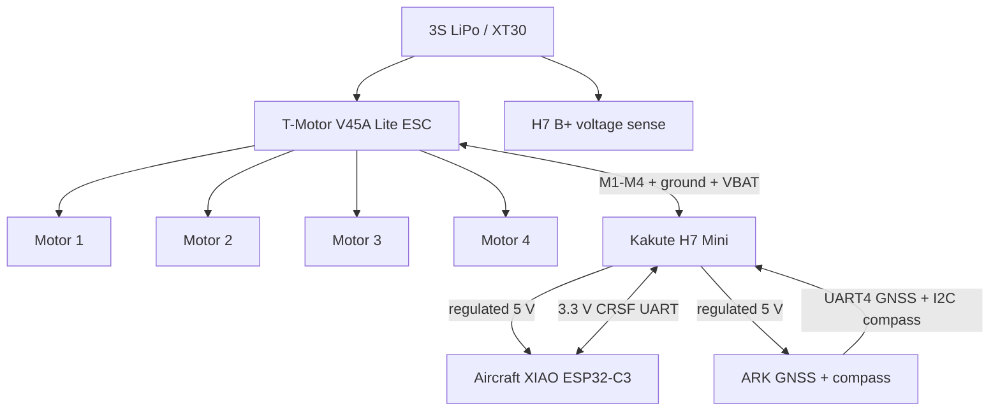

# Electronics and Wiring Design

## Electrical Architecture



The flight battery connects directly to the ESC. The H7 receives battery
voltage on `B+`, uses its onboard regulator for avionics, and drives the ESC
with four DShot signals. No ESP32 pin ever connects to a motor output.

## Power Domains

| Domain | Source | Loads | Design rule |
|---|---|---|---|
| `VBAT_3S` | 3S LiPo through XT30 | ESC power stage, H7 `B+` sense/input | Short 18 AWG loop; capacitor at ESC pads |
| `5V_FC` | Kakute H7 regulator | Aircraft C3, GNSS/compass, buzzer | Budget to 1.5 A until delivered-board documentation is reconciled |
| `3V3_LOGIC` | Local regulators on H7/C3/GNSS boards | UART/I2C logic | Never tie separate 3.3 V regulator outputs together |
| `HAND_BAT` | Protected 1S LiPo | Hand XIAO battery input | Verify polarity and charging path before connection |

Holybro's store page lists a 5 V/2 A BEC, while its current pinout page says
1.5 A maximum. Use the lower 1.5 A value for design and check the manual shipped
with the exact v1.5 board. The 3.3 V H7 output is listed at only 0.25 A and must
not power the aircraft C3. [[9]](sources.md#source-9)
[[26]](sources.md#source-26)

### Avionics budget

| Load | Design allowance |
|---|---:|
| Aircraft XIAO ESP32-C3 including BLE peaks | 500 mA transient allowance |
| ARK SAM GPS Mini | 20 mA maximum published |
| Active buzzer | 50 mA allowance; verify selected part |
| Wiring/regulator margin | At least 500 mA |
| **Total planning ceiling** | **1.07 A** |

This fits the conservative 1.5 A rail on paper. Validate at cold start, during
BLE reconnect, with motors running, and at the lowest expected battery voltage.
If the C3 resets or the 5 V rail dips below its valid range, power the C3 from a
separate 5 V buck regulator rated for at least 500 mA continuous and transient
load. Do not remove decoupling or disable brownout detection to hide the fault.

## Aircraft Wiring

### H7 to ESC

The Kakute ESC connector exposes `B+`, `R7`, `GND`, `CURRENT`, and `M1-M4`.
The V45A is from a different manufacturer. Connector pin order is not assumed.

| H7 signal | ESC connection | Rule |
|---|---|---|
| `B+` | ESC battery positive / VBAT sense | Verify 3S voltage before plugging H7 |
| `GND` | ESC signal/power ground | Required common reference |
| `M1` | ESC channel for motor 1 | Verify against PX4 quad geometry |
| `M2` | ESC channel for motor 2 | Verify against PX4 quad geometry |
| `M3` | ESC channel for motor 3 | Verify against PX4 quad geometry |
| `M4` | ESC channel for motor 4 | Verify against PX4 quad geometry |
| `CURRENT` | Leave open unless V45A current output is documented and calibrated | Do not guess a scale or pin |
| `R7` | Leave open | Selected ESC has no telemetry [[11]](sources.md#source-11) |

Do not insert the supplied H7 cable into the ESC and hope the pinout matches.
Continuity-map both boards, remove every wire from the housings, and repin or
solder a documented custom harness. Label the harness revision and keep the
continuity sheet with the aircraft.

Set DShot300 initially. BLHeli_S supports DShot150/300/600, and DShot300 is fast
enough for this aircraft without selecting the highest mode. [[31]](sources.md#source-31)
Twist or route
each signal with a nearby ground where practical. Keep DShot wires away from
motor phases and the battery loop.

### Battery input and capacitor

- Replace the ESC's heavy XT60 pigtail with a genuine XT30 and short 18 AWG
  silicone wire suitable for the measured current.
- Install a 470 uF low-ESR electrolytic capacitor rated at least 25 V directly
  across ESC battery pads.
- Observe capacitor polarity and insulate both leads.
- Add strain relief so plugging the battery cannot peel pads from the ESC.
- Before first battery connection, check resistance from VBAT to ground and use
  a current-limited smoke stopper.
- Never power the motors from a bench supply that cannot absorb regenerative
  energy or safely deliver the transient current.

### H7 to aircraft C3 CRSF

Use `TELEM1`, exposed as H7 `R1/T1` in the six-pin VTX connector. Fabricate a
four-wire removable receiver cable.

| Aircraft XIAO | H7 | Direction |
|---|---|---|
| `D6/GPIO21` TX | `R1` | C3 CRSF commands to H7 |
| `D7/GPIO20` RX | `T1` | H7 CRSF telemetry to C3 |
| `GND` | `GND` | Common reference |
| `5V` through series Schottky diode | H7 `5V` pad | H7 powers C3 |

For the external 5 V input, follow Seeed's recommended diode arrangement:
source to diode anode, diode cathode to the XIAO 5 V pin. Add 100 uF bulk and
100 nF ceramic decoupling at the C3. [[1]](sources.md#source-1)

Leave `VTX+` and `R6` in the H7 VTX connector unconnected. `VTX+` is raw battery
voltage and would destroy a 5 V-only load. Key the receiver plug so it cannot be
shifted by one pin or reversed.

The later ExpressLRS receiver uses H7 `5V`, `GND`, `R1`, and `T1` on this same
removable interface. The BLE gateway is unplugged first. Never connect receiver
TX lines together.

### H7 to GNSS/compass

The ARK module supplies GNSS over UART and compass over I2C. Its documented
six-pin connector order is 5 V, RX, TX, SCL, SDA, GND. Connector naming
differs between published pages, so use the included cable and verify pitch and
pin 1 on the delivered unit before cutting the flight-controller end.
[[13]](sources.md#source-13) [[14]](sources.md#source-14)

| ARK signal | H7 connection | Note |
|---|---|---|
| 5 V | `5V` | From H7 avionics rail |
| RX | `T4` | H7 UART4 TX to GNSS RX |
| TX | `R4` | GNSS TX to H7 UART4 RX / GPS1 |
| SCL | `SCL` | H7 I2C clock |
| SDA | `SDA` | H7 I2C data |
| GND | `GND` | Common reference |

Mount the antenna face up and forward, as far as practical from the ESC,
battery lead, motors, and C3 antenna. Give the cable strain relief without
placing ferromagnetic fasteners beside the compass.

### Buzzer

Connect the buzzer positive lead to H7 5 V and negative/control lead to the
documented `Z-`/buzzer-negative pad. Confirm the exact buzzer type and current.
Do not substitute an inductive sounder that exceeds the pad's drive capability.

## Hand Controller Wiring

### BNO085 interface

Use UART-RVC rather than I2C. Adafruit documents that the BNO08x I2C
implementation can violate I2C timing and does not work well with ESP32-family
devices. UART-RVC provides yaw, pitch, roll, and acceleration at 115200 baud.
[[6]](sources.md#source-6) [[7]](sources.md#source-7)

Configure the BNO085 breakout for UART-RVC according to its board documentation.
For the Adafruit board, this requires the RVC mode strap. Wire:

| BNO085 breakout | Hand XIAO | Purpose |
|---|---|---|
| `VIN` | `3V3` | Sensor power |
| `GND` | `GND` | Common reference |
| `SDA/TX` | `D7/GPIO20` RX | One-way UART-RVC data |
| RVC mode strap | As documented by breakout | Select UART-RVC at reset |

The XIAO TX line is not required for one-way RVC. Read packets as they arrive,
validate framing, and feed the latest valid sample into the 100 Hz control tick.

### Hand pin map

| XIAO pin | Function | Electrical detail |
|---|---|---|
| `D1/GPIO3` | Vertical stick ADC | Wiper; stick ends to 3.3 V and GND |
| `D2/GPIO4` | Yaw stick ADC | Wiper; stick ends to 3.3 V and GND |
| `D3/GPIO5` | Deadman | External 10 kohm pull to inactive state; switch to active state |
| `D4/GPIO6` | ARM | External 10 kohm pull; momentary input |
| `D5/GPIO7` | KILL | External 10 kohm pull; guarded momentary input |
| `D7/GPIO20` | BNO085 UART RX | 115200 baud |
| `D10/GPIO10` | Status LED | 1 kohm series resistor |
| `D6/GPIO21` | Spare | Reserve for debug or optional haptic driver |
| `D0/GPIO2`, `D8/GPIO8`, `D9/GPIO9` | Reserved | ESP32-C3 strapping-related pins; do not use for safety controls |

The thumb stick contains two self-centering 10 kohm potentiometers. Measure the
actual center, minimum, and maximum at startup while disarmed. Add 10 nF from
each ADC wiper to ground only if noise testing justifies it; too much filtering
adds control lag. [[25]](sources.md#source-25)

Use external resistors so every switch has an inactive electrical state during
reset. Firmware pullups are not sufficient as the only definition for safety
inputs.

### Hand battery

The selected protected 500 mAh cell is a separate part from the XIAO and uses a
JST-PH lead. The XIAO exposes rear battery pads. Verify positive/negative with a
meter and make a polarity-correct, strain-relieved adapter; JST polarity is not
assumed across vendors. [[24]](sources.md#source-24)

Do not connect USB and an external 5 V source in a way that backfeeds either
supply. Follow the XIAO charging instructions for the exact board revision.
Enclose the cell so the operator cannot bend, puncture, or short it.

## Mechanical and RF Placement

```text
top of aircraft

GNSS/compass: highest/cleanest location, forward marker aligned
H7: vibration-isolated 20x20 mount, arrow/orientation recorded
air C3: antenna at body edge, clear of carbon/battery/ESC
ESC: separate 30.5x30.5 mount with airflow
battery: centered near CG, retained by strap plus anti-ejection stop
```

- Keep the C3 external antenna and its feed away from carbon, metal, batteries,
  and switching-current loops.
- Route motor phase wires away from GNSS/compass and the C3 antenna.
- Keep the H7 IMU near the aircraft center of gravity.
- Record H7 orientation in the assembly drawing and PX4 configuration.
- Prevent propeller or guard flex from touching any wire at full deflection.
- Ensure USB, boot, battery disconnect, and receiver plug remain accessible.
- Use a second mechanical battery retention feature; a strap alone can loosen.

## Assembly Inspection

Before applying power, two people independently verify:

1. Battery polarity at XT30 and ESC pads.
2. Capacitor polarity and voltage rating.
3. No continuity short from VBAT to ground.
4. H7/ESC harness pin order wire by wire.
5. No raw VBAT on C3 or GNSS 5 V pins.
6. UART TX crosses to RX in both CRSF and GNSS cables.
7. All grounds are present and regulator outputs are not tied together.
8. Exposed joints are insulated and every connector is strain-relieved.
9. H7 and GNSS orientation arrows match documentation.
10. Propellers are absent for all first-power and motor-order tests.

Photograph both sides of every board and the final harness routing before the
body is closed. These images become the as-built record for fault diagnosis.
