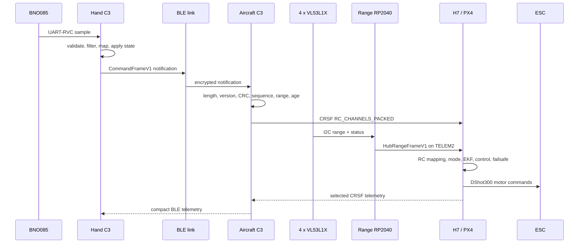
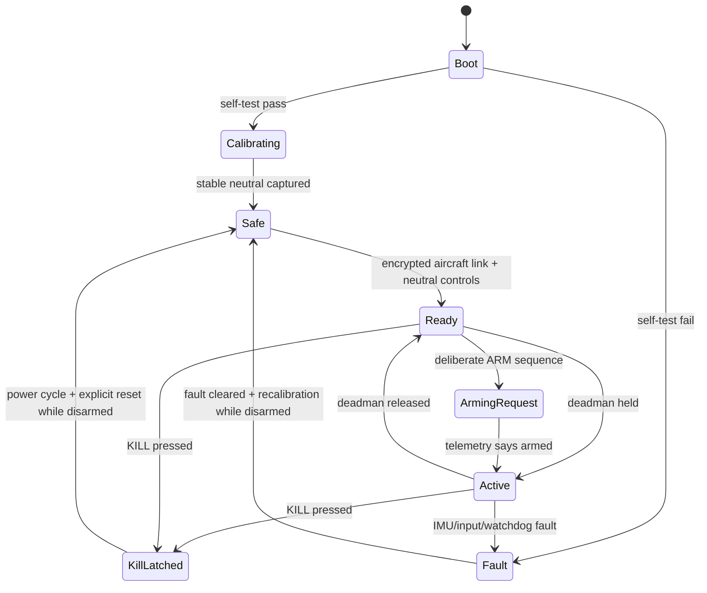
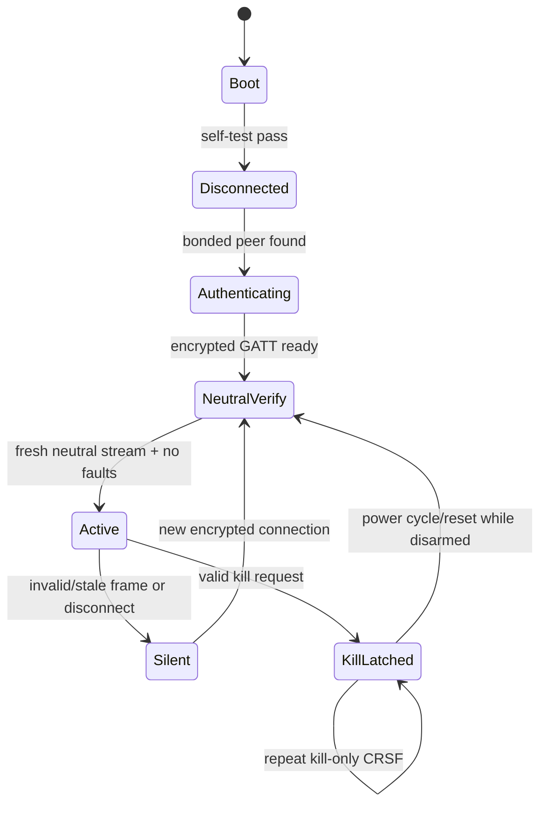

> **Historical design:** this 3S / XIAO / Kakute H7 Mini design predates the current 4S / Feather BOM. Use the [current architecture](../architecture.md) and [controller build guide](../controller/build-guide.md). Do not mix these pin assignments with the current schematic.

# Firmware and MCU Interaction Design

## Version Baseline

Pin exact toolchain and firmware versions in the implementation repository:

| Target | Baseline | Rule |
|---|---|---|
| H7 flight controller | PX4 v1.17.0, `holybro_kakuteh7mini_default` | Custom build with `crsf_rc`; archive binary, parameters, and source commit |
| Hand C3 | ESP-IDF stable release selected at implementation start | Use ESP-NimBLE and hardware UART; no Wi-Fi at runtime |
| Aircraft C3 | Same ESP-IDF release as hand | Share protocol library and test vectors |
| Range hub | Pinned Pico SDK or equivalent RP2040 release | No radio stack; archive binary, source commit, and sensor configuration |
| ESC | Factory BLHeli_S revision recorded before changes | Configure only after props-off motor tests |

PX4 v1.17 is the stable documentation baseline at the research date.
[[15]](sources.md#source-15) Do not silently build against PX4 `main` or update
ESP-IDF between test runs.

## Runtime Ownership



The H7 never waits on BLE or the range hub. The aircraft C3 never computes motor
percentages. The range hub cannot change RC channels or setpoints. The hand
never sends an attitude target that bypasses PX4's manual-control limits.

## Shared Command Protocol

### Frame layout

Use a packed, explicitly serialized, little-endian 18-byte frame. Do not send a
native C struct because padding and endianness would become implicit.

```text
offset  bytes  type   field
0       1      u8     protocol_version = 1
1       1      u8     flags
2       2      u16    sequence
4       4      u32    sender_tick_ms
8       2      i16    pitch       [-1000, 1000]
10      2      i16    roll        [-1000, 1000]
12      2      i16    vertical    [-1000, 1000]
14      2      i16    yaw         [-1000, 1000]
16      2      u16    CRC16-CCITT over bytes 0..15
```

Flag bits:

| Bit | Name | Meaning |
|---:|---|---|
| 0 | `DEADMAN` | Operator is deliberately enabling live commands |
| 1 | `ARM_REQUEST` | Deliberate arming sequence is active |
| 2 | `KILL_REQUEST` | Guarded kill is latched |
| 3 | `CALIBRATED` | Valid neutral calibration exists |
| 4 | `HAND_FAULT` | Sensor/input/self-test fault; control is invalid |
| 5-7 | Reserved | Must be zero in version 1 |

CRC detects accidental application-frame corruption; BLE link encryption and
authentication provide peer security. CRC is not a cryptographic authenticator.

The sender timestamp is for logs. The aircraft C3 timestamps receipt with its
own monotonic clock and uses that local timestamp for the 60 ms age decision.

### Sequence ordering

Use modulo-16-bit forward ordering. A candidate is newer only when the unsigned
difference from the last accepted sequence is in `1..32767`. Reset sequence
state only after a new encrypted connection enters the disarmed handshake.
Test duplicates, rollback, wrap from 65535 to 0, and a sender reboot.

## Hand Controller Firmware

Pin constants and electrical reset states are fixed by the
[pin-level MCU architecture](pin-architecture.md). The hand target uses D1/D2
for scaled ADC1 inputs, D3/D4/D5 for active-low safety controls, D7 for BNO085
UART-RVC RX, and D10 for the status LED. D6/UART0 TX remains unconnected.

### Task structure

| Task | Rate/event | Priority intent |
|---|---|---|
| Safety GPIO | interrupt plus debounce state | Highest application priority; KILL latched immediately |
| BNO085 UART RX | continuous DMA/ring buffer if available | Never block BLE task; validate RVC frames |
| Control tick | 100 Hz | Build one coherent input snapshot and command frame |
| BLE host | stack events | Notify newest frame; no unbounded queue |
| Telemetry/UI | 20 Hz or slower | LED/haptic only; may be dropped |
| Diagnostics | disarmed only | USB logs; must not share control UART |

Watchdog each task and the overall control tick. A sensor parser stall or BLE
allocation failure must transition to `HAND_FAULT`, not preserve the last live
command.

### Hand state machine



No startup, reconnect, or brownout path may enter `Active` or restore an arm
request. `KILL_REQUEST` remains latched until a deliberate disarmed reset.

### BNO085 and gesture mapping

Use BNO085 UART-RVC at 115200. It reports principal-axis yaw, pitch, roll, and
acceleration. [[7]](sources.md#source-7) Read each frame as bytes, validate its
header/checksum per the sensor documentation, reject non-finite/out-of-range
values, and record receive age.

Initial gesture mapping:

| Input | Pilot channel | Initial map |
|---|---|---|
| Hand roll relative to calibrated neutral | Roll | 3 degree deadband; saturate at +/-20 degrees |
| Hand pitch relative to calibrated neutral | Pitch | 3 degree deadband; saturate at +/-20 degrees |
| Self-centering stick vertical axis | Vertical/throttle | Center is zero climb/descent |
| Self-centering stick horizontal axis | Yaw | Center is zero yaw rate |

Do not use hand yaw from the BNO085 for aircraft yaw in version 1. This avoids
turning magnetic heading drift and operator body rotation into an unintended
aircraft command. The dedicated stick is unambiguous and self-centering.

When collision-assisted mode is selected, apply dominant-axis locking after
deadband/filtering: emit either roll or pitch, never both. Use magnitude
hysteresis to retain the current axis near equality, and require horizontal
neutral before accepting yaw. This keeps pilot commands inside the four
measured VL53L1X cones; unrestricted diagonal movement is not supported by the
first sensor geometry.

Capture neutral only while disarmed, deadman released, buttons inactive, and
the IMU is stable for at least two seconds. Store calibration with a version and
CRC, but require a quick neutral check on every boot.

Start with a short low-pass filter selected from measured hand noise. Keep total
filter group delay within the end-to-end latency budget. A smooth-looking trace
is not worth delayed stop intent.

### Button semantics

- Deadman must be continuously held for live movement. Release marks commands
  invalid; the aircraft gateway stops CRSF.
- ARM requires deadman, neutral axes, calibrated hand, good encrypted link, no
  telemetry fault, and a deliberate press-and-hold sequence. PX4 still decides
  whether arming is permitted.
- KILL is a separate guarded momentary input. On activation, set kill high,
  clear arm, and latch locally.

## BLE Design

### Roles and connection

| Setting | Initial value |
|---|---:|
| Hand role | Peripheral / GATT server |
| Aircraft role | Central / GATT client |
| PHY | LE 1M |
| Connection interval request | 10 ms |
| Peripheral latency | 0 |
| Supervision timeout | 200 ms |
| Command notification | 100 Hz, newest only |
| Telemetry notification | 20 Hz maximum |

ESP-IDF documents connection intervals in 1.25 ms units, peripheral latency,
and supervision timeout behavior. [[2]](sources.md#source-2) Read back the
negotiated connection parameters; fail the prearm link check if they are outside
the characterized envelope.

### GATT surface

Use one custom service with a minimal fixed surface:

| Characteristic | Direction | Property | Armed access |
|---|---|---|---|
| Command V1 | Hand to aircraft | Notify | Enabled |
| Telemetry V1 | Aircraft to hand | Notify | Enabled, 20 Hz max |
| Device/protocol info | Both | Read | Enabled |
| Commissioning/config | Both | Authenticated write | Rejected while armed |

Do not expose arbitrary PX4 parameter writes through BLE. Configuration changes
use USB/QGroundControl while disarmed.

### Security and commissioning

- Require LE Secure Connections and bonding.
- Permit pairing only for a short window opened by physical action on both
  devices while the aircraft is disarmed.
- Retain exactly one allowed peer in the first version.
- Use an allowlist after commissioning.
- Reject unencrypted command subscriptions and notifications.
- Disable Wi-Fi in both products during operation.
- Plan secure boot and signed updates for a product revision; do not burn
  irreversible development eFuses before the recovery process is proven.

Because the prototype has no display/keypad and no out-of-band key channel,
Secure Connections pairing will not by itself provide authenticated MITM
protection. The simultaneous physical pairing window and controlled lab reduce
exposure but do not create cryptographic user verification. A product release
must add authenticated out-of-band provisioning or suitable user I/O.

ESP-IDF exposes bonding, authentication, and encryption configuration in its
BLE GAP APIs. [[3]](sources.md#source-3)

### BLE limits

BLE does not provide a guaranteed range. The first operating target is 10 m,
subject to a measured p99 latency and packet-validity test in the real body.
The aircraft C3 antenna can be shadowed by the battery, carbon, wiring, or the
operator. Wi-Fi and other 2.4 GHz devices can increase packet loss.

Log RSSI for RF diagnosis only. Never convert it to meters, trigger Hold from
it, or call it a bounding box.

## Aircraft Gateway Firmware

### State machine



The gateway does not automatically return from `Silent` to active command
output. It requires a new neutral stream and low arm/kill channels. Once a valid
KILL is accepted, the gateway repeatedly sends neutral axes, ARM low, and KILL
high; this kill-only state is the sole exception to stale-command silence. If
the C3 reboots, the selected D10 CRSF TX pin returns to input/high-impedance and
its external 47 kohm pull-up holds the line idle-high. No valid CRSF frames are
sent, so PX4 detects RC loss.

Use `UART_NUM_1`, TX on `D10/GPIO10`, and RX on `D4/GPIO6`. Do not place CRSF
on `D6/GPIO21`: UART0 emits ESP32-C3 ROM boot text there during reset. Configure
the UART pins explicitly with `uart_set_pin()` before enabling the 100 Hz CRSF
scheduler. [[50]](sources.md#source-50) [[51]](sources.md#source-51)

### Validation order

For each notification:

1. Record local receipt timestamp.
2. Check exact length and protocol version.
3. Check reserved flags and legal state combination.
4. Verify CRC16.
5. Verify sequence is newer.
6. Verify all axes are within bounds.
7. Verify calibrated/no-fault/deadman state for live output.
8. Atomically publish the accepted command to the CRSF scheduler.

At every CRSF tick, compare current monotonic time to the last accepted receipt.
If age exceeds 60 ms, stop RC frame transmission. Never retransmit a stale
movement frame just because BLE has not emitted a disconnect event. A previously
validated KILL is separately latched and repeated as the fixed kill-only frame.

### CRSF encoder

Use full-duplex, uninverted, 3.3 V UART at the baud rate owned by the PX4 CRSF
driver (nominally 420000 baud). The standard RC frame is:

```text
byte 0       address/sync: 0xC8
byte 1       length: 24 (type + payload + CRC)
byte 2       type: 0x16 RC_CHANNELS_PACKED
bytes 3..24  16 channels x 11 bits = 22 bytes, little-endian bit packing
byte 25      CRC8, polynomial 0xD5, over type + payload
```

Use the official TBS CRSF specification as the executable contract and create
golden test vectors from it. [[17]](sources.md#source-17)

Map normalized axes monotonically into the documented CRSF channel range with
center at 992. Saturate before packing. Never allow integer overflow to wrap an
axis into an AUX switch.

| CRSF channel | Source | Safe/disconnected value |
|---|---|---|
| CH1 roll | hand roll axis | center |
| CH2 pitch | hand pitch axis | center |
| CH3 vertical | thumb stick | center while connected; no frames on loss |
| CH4 yaw | thumb stick | center |
| CH5 arm | arm state | low |
| CH6 flight mode | fixed Position selection after setup | configured safe mode |
| CH7 valid | gateway state | low |
| CH8 kill | guarded kill latch | high only on valid KILL |
| CH9-CH16 | unused | center/low as defined in test vector |

Transmit at 100 Hz while active. That matches BLE command generation and is far
below UART capacity. Do not build an accumulating queue; each tick uses only
the latest valid command.

In `KillLatched`, transmit the fixed kill-only frame at 100 Hz until a power
cycle or explicit reset is accepted while PX4 is disarmed. Configure and test a
finite PX4 kill-to-disarm timeout so a later receiver-state change cannot
restore motor output.

### Telemetry

If `RC_CRSF_TEL_EN` is enabled, parse only an allowlisted set of valid CRSF
telemetry frames and forward compact status at 20 Hz or less:

- PX4 armed state.
- Flight mode.
- Battery voltage/warning state.
- GNSS/position-ready flag.
- Failsafe flag.
- One fault code.

Telemetry loss must never delay, block, or invalidate fresh command processing.

## Range-Hub Firmware and H7 Driver

The XIAO RP2040 starts all four VL53L1X sensors in shutdown, releases them one
at a time, and assigns volatile I2C addresses `0x30..0x33`. It then alternates
front/rear and right/left measurement slots, validates range status, and emits
fixed `HubRangeFrameV1` messages at 50 Hz on H7 `TELEM2`.

Every frame carries a sequence, four distances, a per-direction valid mask,
hub state, sample span, aggregate sensor-error counter, and CRC16. A sample
older than 100 ms loses its valid bit. Hub reset, bus recovery, or address
reinitialization clears every valid bit before any sensor is restarted.
Unknown/no-return is never converted to maximum range.

Add a small PX4 `gesture_obstacle` serial driver to validate local receive age,
frame structure, CRC, sequence, reserved bits, hub state, sample span, and
range. It publishes one
oriented `distance_sensor` instance per fresh direction with the exact tested
FoV. It stops publishing a direction immediately when the hub marks it invalid.

The complete 26-byte frame, task schedule, pin map, PX4 publication behavior,
and tests are specified in
[collision-prevention.md](collision-prevention.md).

## PX4 Build and Installation

The Kakute ships with Betaflight. PX4 requires flashing the board's PX4
bootloader first. Follow the PX4 board page and retain a known recovery method.
[[10]](sources.md#source-10)

The implementation sequence is:

```sh
git clone https://github.com/PX4/PX4-Autopilot.git
cd PX4-Autopilot
git checkout v1.17.0
git submodule update --init --recursive
make holybro_kakuteh7mini_default boardconfig
```

In `boardconfig`:

- Disable `drivers -> rc_input`.
- Enable `drivers -> RC -> crsf_rc`.
- Enable the project `gesture_obstacle` distance-sensor driver after it passes
  host tests; retain PX4's Collision Prevention and multicopter position control.
- Save the board configuration change in the project fork.

Build and upload only after installing the PX4 bootloader:

```sh
make holybro_kakuteh7mini_default
make holybro_kakuteh7mini_default upload
```

PX4 explicitly states that CRSF support is not included by default and that
`rc_input` must be removed while `crsf_rc` is enabled. [[16]](sources.md#source-16)

Archive for every flight-test release:

- PX4 git commit and dirty-state report.
- Board configuration diff.
- `.px4` firmware artifact and SHA-256.
- QGroundControl parameter export.
- Airframe/body revision.
- Hand and gateway firmware commits and binaries.
- ESC configuration dump if changed.

## PX4 Configuration Baseline

### Ports and sensors

| Item | Configuration |
|---|---|
| CRSF port | Free `TELEM1` from its MAVLink mapping, then set `RC_CRSF_PRT_CFG=TELEM1` |
| CRSF telemetry | `RC_CRSF_TEL_EN=1` only after command-only operation passes |
| Range-hub port | Free `TELEM2` from MAVLink; start `gesture_obstacle` on `/dev/ttyS1` at 115200 |
| GNSS | UART4 / `GPS1`, verified in QGroundControl |
| External compass | Enable/detect external magnetometer and calibrate in final installed orientation |
| ESC protocol | DShot300 on M1 `PB0`, M2 `PB1`, M3 `PB3`, and M4 `PB10` |
| Airframe | Generic quad-X: M1 front-right CCW, M2 rear-left CCW, M3 front-left CW, M4 rear-right CW |

PX4 handles CRSF UART baud configuration after the port is assigned. If
`TELEM1` is mapped to MAVLink, unmap that instance before selecting CRSF.
[[16]](sources.md#source-16)

### RC mapping

Calibrate all channels with propellers removed. Use QGroundControl mapping and
confirm the parameter names on the pinned build:

| Function | Channel |
|---|---:|
| Roll | CH1 |
| Pitch | CH2 |
| Throttle/vertical | CH3 |
| Yaw | CH4 |
| Arm switch | CH5 |
| Flight mode | CH6, Position |
| Kill switch | CH8 |

Verify signs by moving one input at a time. The vehicle must not arm with
deadman released, a stale stream, an uncalibrated hand, non-neutral movement
axes, or a high KILL channel.

### Initial safety and motion parameters

| Parameter/policy | Initial value |
|---|---:|
| `COM_RC_LOSS_T` | 0.5 s |
| `COM_FAIL_ACT_T` | 0 s |
| `NAV_RCL_ACT` | Land |
| `GF_MAX_HOR_DIST` | 15 m |
| `GF_MAX_VER_DIST` | 5 m |
| `GF_ACTION` | Hold |
| Geofence position source | Estimated global position; verify on pinned build |
| `MPC_ACC_HOR_MAX` | 2 m/s^2 |
| `MPC_VEL_MANUAL` | 2 m/s |
| `MPC_Z_VEL_MAX_UP` | 1 m/s |
| `MPC_Z_VEL_MAX_DN` | 0.7 m/s |

These are project starting values, not claims about PX4 defaults. Confirm each
name, unit, range, and resulting behavior in QGroundControl. PX4 documents that
Position mode requires global position and uses `MPC_ACC_HOR_MAX` and
`MPC_VEL_MANUAL` for horizontal movement. [[20]](sources.md#source-20)

Configure battery cell count, voltage-divider calibration, charged/empty
voltage, warning thresholds, and Land action for the exact 3S pack. Derive
thresholds from the battery manufacturer's limits and measured sag; do not copy
generic values from this document.

### Collision-assisted profile

Keep `CP_DIST` negative/disabled until the complete collision test sequence
passes. The first enabled profile uses:

| Parameter/policy | Initial value |
|---|---:|
| `CP_DIST` | 0.6 m |
| `CP_DELAY` | 0.3 s, then tune from logs |
| `CP_GUIDE_ANG` | 0 deg |
| `CP_GO_NO_DATA` | 0 |
| `MPC_POS_MODE` | Acceleration based |
| `MPC_VEL_MANUAL` | 0.5 m/s |
| `MPC_ACC_HOR_MAX` | 1.5 m/s^2 |
| Horizontal command policy | Dominant axis only; no translation while yawing |

PX4 maps rangefinder reports into obstacle sectors according to their
orientation and FoV, blocks movement into no-data directions when configured,
and stops/Holds after complete range loss on documented timeouts. Verify every
behavior on the pinned build. [[32]](sources.md#source-32)

## Failure Timing Budget

| Event | Budget |
|---|---:|
| Last valid BLE command to gateway CRSF silence | <=60 ms |
| CRSF silence to PX4 RC-loss declaration | 500 ms configured |
| Additional PX4 failsafe delay | 0 ms configured |
| Measured last BLE command to Land-action start | <=650 ms acceptance target |
| Guarded KILL to stopped DShot commands | <=100 ms props-off target |

The 650 ms figure includes the 60 ms gateway timeout, 500 ms PX4 timeout, and
scheduler/measurement margin. It is not time to motor stop: Land intentionally
continues controlled thrust until touchdown. KILL is the separate immediate
motor-stop path.

## ExpressLRS Later

The future radio work is deliberately small:

1. Unplug and remove the aircraft BLE gateway.
2. Connect an ExpressLRS receiver TX/RX/5V/GND to the keyed CRSF receiver plug.
3. Bind/configure the transmitter and receiver according to official
   ExpressLRS documentation. [[29]](sources.md#source-29)
4. Keep the same CRSF channels and PX4 port.
5. Repeat calibration, stale/loss behavior, arming, kill, geofence, and range
   validation from zero.

Do not treat longer range as permission to fly farther. The operating boundary
remains an H7 position-safety and site-safety decision.
