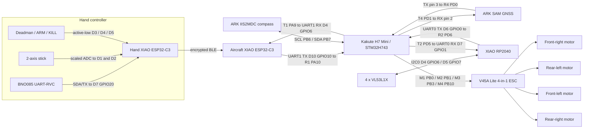

> **Archived design — superseded 2026-09-16.** The active project physically builds only the hand controller: first simulate and validate it in Simantic, then build its prototype. The second goal is a virtual drone: Simantic models its hardware/microcontroller and produces actuator signals for a mechanical simulation shown on screen. Physical drone construction, aircraft purchases and flight tests are outside scope; Pocket/ELRS/trainer hardware is not required.
>
> Use the [project goals](../../README.md), [current architecture](../architecture.md) and [controller plan](../controller/README.md). The original September 10 record below is retained as design history. Its “current,” “required,” “later,” procurement and flight instructions describe that abandoned plan, not present requirements; its MCU selections do not select the virtual drone's implementation.

# Pin-Level MCU and Electrical Architecture

Research and pin audit: 2026-09-10

## Status and Scope

This is the authoritative Revision A pin allocation for the H7/BLE prototype.
It defines the board pad, MCU GPIO, peripheral instance, connected device,
electrical direction, reset behavior, and reason for every used signal.

Use board labels when building harnesses and MCU GPIO names in firmware. Do not
wire from an STM32 package-pin number or connector cavity number alone. The
delivered H7 and ESC must be continuity-mapped because the selected boards come
from different manufacturers and their supplied cable orders are not assumed.

The design contains four processors:

| Processor | Board | Authority |
|---|---|---|
| Hand ESP32-C3 | Seeed XIAO ESP32-C3 | Read operator controls and send pilot intent over BLE |
| Gateway ESP32-C3 | Seeed XIAO ESP32-C3 | Validate BLE and emit CRSF receiver frames |
| Range RP2040 | Seeed XIAO RP2040 | Read four VL53L1X sensors and report ranges |
| Flight STM32H743 | Holybro Kakute H7 Mini v1.5 | Estimate state, enforce safety, allocate motors, and generate DShot |

Only the STM32H743/PX4 flight controller has flight authority.

## Complete Signal Diagram



## Interface Summary

| Link | Source pin | Destination pin | Electrical mode | Rate |
|---|---|---|---|---:|
| Hand IMU | BNO085 `SDA/TX` | Hand C3 `D7/GPIO20` | 3.3 V UART, sensor to MCU only | 115200 baud |
| BLE receiver | Gateway C3 `D10/GPIO10` | H7 `R1/PA10` | 3.3 V full-duplex CRSF TX | 420000 baud |
| CRSF telemetry | H7 `T1/PA9` | Gateway C3 `D4/GPIO6` | 3.3 V full-duplex CRSF RX | 420000 baud |
| Range data | RP2040 `D6/GPIO0` | H7 `R2/PD6` | 3.3 V UART | 115200 baud |
| Range config | H7 `T2/PD5` | RP2040 `D7/GPIO1` | 3.3 V UART | 115200 baud |
| GNSS data | ARK pin 3 `TX` | H7 `R4/PD0` | 3.3 V UART | PX4 GPS driver |
| GNSS control | H7 `T4/PD1` | ARK pin 2 `RX` | 3.3 V UART | PX4 GPS driver |
| Compass/barometer | H7 `SCL/PB6`, `SDA/PB7` | ARK pins 4/5 and onboard barometer | 3.3 V I2C1 | PX4-managed |
| ToF bus | RP2040 `D4/GPIO6`, `D5/GPIO7` | Four VL53L1X `SDA/SCL` | 3.3 V I2C0 | At most 400 kHz |
| Motor commands | H7 `M1..M4` | ESC `S1..S4` | 3.3 V DShot | DShot300 |

[[10]](sources.md#source-10) [[26]](sources.md#source-26)
[[35]](sources.md#source-35) [[45]](sources.md#source-45)

## STM32H743 Flight-Controller Pin Plan

### External board connections

| H7 board label | STM32H743 pin | PX4 endpoint | Connect to | Why selected |
|---|---|---|---|---|
| `T1` | `PA9`, USART1 TX | `/dev/ttyS0`, `TELEM1` | Gateway C3 `D4/GPIO6` RX | Dedicated full-duplex CRSF port; future ELRS can replace the gateway on the same connector |
| `R1` | `PA10`, USART1 RX | `/dev/ttyS0`, `TELEM1` | Gateway C3 `D10/GPIO10` TX | Receives validated CRSF without using the H7 RC-in inverter path |
| `T2` | `PD5`, USART2 TX | `/dev/ttyS1`, `TELEM2` | RP2040 `D7/GPIO1` RX | Dedicated range-hub configuration and heartbeat path |
| `R2` | `PD6`, USART2 RX | `/dev/ttyS1`, `TELEM2` | RP2040 `D6/GPIO0` TX | Keeps experimental ToF traffic off the H7 I2C sensor bus |
| `T4` | `PD1`, UART4 TX | `/dev/ttyS3`, `GPS1` | ARK connector pin 2 `RX` | PX4's board-defined GNSS port |
| `R4` | `PD0`, UART4 RX | `/dev/ttyS3`, `GPS1` | ARK connector pin 3 `TX` | PX4's board-defined GNSS port |
| `SCL` | `PB6`, I2C1 SCL | external I2C bus 1 | ARK connector pin 4 `SCL` | Required by the ARK IIS2MDC compass; also shared with the onboard barometer |
| `SDA` | `PB7`, I2C1 SDA | external I2C bus 1 | ARK connector pin 5 `SDA` | Required by the ARK IIS2MDC compass; also shared with the onboard barometer |
| `M1` | `PB0`, TIM3 CH3 | output 1 | ESC `S1` | Timer/DMA-backed DShot output for PX4 Motor 1 |
| `M2` | `PB1`, TIM3 CH4 | output 2 | ESC `S2` | Timer/DMA-backed DShot output for PX4 Motor 2 |
| `M3` | `PB3`, TIM2 CH2 | output 3 | ESC `S3` | Timer/DMA-backed DShot output for PX4 Motor 3 |
| `M4` | `PB10`, TIM2 CH3 | output 4 | ESC `S4` | Timer/DMA-backed DShot output for PX4 Motor 4 |
| `B+` | Power input plus `PC0`, ADC1 input 10 through board divider | FC input and battery voltage | ESC battery-positive/VBAT pad | Powers the onboard regulator and gives PX4 pack voltage without routing propulsion current through the connector |
| `CURRENT` | `PC1`, ADC1 input 11 | battery current | **No connection in Revision A** | V45A Lite has no documented compatible analog-current output; do not guess a scale |
| `R7` | `PE7`, UART7 RX | `/dev/ttyS5` | **No connection in Revision A** | Selected ESC has no telemetry output |
| `Z-`/`Buz-` | `PC13` | tone alarm | Active piezo negative/control; positive to H7 5 V | PX4-owned audible safety indication |
| `5V` | board 5 V regulator | `5V_FC` | GNSS, C3/hub diode inputs, ToF regulator, buzzer | Use the conservative 1.5 A documented limit until the delivered board is verified |
| `GND` | ground plane | common reference | Every aircraft subsystem | UART, I2C, DShot, and power sensing require a common reference |

USART3 (`PD8/PD9`) remains the NuttX debug console. USART6 (`PC6/PC7`) remains
reserved RC I/O. Motor outputs M5-M8 remain unconnected. This leaves known
recovery paths and prevents a later feature from silently sharing a flight
signal. PX4 v1.17.0 defines the serial and timer mappings in its pinned board
source. [[45]](sources.md#source-45) [[46]](sources.md#source-46)

### Factory-wired H7 devices

These pins are already routed on the Holybro PCB. They are documented so no
custom firmware or later hardware feature attempts to reuse them.

| Device/function | STM32H743 pins | Bus/use | Rule |
|---|---|---|---|
| Onboard flight IMU | `PE2` SCK, `PE5` MISO, `PE6` MOSI, `PE4` CS, `PE1` DRDY | SPI4 | Factory-only; PX4 probes the supported IMU variant |
| Onboard barometer | `PB6` SCL, `PB7` SDA | I2C1 | Shares the external I2C bus with the ARK compass; do not attach ToF sensors here |
| Onboard flash | `PA5` SCK, `PA6` MISO, `PA7` MOSI, `PA4` CS | SPI1 | Reserved for logging/storage hardware |
| Onboard OSD | `PB13` SCK, `PB14` MISO, `PB15` MOSI, `PB12` CS | SPI2 | Factory-only even though no VTX is installed |
| Battery voltage ADC | `PC0`, ADC1 input 10 | Internal divider from `B+` | PX4 voltage monitoring |
| Current ADC | `PC1`, ADC1 input 11 | `CURRENT` pad | Disabled/unscaled until a compatible source is documented |
| Analog RSSI ADC | `PC5`, ADC1 input 8 | `RSI` pad | Unused; BLE RSSI never connects here |
| Tone output | `PC13` | `Z-`/`Buz-` | Active piezo only within pad-current limits |
| Onboard status LED | `PC2` | active-low/open-drain | PX4/board status only |
| USB | `PA11` DM, `PA12` DP, `PA8` VBUS detect | USB FS | Setup, bootloader, and logs |

The Holybro store identifies the purchasable v1.5 as ICM-42688-P plus SPA06.
The pinned PX4 board startup probes MPU6000, BMI270, then ICM-42688-P, and probes
BMP280 before SPA06 to support board revisions. Holybro's general documentation
currently contains conflicting sensor names, so procurement must use v1.5 SKU
11082 and receiving inspection must verify the detected PX4 device IDs before
the board is accepted. [[9]](sources.md#source-9)
[[47]](sources.md#source-47) [[53]](sources.md#source-53)

### Motor allocation and rotation

Use PX4's Generic Quadcopter X geometry. In the PX4 forward-right-down body
frame, positive X is forward and positive Y is right. Revision A assigns:

```text
                         FRONT

               M3 / output 3     M1 / output 1
               front-left        front-right
                   CW                CCW
                     \              /
                      \  H7 arrow  /
                      /            \
                     /              \
               M2 / output 2     M4 / output 4
               rear-left          rear-right
                   CCW               CW

                          REAR
```

| PX4 motor | Physical location | Rotation viewed from above | H7 pad/MCU pin | ESC channel |
|---:|---|---|---|---|
| 1 | Front right | CCW | `M1/PB0` | `S1` |
| 2 | Rear left | CCW | `M2/PB1` | `S2` |
| 3 | Front left | CW | `M3/PB3` | `S3` |
| 4 | Rear right | CW | `M4/PB10` | `S4` |

This mapping follows the pinned PX4 Generic Quadcopter X parameters: rotor 0
at `(+X,+Y)`, rotor 1 at `(-X,-Y)`, rotor 2 at `(+X,-Y)`, and rotor 3 at
`(-X,+Y)`. Positive moment coefficient means CCW and negative means CW.
[[48]](sources.md#source-48)

In QGroundControl, explicitly assign Motor 1 through Motor 4 to output 1 through
output 4. Remove all propellers, use Identify & Assign Motors, and record which
physical motor spins for every output. Configure ESC rotation in BLHeliSuite or
swap any two phase wires. Never change the PX4 function assignment merely to
make a motor spin in the other direction. [[49]](sources.md#source-49)

M1/M2 share the TIM3 output group and M3/M4 share TIM2. Configure all four as
DShot300. Do not mix PWM and DShot within either group.

## Aircraft ESP32-C3 Gateway Pin Plan

### Important correction from the earlier draft

Do not use XIAO `D6/GPIO21` as the CRSF transmit pin. It is ESP32-C3 UART0 TX,
and Seeed documents that ROM/bootloader text appears there during startup. A
resetting gateway must not send boot text into PX4's receiver input.
[[50]](sources.md#source-50)

Use `UART_NUM_1` and route it through the ESP32-C3 GPIO matrix:

```c
uart_set_pin(UART_NUM_1, GPIO_NUM_10, GPIO_NUM_6,
             UART_PIN_NO_CHANGE, UART_PIN_NO_CHANGE);
```

ESP-IDF supports assigning UART signals to selected GPIOs with `uart_set_pin()`.
[[51]](sources.md#source-51)

### Complete gateway pin table

| XIAO pin | ESP32-C3 function | Assignment | Reset/electrical rule | Reason |
|---|---|---|---|---|
| `D0` | `GPIO2`, ADC1 CH2 | Reserved | Strapping pin; no connection | Avoid changing boot mode |
| `D1` | `GPIO3`, ADC1 CH3 | Reserved input | No connection | Available only after a reviewed change |
| `D2` | `GPIO4`, ADC1 CH4/MTMS | Reserved input | No connection | Keep debug/future margin |
| `D3` | `GPIO5`, ADC2/MTDI | Reserved input | No connection | Keep debug/future margin |
| `D4` | `GPIO6`, MTCK | `UART_NUM_1` RX | 100 ohm series from H7 `T1`; 3.3 V only | CRSF telemetry input without a strapping pin |
| `D5` | `GPIO7`, MTDO | Reserved | No connection | Do not add a second flight interface |
| `D6` | `GPIO21`, U0TXD | ROM/debug only | No flight connection | Emits boot text during reset |
| `D7` | `GPIO20`, U0RXD | ROM/debug only | No flight connection | Preserve UART0 recovery/debug pair |
| `D8` | `GPIO8` | Reserved | Strapping pin; no connection | Avoid invalid boot strap combinations |
| `D9` | `GPIO9`, BOOT button | Reserved | Strapping/boot pin; no connection | Keep firmware recovery available |
| `D10` | `GPIO10` | `UART_NUM_1` TX | 100 ohm series to H7 `R1`; 47 kohm pull-up to gateway 3.3 V | Quiet, non-strapping CRSF transmit pin |
| `5V` | board power input | From H7 5 V through Schottky diode | Diode anode at H7 source, cathode at XIAO `5V` | Prevent USB/external-supply backfeed |
| `3V3` | local regulator output | UART pull-up only | Never tie to H7 3.3 V | Keep regulator domains separate |
| `GND` | ground | H7 ground | Required | Shared UART reference |

The gateway uses no hardware line that can arm or drive an ESC. Its only H7
interface is CRSF pilot intent on TELEM1. Before `UART_NUM_1` is configured,
`D10` remains input/high-impedance and the external pull-up holds the H7 receive
line at UART idle-high. PX4 must ignore all bytes until a complete valid CRSF
frame passes its protocol checks.

The H7 VTX connector includes `T1`, `R1`, and ground, but its `VTX+` pin is raw
battery voltage. Never connect `VTX+` to the XIAO. Bring regulated H7 `5V` from
a separate pad into the keyed four-wire receiver harness.

## Hand ESP32-C3 Pin Plan

### Complete hand-controller pin table

| XIAO pin | ESP32-C3 function | Assignment | Electrical rule | Reason |
|---|---|---|---|---|
| `D0` | `GPIO2`, ADC1 CH2 | Reserved | Strapping pin; no connection | Avoid boot-state dependency |
| `D1` | `GPIO3`, ADC1 CH3 | Vertical stick ADC | Scaled/filtered wiper input | ADC1 is suitable for reliable analog sampling |
| `D2` | `GPIO4`, ADC1 CH4/MTMS | Yaw stick ADC | Scaled/filtered wiper input | Uses the second reliable ADC1 channel |
| `D3` | `GPIO5`, ADC2/MTDI | Deadman | Active-low, external 10 kohm pull-up | Digital use avoids the documented ADC2 concern |
| `D4` | `GPIO6`, MTCK | ARM request | Active-low, external 10 kohm pull-up | Non-strapping pin and physically distinct control |
| `D5` | `GPIO7`, MTDO | KILL request | Active-low, external 10 kohm pull-up | Non-strapping pin; guarded control |
| `D6` | `GPIO21`, U0TXD | No connection | ROM boot-log output | Never attach a haptic motor or safety control here |
| `D7` | `GPIO20`, U0RXD | BNO085 UART-RVC RX | BNO `SDA/TX` to input; 115200 8N1 | Hardware UART receive and no MCU TX is needed |
| `D8` | `GPIO8` | Reserved | Strapping pin; no connection | Avoid invalid boot state |
| `D9` | `GPIO9`, BOOT button | Reserved | Strapping/boot pin; no connection | Preserve USB firmware recovery |
| `D10` | `GPIO10` | Status LED | 1 kohm series resistor | Link/ready/fault indication only |
| `3V3` | regulator output | BNO085, joystick, pulls | Hand domain only | Common 3.3 V logic/reference |
| `BAT+`, `BAT-` | underside battery pads | Protected 1S LiPo through master switch | Meter-verify polarity before soldering | Portable hand-controller supply |
| `GND` | ground | All hand peripherals | Required | Common signal reference |

Seeed identifies `GPIO2`, `GPIO8`, and `GPIO9` as ESP32-C3 strapping pins and
warns that D3 uses ADC2, while D0-D2 use ADC1. This allocation keeps both stick
axes on ADC1 and all safety controls off strapping pins. [[1]](sources.md#source-1)

### BNO085 exact wiring

Use the Adafruit BNO085 breakout in UART-RVC mode:

| BNO085 pin | Connection | State |
|---|---|---|
| `VIN` | Hand XIAO `3V3` | 3.3 V power |
| `GND` | Hand XIAO `GND` | Common reference |
| `SDA/TX` | Hand XIAO `D7/GPIO20` | One-way UART-RVC output |
| `P0` | `3V3`, preferably with the board solder jumper | High at reset |
| `P1` | Leave at breakout's default pull-down | Low at reset |
| `SCL/RX` | No connection | RVC needs no host TX |
| `RST`, `INT`, `BT`, `DI`, `CS` | No connection | Not used in UART-RVC mode |

`P1=0, P0=1` selects UART-RVC. Adafruit specifies 115200 baud and documents
that only the BNO085 `SDA` output and MCU RX are required. [[5]](sources.md#source-5)
[[7]](sources.md#source-7)

### Joystick analog front end

Do not connect a 0-3.3 V wiper directly and assume the full ADC range is linear.
Use this network independently on both axes:

```text
XIAO 3V3 ---- joystick potentiometer end
XIAO GND ---- joystick potentiometer other end

joystick wiper ---- 10 kohm ----+---- D1 or D2 ADC
                                 |
                               22 kohm
                                 |
                                GND
                                 |
                       10 nF from ADC node to GND
```

The 10 kohm/22 kohm divider limits a 3.3 V wiper to about 2.27 V before
potentiometer loading, below Seeed's nominal 2.5 V ADC full-scale guidance.
Calibrate minimum, center, and maximum on each assembled controller. Treat a
sample outside the accepted calibrated window as a control fault, not as a
full-scale command.

### Safety-switch input circuit

Use this circuit for Deadman, ARM, and KILL:

```text
3V3 ---- 10 kohm ----+---- ESP32-C3 input
                     |
                   10 nF
                     |
                    GND

ESP32-C3 input ---- 1 kohm ---- normally-open switch ---- GND
```

The released/open state is logic high and inactive. Pressing the switch is
logic low and active. On every boot, firmware must reject operation if ARM or
KILL is already active, and it must require a released-then-pressed transition.
The deadman alone can never arm. Firmware debounce is still required.

## RP2040 Range-Hub Pin Plan

| XIAO pin | RP2040 function | Assignment | Electrical rule | Reason |
|---|---|---|---|---|
| `D0` | `GPIO26/ADC0` | Front `XSHUT` | Output-low or input/high-Z only | Starts front sensor for address assignment |
| `D1` | `GPIO27/ADC1` | Right `XSHUT` | Output-low or input/high-Z only | Starts right sensor for address assignment |
| `D2` | `GPIO28/ADC2` | Rear `XSHUT` | Output-low or input/high-Z only | Starts rear sensor for address assignment |
| `D3` | `GPIO29/ADC3` | Left `XSHUT` | Output-low or input/high-Z only | Starts left sensor for address assignment |
| `D4` | `GPIO6/I2C0 SDA` | Shared ToF SDA | 3.3 V only; inspect aggregate pull-ups | Native XIAO I2C0 pin |
| `D5` | `GPIO7/I2C0 SCL` | Shared ToF SCL | 3.3 V only; at most 400 kHz | Native XIAO I2C0 pin |
| `D6` | `GPIO0/UART0 TX` | Range frames | 100 ohm series to H7 `R2/PD6` | Native XIAO UART transmit pin |
| `D7` | `GPIO1/UART0 RX` | Config/heartbeat | 100 ohm series from H7 `T2/PD5` | Native XIAO UART receive pin |
| `D8` | `GPIO2` | Reserved | No connection | Future test input only |
| `D9` | `GPIO4` | Reserved | No connection | Future test input only |
| `D10` | `GPIO3` | Reserved | No connection | Future test input only |
| `5V` | board power input | H7 5 V through Schottky diode | Do not connect powered USB simultaneously during aircraft operation | Hub power |
| `3V3` | local output | Logic reference only | Do not tie to `3V3_TOF` regulator output | Prevent regulator contention |
| `GND` | ground | H7, regulator, all sensors | Required | Common UART/I2C reference |

Use the XIAO RP2040's onboard LEDs for hub status; no external signal pin is
allocated. The standard board exposes the exact GPIO/I2C/UART mapping above.
[[36]](sources.md#source-36)

### VL53L1X branch netlist

Each of the four sensor branches contains six connected signals:

| VL53L1X carrier pin | Connect to | Rule |
|---|---|---|
| `VIN` | `3V3_TOF` from D24V5F3 | Powers onboard regulator and makes level-shifted I2C high equal 3.3 V |
| `GND` | Common aircraft ground | Required |
| `SDA` | RP2040 `D4/GPIO6` | Shared bus |
| `SCL` | RP2040 `D5/GPIO7` | Shared bus |
| `XSHUT` | Dedicated D0/D1/D2/D3 listed above | Never drive high; use low or high-Z |
| `GPIO1` | No connection | Polling design; interrupt output is unused |
| `VDD` | No connection | Regulated 2.8 V output; do not tie to a rail |

The carriers boot at 7-bit address `0x29`. Hold all four in shutdown and release
them one at a time, assigning front `0x30`, right `0x31`, rear `0x32`, and left
`0x33`. Addresses are volatile and must be reassigned after every power cycle.
[[35]](sources.md#source-35)

## ARK GNSS and Compass Harness

The ARK connector is a six-pin JST-GH UART/I2C interface:

| ARK pin | ARK signal | H7 board label / MCU pin | Direction |
|---:|---|---|---|
| 1 | `5V` | H7 `5V` | H7 to module power |
| 2 | `RX` | H7 `T4/PD1` | H7 to GNSS |
| 3 | `TX` | H7 `R4/PD0` | GNSS to H7 |
| 4 | `SCL` | H7 `SCL/PB6` | I2C clock |
| 5 | `SDA` | H7 `SDA/PB7` | I2C data |
| 6 | `GND` | H7 `GND` | Common reference |

Verify pin 1 and connector orientation on the delivered module before adapting
the included cable. The module receives 5 V power but its UART and I2C signals
are 3.3 V. [[13]](sources.md#source-13) [[52]](sources.md#source-52)

## H7-to-ESC Harness and Motor Phases

The H7 ESC connector exposes `B+`, `R7`, `GND`, `CURRENT`, and `M1..M4`. Build
a custom harness by net name:

| H7 net | ESC net | Revision A action |
|---|---|---|
| `B+` | ESC battery-positive/VBAT pad | Connect through a small-gauge FC supply wire; this powers the H7 regulator and voltage divider, so verify 3S voltage first |
| `R7` | none | Remove/insulate wire |
| `GND` | ESC logic/power ground | Connect |
| `CURRENT` | none | Remove/insulate wire until a compatible calibrated output is documented |
| `M1` | ESC `S1` | Connect |
| `M2` | ESC `S2` | Connect |
| `M3` | ESC `S3` | Connect |
| `M4` | ESC `S4` | Connect |

The V45A Lite is a cross-vendor ESC and the official product text does not give
a trustworthy connector-cavity order for this H7. Therefore, do not mate the
supplied cables unchanged. Continuity-map every H7 cavity to its labeled board
net and every ESC signal pad before repinning. Photograph and label the finished
harness.

Each brushless motor has three phase wires connected only to its corresponding
ESC channel. Phase wire order does not identify Motor 1-4; the ESC channel and
physical arm do. Swapping any two phase wires reverses that one motor. All
direction and order tests are props-off.

## Harness Definitions

| Harness ID | Conductors | Keyed net order to document on build sheet |
|---|---:|---|
| `J-RX-A` | 4 | `5V_FC`, `GND`, `H7_T1_TO_C3_RX`, `C3_TX_TO_H7_R1` |
| `J-RANGE-A` | 4 | `5V_FC`, `GND`, `H7_T2_TO_HUB_RX`, `HUB_TX_TO_H7_R2` |
| `J-GPS-A` | 6 | ARK pins 1-6 exactly as listed above |
| `J-ESC-A` | 6 active of 8 | `B+`, `GND`, `M1`, `M2`, `M3`, `M4`; remove `R7` and `CURRENT` wires |
| `J-TOF-F/R/B/L` | 5 active | `3V3_TOF`, `GND`, `SDA`, `SCL`, dedicated `XSHUT`; `GPIO1` unused |

Do not reuse a connector shell for a different voltage domain. Put ground next
to high-speed UART/DShot signals where the connector permits, strain-relieve
every branch, and route ToF I2C away from motor phases and the battery loop.

## Firmware Constants

The pin assignment must live in one header per firmware target, with compile-time
checks where the SDK permits:

```c
// Hand ESP32-C3
#define PIN_STICK_VERTICAL  GPIO_NUM_3
#define PIN_STICK_YAW       GPIO_NUM_4
#define PIN_DEADMAN_N       GPIO_NUM_5
#define PIN_ARM_N           GPIO_NUM_6
#define PIN_KILL_N          GPIO_NUM_7
#define PIN_BNO_RX          GPIO_NUM_20
#define PIN_STATUS_LED      GPIO_NUM_10

// Aircraft gateway ESP32-C3, UART_NUM_1
#define PIN_CRSF_RX         GPIO_NUM_6
#define PIN_CRSF_TX         GPIO_NUM_10

// Range hub RP2040
#define PIN_XSHUT_FRONT     26
#define PIN_XSHUT_RIGHT     27
#define PIN_XSHUT_REAR      28
#define PIN_XSHUT_LEFT      29
#define PIN_TOF_SDA         6
#define PIN_TOF_SCL         7
#define PIN_RANGE_TX        0
#define PIN_RANGE_RX        1
```

The H7 mappings remain in the pinned PX4 board source. The custom PX4 range
driver opens `/dev/ttyS1`; CRSF owns `/dev/ttyS0`; GPS owns `/dev/ttyS3`.

## Pin-Conflict and Bring-Up Gates

1. Confirm the H7 silkscreen and purchase record identify v1.5 SKU 11082.
2. With only USB connected, confirm PX4 detects the expected IMU and barometer.
3. Meter every harness end-to-end and verify no `VTX+`/VBAT reaches any 5 V or
   3.3 V peripheral pin.
4. Scope gateway `D10` through reset. It must remain idle-high and emit no UART0
   boot log before intentional CRSF traffic.
5. Confirm CRSF bytes appear on C3 `D10` and H7 `R1`, never on C3 `D6`.
6. Confirm range frames appear on RP2040 `D6` and H7 `R2`.
7. Run `i2cdetect`/PX4 sensor checks and prove the ARK compass and onboard
   barometer coexist without errors on `PB6/PB7`.
8. Address the four VL53L1X sensors in F/R/B/L order and verify one physical
   target at a time.
9. In QGroundControl with propellers removed, identify outputs 1-4 and sign the
   physical motor-location table.
10. Verify M1/M2/M3/M4 rotation is CCW/CCW/CW/CW at the locations specified.
11. Run motors in a secured fixture while monitoring UART, I2C, IMU, barometer,
    GNSS, compass, 5 V, and `3V3_TOF` for errors or resets.

Any disagreement between this document, silkscreen, continuity measurement,
and detected firmware devices stops assembly. Update the as-built record and
review the change before applying battery power.
