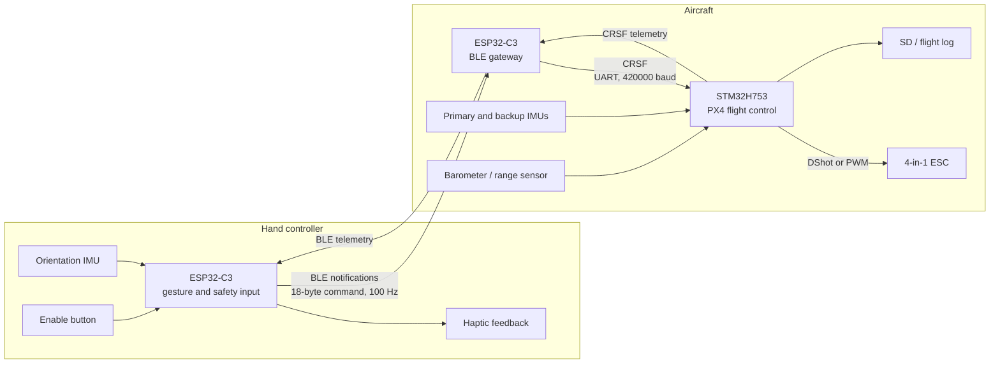
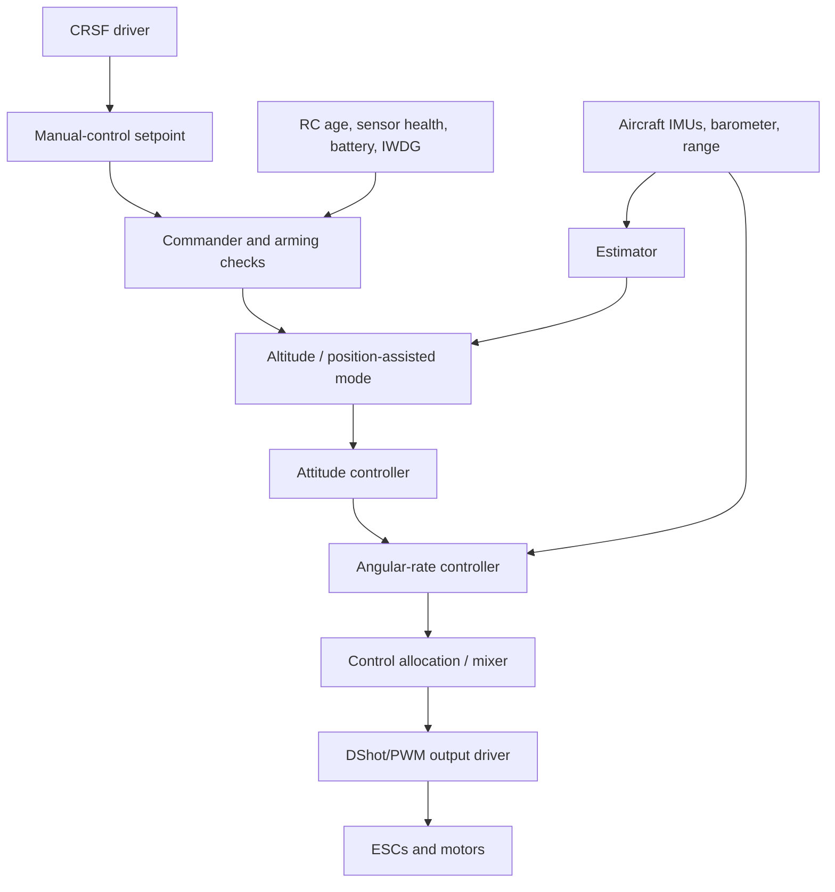
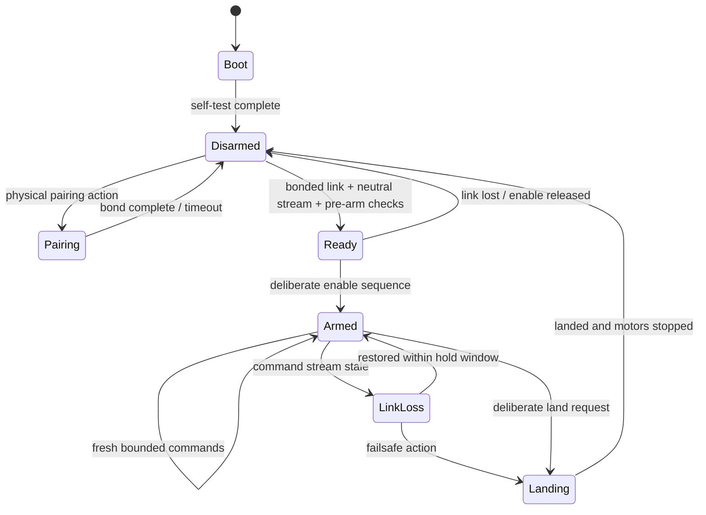
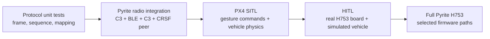

# MCU Selection and System Architecture Research

## Executive Decision

Build the first custom system around three processors:

| Location | Recommended part | Role | Decision rationale |
|---|---|---|---|
| Hand controller | **ESP32-C3-MINI-1-N4X** | Sensor acquisition, gesture mapping, BLE peripheral, haptics | It is sufficient for the workload, has an integrated certified-antenna module, and preserves exact ESP-IDF firmware execution in the current Pyrite plan. |
| Aircraft radio | **ESP32-C3-MINI-1-N4X** | BLE central, packet validation, BLE-to-CRSF gateway | Reusing the MCU and toolchain reduces firmware, procurement, and simulation risk while keeping BLE outside the flight-control fault domain. |
| Flight controller | **STM32H753VIT6** | Estimation, control, safety state, logging, DShot/PWM | Its 480 MHz Cortex-M7, 2 MB flash, 1 MB RAM, TCM, DMA, timers, and active LQFP100 package provide a mature PX4-class platform.[^1] |

Use **Bluetooth LE only for the prototype/demo air link**. Use a 10 ms connection interval, no peripheral latency, an 18-byte command notification, sequence checking, bonding, and an application freshness limit. On the aircraft PCB, convert valid BLE commands to **CRSF at 420000 baud over a full-duplex UART**. PX4 already has a CRSF input driver and telemetry support, so the flight controller can treat the custom radio as a conventional receiver instead of accepting a new flight-critical protocol.[^2][^3]

This is the recommended architecture for a small, supervised indoor or short-range demonstrator. For outdoor flight, meaningful range, or operation around people, replace the BLE air link with a purpose-built RC link such as ExpressLRS while keeping the CRSF aircraft interface. ExpressLRS receivers use CRSF to communicate with flight controllers, so this change does not require redesigning the flight-controller boundary.[^4]

The wearable creates bounded pilot setpoints. The STM32H753 remains the sole authority for arming, failsafe selection, state estimation, control allocation, and motor output.

## Assumptions

This recommendation assumes:

- A small quadrotor intended to demonstrate gesture control, hover, and altitude-assisted flight.
- A hand controller with one fused-orientation IMU, a deliberate-enable/dead-man input, haptic feedback, battery measurement, and USB development access.
- A custom aircraft PCB or carrier using PX4 or a similarly mature flight stack, not a new estimator and flight controller written from scratch.
- A target command update rate of 100 Hz, with aircraft rate control running independently at 1 kHz or faster.
- A strong requirement to execute the two radio firmwares in Pyrite and inject radio, sensor, and serial faults reproducibly.
- A prototype rather than a safety-certified product.

Airframe mass, required range, legal operating category, battery-life target, production quantity, or a mandated flight stack could change the result. Those requirements were not available, so the architecture preserves an upgrade path at the radio/CRSF boundary.

## Why Three Processors



The split is about fault containment, not raw compute. BLE hosts, reconnection logic, configuration services, and future phone support have bursty timing and a larger attack surface than a flight-control loop. A dedicated aircraft radio MCU can reset or reconnect without directly controlling an ESC. The H753 sees a standard receiver stream and independently decides whether that stream is valid enough to use.

The boundary also preserves optionality. The aircraft can later accept an ExpressLRS receiver, a different BLE radio, or a wired test source without changing its estimator, controllers, or motor drivers. The hand controller can be tested against a scripted BLE peer before an aircraft exists.

## Hand-Controller MCU

### Recommendation: ESP32-C3-MINI-1-N4X

The ESP32-C3 provides a 160 MHz single-core RISC-V processor, 400 KB SRAM, Bluetooth LE 5, Wi-Fi, DMA, two UARTs, SPI, I2C, PWM, ADC, timers, watchdogs, and hardware security features.[^5] That is comfortably above the needs of a controller that reads a fused quaternion, filters it, maps it to four bounded axes, services a button and haptic motor, and emits a short packet at 100 Hz.

The specific **MINI-1-N4X** module is preferable to a bare chip for this project. Espressif identifies it as the recommended 4 MB, revision-1.1 module; it measures 13.2 x 16.6 mm and includes an antenna.[^6] The module removes RF matching and antenna tuning from the first custom PCB and carries module-level certification that can simplify, though not eliminate, final-product RF work.

Use ESP-NimBLE, not a Wi-Fi transport. ESP-IDF provides a NimBLE host port for the C3, while the current emulator path already targets C3/NimBLE firmware.[^7] Disable Wi-Fi in normal operation so it cannot add coexistence latency or power load.

### Why not ESP32-S3

The ESP32-S3 has two 240 MHz Xtensa cores and 512 KB internal SRAM.[^8] Those resources help camera, audio, display, or on-device neural workloads, but they do not solve a current requirement. Espressif's BLE power guidance lists higher connected sleep figures for S3 than C3 in comparable modes, and the existing simulation plan has C3 support rather than an S3 platform.[^9]

Choose S3 only if the hand controller gains a display, substantial local inference, audio, or high-rate logging that is demonstrated to exceed C3 limits. Extra headroom alone is not enough to pay the power, firmware, and emulator cost.

### Why not nRF52840

For a battery-optimized commercial wearable, the nRF52840 is the strongest alternative. It has a 64 MHz Cortex-M4F, 1 MB flash, 256 KB RAM, mature BLE support, USB, and radio currents specified around 4.8 mA TX at 0 dBm and 4.6 mA RX under the stated test conditions.[^10][^11] It avoids carrying an unused Wi-Fi radio and has an excellent low-power architecture.

It is not the first recommendation because it introduces another embedded SDK and a new MCU/radio model into the exact-firmware simulation program. Do not infer battery life directly from peak-radio figures: connection interval, clocks, IMU current, haptic use, regulator efficiency, and firmware sleep behavior dominate the system result. Build a C3 power prototype and measure it.

The decision should flip to nRF52840, or a newer nRF54L15-class part, if measured C3 battery life misses the product requirement by more than firmware and regulator changes can recover. Nordic specifies 1.5 MB NVM, 256 KB RAM, 3.4 mA RX, and 4.8 mA TX at 0 dBm for the nRF54L15, but a newer family increases toolchain and availability risk for a student schedule.[^12]

### Other Candidates

| MCU | Strength | Material drawback here | Outcome |
|---|---|---|---|
| ESP32-C3 | Exact simulation path, one SDK, adequate compute, inexpensive module | Higher power than BLE-only leaders; unused Wi-Fi | **Select** |
| ESP32-S3 | More CPU/RAM, vector instructions, USB OTG | Unneeded compute, higher power, different emulator target | Do not select now |
| nRF52840 | Excellent BLE power, 1 MB flash, mature wearable fit | New SDK and emulator platform | Production fallback |
| nRF5340 | Separate 128 MHz application and 64 MHz network cores, 1 MB + 256 KB flash, 512 KB + 64 KB RAM[^13] | More complexity than this workload needs | Reject |
| STM32WB55 | 64 MHz M4 plus radio M0+, 1 MB flash, BLE 5.4, 4.5 mA RX/5.2 mA TX at 0 dBm[^14] | New dual-core radio architecture and emulator work | Reject for this phase |

## Aircraft-Radio MCU

### Recommendation: the same ESP32-C3 module

The aircraft gateway workload is smaller than the hand workload: maintain one bonded BLE connection, validate command frames, publish CRSF channel frames, parse selected CRSF telemetry, and supervise freshness. A second ESP32-C3-MINI-1-N4X provides enough CPU and memory while giving both radio teams one board support package, one BLE behavior, one update mechanism, and one Pyrite machine model.

The aircraft C3 should be a **gateway, not a co-flight-controller**. It may:

- Establish the bonded connection and subscribe to command notifications.
- Check frame length, version, CRC, sequence progression, ranges, and local receive age.
- Convert axes and flags to CRSF channels.
- Stop CRSF output when the BLE command stream becomes stale.
- Translate a small, allowlisted set of CRSF telemetry fields back to BLE.
- Expose diagnostics while disarmed.

It must not:

- Arm motors on its own authority.
- Estimate aircraft attitude or run the motor mixer.
- Continue transmitting the last valid pilot command after link loss.
- Write arbitrary parameters or commands into the flight controller while armed.
- Share its command UART with debug logging.

Place the module antenna at the PCB edge with the vendor keep-out, away from H7 clocks, the switch-mode power loop, ESC phase nodes, carbon structure, and battery leads. Give the C3 its own filtered 3.3 V branch and local bulk/decoupling. The H753 may assert the C3 reset line; the C3 must not be able to reset the H753.

## Flight-Controller MCU

### Recommendation: STM32H753VIT6

The STM32H753VI combines a 480 MHz Cortex-M7 with double-precision FPU and DSP instructions, 2 MB dual-bank flash, 1 MB RAM including 192 KB TCM, multiple DMA engines, nine UART/USART-class interfaces, multiple SPI/I2C interfaces, CAN FD, high-resolution and motor-control timers, CRC, watchdogs, and hardware cryptography.[^1] The `T6` option is a 100-pin LQFP package, more practical for university assembly and rework than fine-pitch BGA. ST lists the part as active and in volume production with a ten-year longevity commitment beginning in 2026.[^1]

This is not selected because a PID loop intrinsically needs 480 MHz. A mature flight stack also carries estimation, filtering, sensor redundancy, logging, communications, parameter storage, and DShot telemetry. Betaflight recommends H7-class devices for 8 kHz gyro/PID operation with DShot600, while lower classes require more compromises.[^15] PX4's Pixhawk V6X reference likewise uses an STM32H753 at 480 MHz with 2 MB flash.[^16]

The H753 leaves room for two independent SPI IMUs, barometer/range/optical-flow sensors, DMA-driven DShot, high-rate logging, a robust bootloader/update strategy, and flight-stack growth without a board respin.

The selection does not waive silicon review. ST's ES0392 revision 15 applies to STM32H753xI and distinguishes device revisions by marking/`REV_ID`; the schematic and firmware design review must record the procured revision and disposition every relevant erratum before flight.[^31] Follow ST's H74x/H75x hardware-development guidance for the multi-domain power, regulator, clock, reset, and decoupling design rather than copying a generic STM32 circuit.[^32]

### Alternatives

| Part | CPU / memory | Assessment |
|---|---|---|
| STM32H753VIT6 | 480 MHz M7, 2 MB flash, 1 MB RAM, crypto | **Best overall** for PX4-class firmware and an LQFP100 prototype. |
| STM32H743VIT6 | 480 MHz M7, 2 MB flash, 1 MB RAM | Good cost fallback when H753 security acceleration is unnecessary; verify the exact BOM and pin configuration before substitution.[^17] |
| STM32H723VG | 550 MHz M7, up to 1 MB flash, 564 KB RAM | Faster core but less memory. Attractive for a lean Betaflight/custom stack, less comfortable for growing PX4.[^18] |
| STM32F765VI | 216 MHz M7, up to 2 MB flash, 512 KB SRAM | Adequate and active, but offers less headroom without removing new Pyrite-platform work.[^19] |
| STM32F429 | 180 MHz M4F, up to 2 MB flash, 256 KB SRAM | Useful for emulator bring-up because the local plan says Pyrite models F429 peripherals, but lower memory makes it a poor new flight-board choice.[^20] |

Do not combine BLE and flight control in an STM32WB-class device. Its 64 MHz application core suits a wearable, not a modern estimator, logging stack, and high-rate controller. Conversely, do not run BLE on the H753 through an HCI module unless board area matters more than isolation; that moves BLE host and recovery behavior into the flight-control process.

## Air-Link Design

### Roles and connection parameters

Use the hand controller as the **BLE peripheral/GATT server** and the aircraft C3 as the **BLE central/GATT client**. The hand advertises only while disarmed or reconnecting. The aircraft scans for its bonded hand controller, connects, discovers the control service, and subscribes to command notifications.

This puts continuous scanning on the aircraft, where energy is abundant, and lets the wearable use scheduled peripheral connection events.

| Parameter | Initial value | Reason |
|---|---:|---|
| PHY | LE 1M | Conservative compatibility and range starting point. |
| Connection interval | 10 ms | Supports 100 Hz command delivery within conventional BLE interval rules. |
| Peripheral latency | 0 | The hand participates in every event while enabled. |
| Command rate | 100 Hz | Faster than PX4's minimum manual-control needs while leaving retry margin.[^21] |
| Telemetry rate | 20 Hz | Enough for haptics, mode, battery, and link status. |
| Command payload | 18 bytes | Fits below the default GATT MTU without MTU negotiation.[^22] |

For C3-class Bluetooth 5 controllers, do not plan around the sub-7.5 ms intervals introduced in Bluetooth Core 6.2. The baseline minimum is 7.5 ms; shorter intervals require support in both hosts and controllers.[^23] A 10 ms target is realistic and fast relative to human gesture dynamics.

### Command characteristic

Use a notification characteristic for commands. Notifications avoid application request/response serialization. The receiver consumes the newest valid command and discards duplicates, backwards sequences, malformed lengths, and out-of-range fields.

An 18-byte little-endian version-1 frame is sufficient:

```text
offset  size  field
0       1     protocol_version
1       1     flags: enable, mode[2:0], reserved
2       2     sequence_u16
4       4     sender_tick_ms_u32
8       2     pitch_i16     normalized -1000..1000
10      2     roll_i16      normalized -1000..1000
12      2     thrust_i16    normalized -1000..1000
14      2     yaw_i16       normalized -1000..1000
16      2     crc16_ccitt over bytes 0..15
```

The timestamp is diagnostic, not a cross-clock safety decision. The aircraft C3 stamps every accepted packet with its own monotonic receive time; the H753 relies on CRSF arrival time and its own RC-loss timer. Sequence state resets only after a new encrypted connection and a disarmed handshake.

Keep configuration and telemetry on separate characteristics. Configuration writes require the aircraft to be disarmed. Telemetry should include flight mode, armed state, battery warning, link status, and one compact fault code; the hand converts these to haptic patterns and LEDs.

### Pairing and authorization

Use LE Secure Connections, bonding, and an allowlist. Because neither device has a display, pairing must require a physical action on both devices during a short commissioning window. On every reconnect, the aircraft remains disarmed until it receives a fresh neutral stream and normal pre-arm checks pass.

For a product build, enable signed firmware, secure boot, and flash encryption on both C3s. Espressif recommends Secure Boot V2 for production and recommends using it with flash encryption.[^24] Treat irreversible eFuse settings as a manufacturing step, not an early development setting.

## Aircraft Interprocessor Link

### Recommendation: CRSF over full-duplex UART

CRSF is the right boundary because it is already a receiver protocol in PX4, carries normalized RC channels plus telemetry, includes frame-level integrity checks, and is widely used between receivers and flight controllers. PX4's implementation defines an uninverted 420000-baud UART and notes 150 Hz RC channel delivery.[^2] PX4 documents CRSF receivers on a spare UART, and its driver parses uplink control while producing downlink telemetry.[^3]

| CRSF channel | Meaning | Policy |
|---|---|---|
| CH1 | Roll | Normalized gesture command |
| CH2 | Pitch | Normalized gesture command |
| CH3 | Thrust / vertical command | Mode-dependent, bounded in hand firmware |
| CH4 | Yaw | Zero unless a deliberate yaw control exists |
| CH5 / AUX1 | Arm request | Low unless deliberate enable sequence is valid |
| CH6 / AUX2 | Flight mode | Select while disarmed |
| CH7 / AUX3 | Gesture-control validity | Diagnostic, not a substitute for timeout |
| CH8 / AUX4 | Emergency request | Deliberate, debounced input only |

The radio C3 may repeat the newest valid BLE command at CRSF's expected cadence, but only while its local age is below the freshness threshold. On stale BLE data it must **stop emitting RC frames**, not hold final stick values. PX4 warns that a receiver that holds its last value prevents the flight controller from detecting signal loss.[^25]

Use the H753's normal CRSF driver and PX4 manual-control loss configuration. PX4 exposes a short `COM_RC_LOSS_T` timeout followed by configurable Hold, Return, Land, Disarm, or Terminate behavior; its documentation warns that the timeout must remain short because old setpoints are otherwise retained.[^26] For indoor flight without reliable global position, a controlled Land/Descend policy is generally more credible than Return, but the final choice must be flight-tested.

### Why not the other links

| Link | Advantage | Reason not selected |
|---|---|---|
| Custom COBS + CRC UART | Simple and controlled | Requires a new flight-critical parser, telemetry schema, and failsafe integration on H7. |
| MAVLink over UART | Standard command and telemetry ecosystem | Treats the hand link like a broad-authority data link rather than an RC receiver. |
| SPI | Higher throughput | Throughput is irrelevant; master scheduling, recovery, and emulator modeling are more complex. |
| SBUS | Broad compatibility | Unidirectional and lacks telemetry; CRSF is the better full-duplex boundary. |

MAVLink still belongs on a separate USB/telemetry UART for QGroundControl, setup, logs, and SITL/HITL. It should not share the command UART or be exposed through the hand controller while armed.

## Flight-Control Software Architecture

Use a mature flight stack, preferably PX4 for altitude/position-assisted behavior. PX4 provides a cascaded multicopter architecture with estimation feeding attitude and angular-rate control, and implements the innermost angular-rate loop as PID control.[^27] It also provides SITL, HITL, logging, parameter management, pre-arm checks, and configurable loss behavior.[^28]



The hand controller commands pilot intent, not motor percentages. The flight stack limits that intent, checks mode and estimator validity, and converts it to motor output. This keeps gesture calibration errors from bypassing stabilization.

Allocate H753 resources so time-critical code and data use TCM, IMUs use separate SPI/DMA paths where practical, command reception has a bounded-priority task, and logging never blocks control. Use independent hardware and software task watchdogs. Boot defaults to outputs inhibited; loss of the radio MCU, malformed CRSF, or an H7 reset must leave outputs disarmed.

## Safety State and Failure Behavior



Use two independent freshness checks:

1. The aircraft C3 accepts only recent, monotonic BLE commands and stops CRSF output when local receive age exceeds the gateway threshold.
2. The H753 independently declares manual-control loss when CRSF frames stop and chooses the configured aircraft-safe action.

Do not make dead-man release synonymous with immediate motor cutoff in the air. It should request a flight-stack-managed Hold/Land behavior; hard termination belongs to a separate deliberate emergency action and depends on the environment.

| Event | Initial target | Required verification |
|---|---:|---|
| C3 BLE command stale | 50 ms | Radio stops CRSF; no repeated last value |
| H753 manual-control loss | 100-250 ms | PX4 enters the selected failsafe consistently |
| Reconnection | Disarmed only | No automatic re-arm or previous throttle restoration |
| Out-of-range axis | Immediate rejection | Fault counter increments |
| Sequence rollback/duplicate | Reject | Wrap-around handled explicitly |
| C3 reset while armed | H753 detects RC loss | Response follows PX4 policy |

These are engineering starting points, not certified limits. Tune them from measured latency and RF-loss distributions, then test each failure propeller-free, in SITL, in HITL, and in restrained flight.

## Timing Budget

Target a median under 25 ms and a normal worst case under 40 ms before RF retransmission tails:

| Stage | Target budget |
|---|---:|
| IMU report and hand sampling | 0-10 ms |
| Gesture filter/mapping | 1-5 ms group delay |
| Wait to next BLE event | 0-10 ms |
| Radio validation and CRSF scheduling | 0-7 ms |
| H753 reception and setpoint publication | under 2 ms |
| **Nominal total** | **roughly 2-34 ms** |

The conventional BLE minimum interval is 7.5 ms.[^23] The 10 ms event schedule, not MCU compute, is therefore likely to dominate nominal latency. Keep gesture filtering short and measure percentile latency from IMU interrupt to accepted H753 setpoint. Average latency hides the failure tail that matters.

The H753 loop is decoupled from command arrival. It continues estimation and stabilization at a fixed rate, using the most recent valid pilot setpoint until the freshness/failsafe boundary is crossed.

## Simulation and Verification Architecture

The current repository proposes placing two C3 machines and one H7 machine in one Pyrite emulation. That remains a useful end state, but making complete H753 emulation the first dependency is high risk. The local plan indicates mature C3/BLE and STM32F4 building blocks but requires a new H7 platform, clock/power behavior, DMA, timers, and output peripherals. Booting a binary is not equivalent to validating PX4 timing or its complete sensor/output path.

Use four layers instead:



### Layer 0: deterministic host tests

Keep frame encoding, CRC, sequence comparison, axis mapping, neutral detection, and failsafe transitions in platform-independent libraries. Fuzz the BLE decoder and CRSF gateway. Every malformed frame must have one specified result.

### Layer 1: exact radio firmware in Pyrite

Run both unmodified ESP32-C3 images, the BLE medium, hand IMU model, and aircraft UART against a scripted CRSF peer. Verify advertising, bonding, connection, discovery, notification subscription, packet loss, delay, corruption, disconnect, reconnect, staleness, sensor silence, FIFO overflow, button bounce, and low-battery behavior.

An official Espressif RISC-V emulator also demonstrates C3 ESP-IDF binaries, NimBLE/HCI forwarding, I2C, SPI, UART, DMA, and related peripheral emulation; it is a useful comparison or fallback if a Pyrite model is incomplete.[^29]

### Layer 2: PX4 SITL

Feed the same recorded gesture traces into PX4 SITL and a physics simulator. Validate axis signs, mode transitions, limits, takeoff, hover, landing, and RC-loss behavior. PX4 officially supports SITL and HITL and positions simulation as the safe place to test flight-code changes before flight.[^28]

### Layer 3: HITL

Run normal PX4 firmware on the actual H753 board while a simulator supplies vehicle dynamics and sensors. Connect the real or emulated C3 radio over CRSF. This verifies the real clock tree, DMA, UART, interrupts, flash, and scheduler without spinning propellers.

### Layer 4: targeted H753 emulation

Add the Pyrite H753 platform incrementally for deterministic fault injection in the paths that matter: reset/clock control, memory map, USART + DMA for CRSF, SPI + DMA for IMU, timers/DShot, watchdogs, and GPIO interrupts. Do not wait for unused Ethernet, graphics, camera, USB-host, or analog peripherals.

This layered plan produces evidence early and avoids treating one emulator as the only truth. PX4 notes that SITL and HITL exercise somewhat different code paths, so both are valuable.[^30]

## PCB-Level Architecture

### Hand PCB

- ESP32-C3-MINI-1-N4X at the board edge with antenna keep-out.
- BNO085-class fused IMU on I2C for prototype continuity; reserve interrupt, reset, and configuration pins. Move to SPI only if measurement requires it.
- Physical enable input on a dedicated GPIO with hardware pull and firmware debounce.
- Haptic motor driver controlled by PWM; never drive the motor from a GPIO.
- Li-ion charger, protected-cell connection, regulated 3.3 V rail, and battery measurement/fuel gauge.
- USB Serial/JTAG and recovery/test pads.
- Optional 32.768 kHz crystal footprint for connected low-power characterization.

### Aircraft PCB

- STM32H753VIT6 on a clean digital/analog 3.3 V domain with required decoupling and regulator topology.
- ESP32-C3-MINI-1-N4X on a separately filtered RF branch.
- Full-duplex 3.3 V UART between C3 and H753, with RX/TX test pads and no debug multiplexing.
- H753-controlled C3 reset and optional C3 status GPIO.
- Two flight IMUs on separate SPI chip-select paths, ideally with separate buses and data-ready lines.
- Barometer away from prop wash; range/optical-flow connectors as required by hover mode.
- Four timer/DMA-capable DShot outputs with series-damping footprints and a defined disarmed level.
- Battery voltage/current sensing, brownout supervision, watchdog, SWD, USB, and logging storage.
- Separate MAVLink/debug UART so setup traffic cannot congest CRSF.

Before schematic capture, produce a pin-allocation table proving every SPI, UART, timer channel, DMA request, interrupt, boot strap, SWD pin, oscillator, and power pin can coexist. Peripheral counts alone do not guarantee a conflict-free STM32 mapping.

## Development Sequence and Gates

1. **Freeze behavior, not the PCB.** Define axes, neutral ranges, maximum attitude/rate requests, arming sequence, and failsafe action.
2. **Prototype the selected MCUs.** Use two C3 boards and an H753/Pixhawk-class board. Measure memory, CPU, current, latency, and reconnection distributions.
3. **Freeze the BLE frame.** Add golden vectors, fuzz tests, wrap-around tests, and version rejection.
4. **Build the BLE-to-CRSF gateway.** Prove stale BLE causes CRSF silence and PX4 detects it.
5. **Run PX4 SITL.** Inject recorded hand traces and failure transitions before motor hardware exists.
6. **Run H753 HITL.** Verify real UART, timing, logging, watchdog, reset, and failsafe behavior.
7. **Capture custom boards.** Use measured power and RF results, not dev-board estimates.
8. **Bring up without propellers.** Verify polarity, axis mapping, arming denial, motor order, and reset paths.
9. **Tethered flight and envelope expansion.** Start with conservative limits and a conventional backup control path.

The architecture gate requires:

- At least 25% free internal RAM on the hand C3 under worst-case BLE activity.
- Measured 99.9th-percentile hand-to-H753 latency below the stale threshold with margin.
- CRSF output stops on every modeled BLE-loss path.
- H753 enters failsafe when the radio C3 is reset, disconnected, corrupted, or unplugged.
- No radio, telemetry, logging, or update task can write motor outputs directly.
- Reconnection never restores armed state.
- BLE range is demonstrated in the intended environment with interference present.

## Final Recommendation

Proceed with **C3 + C3 + H753**, but make the aircraft interface **CRSF**, not a custom raw stream. This gives exact radio-firmware simulation, one wireless toolchain, a clear fault boundary, and compatibility with mature flight-controller behavior.

Treat BLE as a demonstrator link with a documented operating envelope. If the goal moves toward an outdoor drone, keep the ESP32-C3 as the gesture processor but send channel data into an ExpressLRS transmitter module and use a standard ExpressLRS receiver on the aircraft. The H753 and CRSF integration remain unchanged.

Do not upgrade the hand MCU to ESP32-S3 unless measurements show a resource problem. Do not replace the H753 with an integrated wireless MCU. Do not make complete H753 emulation a prerequisite for flight-stack validation: use exact C3 emulation, PX4 SITL, H753 HITL, and targeted H753 Pyrite work as complementary layers.

## Sources

[^1]: STMicroelectronics. [STM32H753VI product page](https://www.st.com/en/microcontrollers-microprocessors/stm32h753vi.html). Specifications, package status, and longevity listing.
[^2]: PX4 Autopilot. [CRSF protocol definition and parser interface](https://github.com/PX4/PX4-Autopilot/blob/main/src/lib/rc/crsf.h). Accessed September 2026.
[^3]: PX4 Guide. [Radio-control driver reference: `crsf_rc`](https://docs.px4.io/main/en/modules/modules_driver_radio_control). Accessed September 2026.
[^4]: ExpressLRS. [Receiver serial protocols](https://www.expresslrs.org/software/serial-protocols/). Accessed September 2026.
[^5]: Espressif Systems. [ESP32-C3 Series Datasheet, version 2.4](https://documentation.espressif.com/esp32-c3_datasheet_en.html). Accessed September 2026.
[^6]: Espressif Systems. [ESP32-C3-MINI-1 and MINI-1U Datasheet, version 2.2](https://documentation.espressif.com/esp32-c3-mini-1_datasheet_en.html). Accessed September 2026.
[^7]: Espressif Systems. [ESP-NimBLE host APIs for ESP32-C3](https://docs.espressif.com/projects/esp-idf/en/latest/esp32c3/api-reference/bluetooth/nimble/index.html). Accessed September 2026.
[^8]: Espressif Systems. [ESP32-S3 product overview](https://www.espressif.com/en/products/socs/esp32-s3). Accessed September 2026.
[^9]: Espressif Systems. [BLE performance and power optimization](https://docs.espressif.com/projects/esp-techpedia/en/latest/esp-friends/advanced-development/ble-application-note/performance.html). Accessed September 2026.
[^10]: Nordic Semiconductor. [nRF52840 product page](https://www.nordicsemi.com/products/nrf52840). Accessed September 2026.
[^11]: Nordic Semiconductor. [nRF52840 Product Specification](https://docs.nordicsemi.com/r/bundle/ps_nrf52840/page/keyfeatures_html5.html). Accessed September 2026.
[^12]: Nordic Semiconductor. [nRF54L15 product page](https://www.nordicsemi.com/Products/nRF54L15). Accessed September 2026.
[^13]: Nordic Semiconductor. [Bluetooth LE SoC comparison](https://www.nordicsemi.com/Products/Wireless/Bluetooth-Low-Energy). Accessed September 2026.
[^14]: STMicroelectronics. [STM32WB55RG product page](https://www.st.com/en/microcontrollers-microprocessors/stm32wb55rg.html). Accessed September 2026.
[^15]: Betaflight. [Flight-controller manufacturer design guidelines](https://betaflight.com/docs/development/manufacturer/manufacturer-design-guidelines). Accessed September 2026.
[^16]: PX4 Guide. [CUAV Pixhawk V6X](https://docs.px4.io/main/en/flight_controller/cuav_pixhawk_v6x). Accessed September 2026.
[^17]: STMicroelectronics. [STM32H743VI product page](https://www.st.com/content/st_com/en/products/microcontrollers-microprocessors/stm32-32-bit-arm-cortex-mcus/stm32-high-performance-mcus/stm32h7-series/stm32h743-753/stm32h743vi.html). Accessed September 2026.
[^18]: STMicroelectronics. [STM32H723/733 product family](https://www.st.com/en/microcontrollers-microprocessors/stm32h723-733/products.html). Accessed September 2026.
[^19]: STMicroelectronics. [STM32F765VI product page](https://www.st.com/en/microcontrollers-microprocessors/stm32f765vi.html). Accessed September 2026.
[^20]: STMicroelectronics. [STM32F429ZI product page](https://www.st.com/en/microcontrollers-microprocessors/stm32f429zi.html). Accessed September 2026.
[^21]: MAVSDK. [Manual-control API reference](https://mavsdk.mavlink.io/main/en/cpp/api_reference/classmavsdk_1_1_manual_control.html). Accessed September 2026.
[^22]: Espressif Systems. [Bluetooth LE connection and MTU overview](https://docs.espressif.com/projects/esp-idf/en/stable/esp32c3/api-guides/ble/get-started/ble-connection.html). Accessed September 2026.
[^23]: Bluetooth SIG. [Bluetooth Core 6.2 feature overview](https://www.bluetooth.com/bluetooth-core-6-2-feature-overview/). Accessed September 2026.
[^24]: Espressif Systems. [ESP32-C3 Secure Boot V2](https://docs.espressif.com/projects/esp-idf/en/v6.0/esp32c3/security/secure-boot-v2.html). Accessed September 2026.
[^25]: PX4 Guide. [Radio-control systems and RC-loss detection](https://docs.px4.io/main/en/getting_started/rc_transmitter_receiver). Accessed September 2026.
[^26]: PX4 Guide. [Safety and manual-control loss configuration](https://docs.px4.io/main/en/config/safety). Accessed September 2026.
[^27]: PX4 Guide. [Multicopter controller diagrams](https://docs.px4.io/v1.13/en/flight_stack/controller_diagrams). Accessed September 2026.
[^28]: PX4 Guide. [Simulation](https://docs.px4.io/main/en/simulation/). Accessed September 2026.
[^29]: Espressif Systems. [ESP RISC-V Emulator](https://github.com/espressif/esp-emulator). Accessed September 2026.
[^30]: PX4 Guide. [Hardware-in-the-loop simulation](https://docs.px4.io/v1.14/en/simulation/hitl). Accessed September 2026.
[^31]: STMicroelectronics. [ES0392: STM32H742/H743/H750/H753 device errata, revision 15](https://www.st.com/resource/en/errata_sheet/es0392-stm32h742xig-stm32h743xig-stm32h750xb-stm32h753xi-device-errata-stmicroelectronics.pdf). September 2025.
[^32]: STMicroelectronics. [AN4938: Getting started with STM32H74xI/G and STM32H75xI/G MCU hardware development](https://www.st.com/resource/en/application_note/an4938-getting-started-with-stm32h74xig-and-stm32h75xig-mcu-hardware-development-stmicroelectronics.pdf). Revision 7, October 2024.
