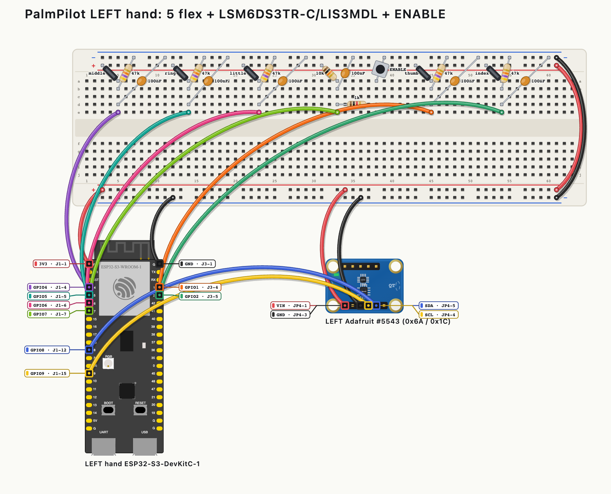
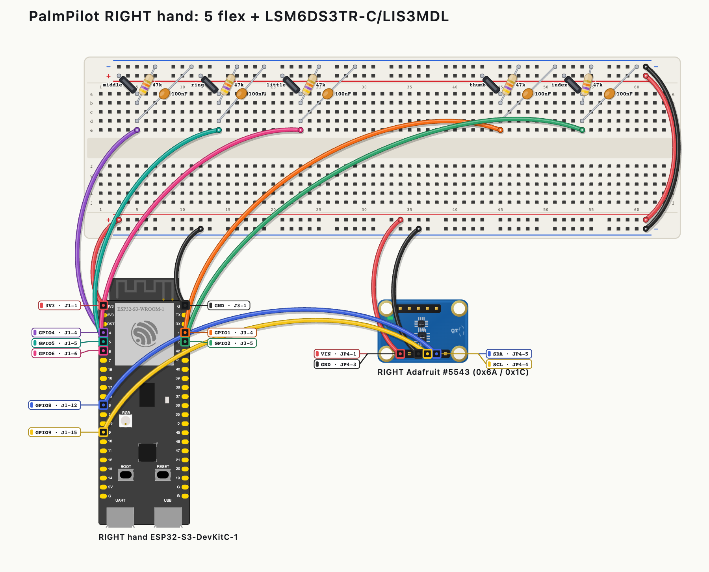
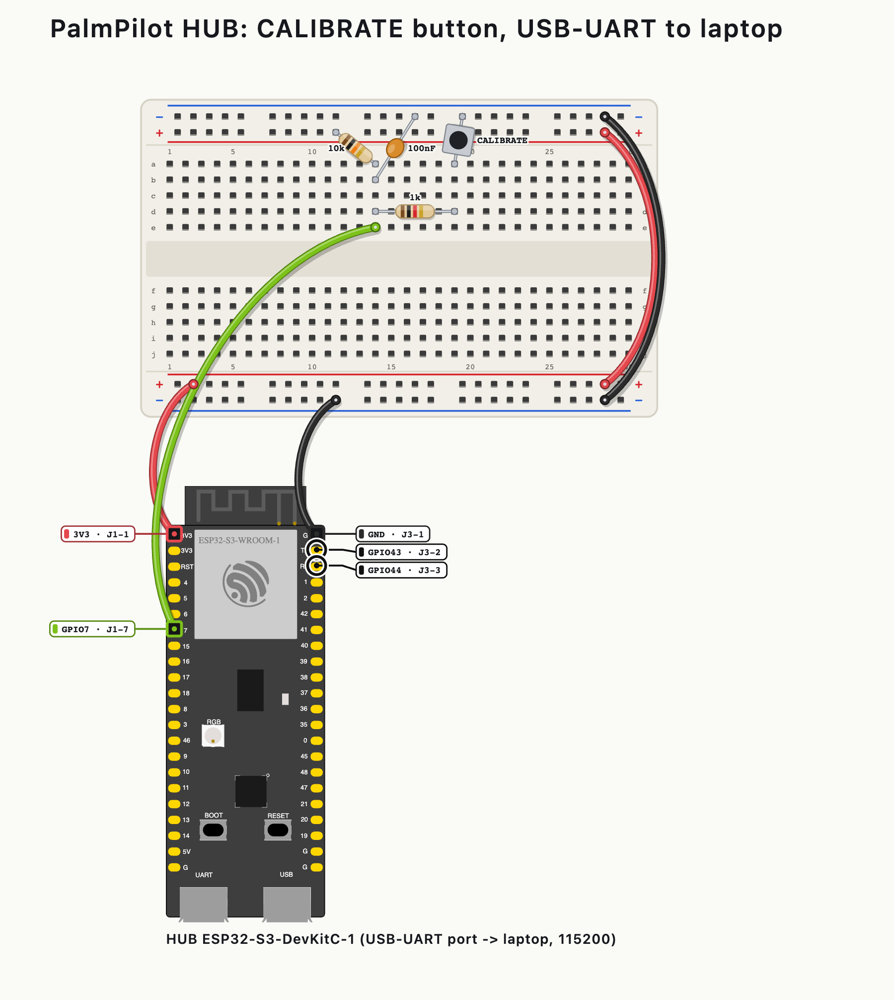

# Wiring

How the boards are wired for testing, in the order they are built. The drawings
come from [pinplanner](https://github.com/simantic-dev/pinplanner). They are bench
plans and have not been built or checked on hardware yet. Each step is tested before
the next one is wired; the checks for each step are in the
[test plan](../test-plan.md#part-b--physical-controller-on-the-bench), and the
step-by-step procedures, with a drawing for every stage, are in [docs/bench](../bench/README.md).

Every board has its own breadboard and its own USB supply. **No wire joins two
boards.** The hands reach the hub over BLE, and the hub reaches the laptop over
USB.

```text
LEFT hand DevKit  (5 flex, #5543 IMU, ENABLE)   USB power ─┐
RIGHT hand DevKit (5 flex, #5543 IMU)           USB power ─┤ laptop or powered hub
        \                /                                 │
         \---- BLE -----/                                  │
               HUB DevKit (CALIBRATE)  UART USB port ───────┘ 115200 baud, JSON lines
```

## Build order

| Step | What is wired | Drawing | Test |
|---|---|---|---|
| 1 | One bare LEFT DevKit, nothing attached | — | B0 |
| 2 | LEFT thumb only: flex on GPIO1 with its 47 kΩ and 100 nF | [bench 01](../bench/01-s1a-one-flex/wiring.png); [LEFT](#left-hand) rows 21–24 | B1 |
| 3 | All five LEFT flex channels and the #5543 breakout | [bench 03](../bench/03-s1d-motion/wiring.png) | B2 |
| 4 | LEFT ENABLE button on GPIO7 | [bench 05](../bench/05-s1c-enable-control/wiring.png); [LEFT](#left-hand) rows 29–33 | B3 |
| 5 | RIGHT hand: as step 3, no button | [RIGHT](#right-hand) | B4 |
| 6 | HUB: CALIBRATE button on GPIO7 | [HUB](#hub) | B5 |
| 7 | HUB UART USB port to the laptop | [HUB](#hub) | B6 |

| file | board | what is wired |
|---|---|---|
| [`left-hand.wiring.json`](left-hand.wiring.json) | LEFT | 5 flex channels, Adafruit #5543, ENABLE button |
| [`right-hand.wiring.json`](right-hand.wiring.json) | RIGHT | 5 flex channels, Adafruit #5543 |
| [`hub.wiring.json`](hub.wiring.json) | HUB | CALIBRATE button; the UART USB port goes to the laptop |

The wiring files here and the bench-stage wiring in [`../bench/`](../bench/README.md) are
generated by [`gen_wiring.py`](gen_wiring.py). Edit the script, not the JSON.

## Circuits

**Flex channel**, one per finger:

```text
own 3V3 ── flex ──+── GPIO (ADC1)
                  ├── 47 kΩ ── own GND
                  └── 100 nF ── own GND
```

The resistor and the capacitor are separate branches from the node to ground,
placed near the GPIO jumper. The flex has no polarity. At 3.300 V, a 25 kΩ flex
gives about 2.154 V and a 100 kΩ flex about 1.055 V. Those are divider examples,
not calibration values. An unplugged flex pulls the node to GND through 47 kΩ, and
a shorted one pulls it to 3V3. The firmware reads both as faults.

Firmware settings: ADC1 one-shot, 12-bit, high attenuation, calibrated millivolts,
GPIO pulls off, 50 ms provisional settling.

**Button**, ENABLE on LEFT and CALIBRATE on the hub:

```text
own 3V3 ── 10 kΩ ──+── GPIO7
                   ├── 100 nF ── own GND
                   └── 1 kΩ ── normally-open button ── own GND
```

Released reads high and pressed reads low. The firmware debounces it and ignores a
button that is held at boot until it is released.

**Motion sensor**, Adafruit #5543 LSM6DS3TR-C + LIS3MDL: VIN to 3V3, GND to GND,
SDA to GPIO8, SCL to GPIO9, at 100 kHz. The breakout has its own pull-ups, so do not
add more. Leave 3Vo, the interrupt pins and the address jumpers as delivered. The
addresses are 0x6A (accelerometer/gyro) and 0x1C (magnetometer). Note the mounting
axes on the glove: the firmware's tilt signs assume them.

**Power.** Every board runs from its own USB cable into its UART USB port. Never
connect 5 V or a LiPo to any ADC pin. GPIO10 is reserved for a future battery
monitor and stays unconnected. A wearable power circuit is not designed yet.

## How the breadboard is laid out

- The DevKit's 3V3 (J1-1) and GND (J3-1) go to the bottom rails, next to the DevKit.
  Two jumpers at the right end carry them to the top rails. On every board, + is
  3V3 and - is GND.
- Each circuit node has one column strip (rows a-e). The parts run from the strip
  to a top rail, and one jumper from row e takes the node to its GPIO.
- Strips fed from the J1 header (GPIO4/5/6/7) sit left of those fed from J3
  (GPIO1/2), so the jumpers don't cross.
- **Flex channel** (one per finger): the flex sensor from the + rail to the node,
  then 47 kOhm and 100 nF as separate branches from the node to the - rail. The
  sensor sits on the glove; its two leads come to the rail hole and node hole shown.
- **Button** (ENABLE on LEFT, CALIBRATE on the hub): 10 kOhm from the + rail to
  the GPIO7 node, 100 nF from the node to the - rail, and 1 kOhm from the node to a
  second strip that holds the normally-open switch to the - rail.
- The IMU breakout is wired with jumpers: VIN and GND from the bottom rails, SDA
  and SCL straight to GPIO8 and GPIO9.

`pinplanner check` reports no errors or warnings for any of the four files. That
covers rail shorts, a part with both legs in one strip, and two leads in one hole.
It is a drawing check, not an electrical test.

## LEFT hand



([SVG](left-hand.svg))

### Jumper and part table (LEFT)

| # | wire | header pins | colour | tests |
|---|---|---|---|---|
| 1 | esp:3V3 -> bb:BP | esp:J1-1 -> bb:BP1 | red | LEFT 3V3 -> bottom + rail |
| 2 | esp:GND -> bb:BN | esp:J3-1 -> bb:BN9 | black | LEFT GND -> bottom - rail |
| 3 | bb:BP -> bb:TP | bb:BP50 -> bb:TP50 | red | bottom + rail -> top + rail |
| 4 | bb:BN -> bb:TN | bb:BN50 -> bb:TN50 | black | bottom - rail -> top - rail |
| 5 | bb:BP -> imu:VIN | bb:BP27 -> imu:JP4-1 | red | LEFT 3V3 -> IMU VIN |
| 6 | bb:BN -> imu:GND | bb:BN29 -> imu:JP4-3 | black | LEFT GND -> IMU GND |
| 7 | esp:GPIO8 <-> imu:SDA | esp:J1-12 <-> imu:JP4-5 | blue | I2C SDA <-> GPIO8 (breakout pull-ups) |
| 8 | esp:GPIO9 -> imu:SCL | esp:J1-15 -> imu:JP4-4 | yellow | I2C SCL GPIO9 -> IMU (100 kHz) |
| 9 | middle flex between bb:TP and bb:5a | bb:TP1 - bb:5a | part | LEFT 3V3 -> middle flex -> node |
| 10 | 47k resistor between bb:5b and bb:TN | bb:5b - bb:TN5 | part | middle node -> 47k -> GND |
| 11 | 100nF capacitor between bb:5d and bb:TN | bb:5d - bb:TN8 | part | middle node -> 100nF -> GND |
| 12 | bb:5e -> esp:GPIO4 | bb:5e -> esp:J1-4 | purple | middle node -> GPIO4 (ADC1_CH3) |
| 13 | ring flex between bb:TP and bb:14a | bb:TP9 - bb:14a | part | LEFT 3V3 -> ring flex -> node |
| 14 | 47k resistor between bb:14b and bb:TN | bb:14b - bb:TN12 | part | ring node -> 47k -> GND |
| 15 | 100nF capacitor between bb:14d and bb:TN | bb:14d - bb:TN15 | part | ring node -> 100nF -> GND |
| 16 | bb:14e -> esp:GPIO5 | bb:14e -> esp:J1-5 | teal | ring node -> GPIO5 (ADC1_CH4) |
| 17 | little flex between bb:TP and bb:23a | bb:TP16 - bb:23a | part | LEFT 3V3 -> little flex -> node |
| 18 | 47k resistor between bb:23b and bb:TN | bb:23b - bb:TN20 | part | little node -> 47k -> GND |
| 19 | 100nF capacitor between bb:23d and bb:TN | bb:23d - bb:TN23 | part | little node -> 100nF -> GND |
| 20 | bb:23e -> esp:GPIO6 | bb:23e -> esp:J1-6 | pink | little node -> GPIO6 (ADC1_CH5) |
| 21 | thumb flex between bb:TP and bb:45a | bb:TP35 - bb:45a | part | LEFT 3V3 -> thumb flex -> node |
| 22 | 47k resistor between bb:45b and bb:TN | bb:45b - bb:TN38 | part | thumb node -> 47k -> GND |
| 23 | 100nF capacitor between bb:45d and bb:TN | bb:45d - bb:TN41 | part | thumb node -> 100nF -> GND |
| 24 | bb:45e -> esp:GPIO1 | bb:45e -> esp:J3-4 | orange | thumb node -> GPIO1 (ADC1_CH0) |
| 25 | index flex between bb:TP and bb:54a | bb:TP42 - bb:54a | part | LEFT 3V3 -> index flex -> node |
| 26 | 47k resistor between bb:54b and bb:TN | bb:54b - bb:TN45 | part | index node -> 47k -> GND |
| 27 | 100nF capacitor between bb:54d and bb:TN | bb:54d - bb:TN49 | part | index node -> 100nF -> GND |
| 28 | bb:54e -> esp:GPIO2 | bb:54e -> esp:J3-5 | green | index node -> GPIO2 (ADC1_CH1) |
| 29 | 10k resistor between bb:TP and bb:33a | bb:TP25 - bb:33a | part | LEFT 3V3 -> 10k -> ENABLE node (pull-up) |
| 30 | 100nF capacitor between bb:33b and bb:TN | bb:33b - bb:TN28 | part | ENABLE node -> 100nF -> GND (debounce) |
| 31 | 1k resistor between bb:33d and bb:38d | bb:33d - bb:38d | part | ENABLE node -> 1k -> switch |
| 32 | ENABLE button between bb:38a and bb:TN | bb:38a - bb:TN31 | part | normally-open ENABLE switch -> GND |
| 33 | bb:33e -> esp:GPIO7 | bb:33e -> esp:J1-7 | lime | ENABLE node -> GPIO7, active low |

## RIGHT hand



The LEFT hand without the ENABLE circuit: GPIO7 stays unconnected
([SVG](right-hand.svg)).

## HUB



The CALIBRATE circuit on a half breadboard ([SVG](hub.svg)). The laptop link is the
DevKit's UART USB port: the on-board USB-to-UART bridge on UART0 at 115200 baud,
which also powers the hub. GPIO43 and GPIO44 are ringed because the bridge uses
them; do not wire them. The hub has no flex sensors and no motion sensor.

## Bench stages

[docs/bench](../bench/README.md) builds these boards one part at a time, with a drawing and
a procedure for each simulation suite (S1-A to S3). Every part goes in the hole it has on
the finished board, so each stage only adds parts. Its finished LEFT hand (bench 05) is the
same wiring as [`left-hand.wiring.json`](left-hand.wiring.json).

## Pins

| function | pin | DevKit header |
|---|---|---|
| thumb / index flex | GPIO1 / GPIO2 (ADC1_CH0 / CH1) | J3-4 / J3-5 |
| middle / ring / little flex | GPIO4 / GPIO5 / GPIO6 (ADC1_CH3 / CH4 / CH5) | J1-4 / J1-5 / J1-6 |
| ENABLE (LEFT only) / CALIBRATE (HUB only) | GPIO7, active low | J1-7 |
| IMU SDA / SCL | GPIO8 / GPIO9 | J1-12 / J1-15 |
| 3V3 / GND | own board | J1-1 / J3-1 |

Leave unconnected: GPIO10 (battery sense, reserved), the breakout's 3Vo and
interrupt pins, GPIO19/20, GPIO43/44, and GPIO0/3/45/46.

**Board variant:** the header positions are for a genuine DevKitC-1 (the BOM's
N8R8 has the same headers as the N8R2). On the N8R8, GPIO35-37 go to octal
PSRAM; this pin map doesn't use them. A clone such as the Freenove ESP32-S3
WROOM board has a different header and needs its own mapping.

## Re-rendering

Needs pinplanner main (breadboards and parts since simantic-dev/pinplanner#12).
From this folder, then from a pinplanner checkout:

    python3 gen_wiring.py
    node cli/pinplanner.ts check <this folder>/<name>.wiring.json
    node cli/pinplanner.ts svg   <this folder>/<name>.wiring.json -o <this folder>/<name>.svg

The PNGs are the SVGs rendered in Chrome at 1800 px wide. pinplanner's
`test/shot.mjs` does this when it is given a page that shows the SVG at 900 px.
`node cli/pinplanner.ts link <file>` opens a diagram in the pinplanner app.
